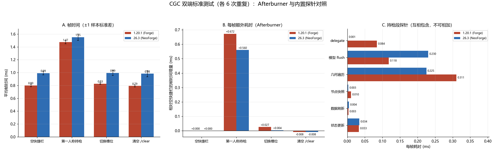
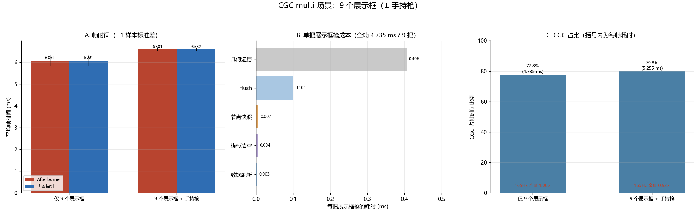
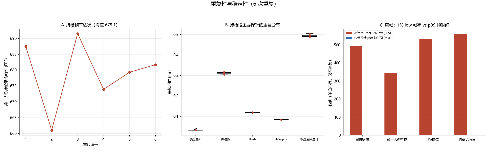

# 测试数据计算报告（CGC 单端 · 内置探针）

**数据**：本目录 25 个文本 —— MSI Afterburner 标准测试 6 次 × 4 步 + multi 6 次 × 2 步；模组内置探针同规模；共 36 + 36 条有效记录。
**口径**：帧时间 = 1000 / FPS；内置探针的时间是采集窗口内逐帧统计的均值，窗口比 Afterburner 略长（F12 提前开始、延迟结束）。所有「平均」均为 6 次重复的均值 ± 1 样本标准差。
**环境**：GTX 1660 SUPER / i5-9400F / 1920×1080 165Hz，Forge 47.4.23 + Embeddium + Oculus，详见 [标准.txt](./标准.txt)。
**复现**：`python analyze.py` → 三张总览图。

---

## 0. 数据整理说明

|事项|处理|
|---|---|
|官方启动器在后台未最小化，会略微拉低帧数；测试时已手动删除大部分 `Minecraft.exe` 帧数块|`cgc1 (3).txt` 残留 4 条（约 26 FPS），解析时只保留 `javaw.exe`；受影响的场次在 4.2 单独标注|
|multi 第 1 段为「初始即没有手持枪」，第 2 段为「9 个展示框 + 第一人称枪」（[标准.txt](./标准.txt) 已按实际顺序更新）|解析仍按内置探针的提交计数（0 / 1）分组，脚本不依赖录制顺序|
|Afterburner 与内置探针窗口对齐|同一步骤的帧率差 ≤ 0.6%，可视为同一窗口|
|`cgc1 (3).txt` 之后有一次异常长的采集（内置块多一段）|数据保留，逐块核对时单独标注|

---

## 1. 标准测试（6 次重复）

|步骤|Afterburner FPS|AF 帧时间|内置帧时间|采集开销|CGC|占帧|Δ帧时间(AF)|Δ帧时间(内置)|1% low(AF)|p99(内置)|
|---|---:|---:|---:|---:|---:|---:|---:|---:|---:|---:|
|空快捷栏|1250.2 ± 30.7|0.8003 ± 0.0196|0.8030 ± 0.0208|+0.0027|0.0000|0.0%|—|—|494.7|1.7332|
|第一人称持枪|679.1 ± 10.8|1.4727 ± 0.0237|1.4788 ± 0.0240|+0.0061|0.5565|37.6%|+0.6725|+0.6758|345.1|2.6385|
|切换槽位|1209.2 ± 15.9|0.8271 ± 0.0110|0.8278 ± 0.0106|+0.0007|0.0000|0.0%|+0.0269|+0.0248|532.7|1.6727|
|清空 `/clear`|1262.4 ± 27.8|0.7924 ± 0.0173|0.7932 ± 0.0168|+0.0007|0.0000|0.0%|−0.0078|−0.0098|561.1|1.6052|

- 唯一显著项仍是第一人称持枪：**+0.6725 ms/帧**（−45.8%）。
- 切换槽位只多一个 GUI 图标，**+0.027 ms**；`/clear` 回到基线。
- 采集开销（内置 − Afterburner）：持枪时 **+0.0061 ms**（0.4%），空手时 +0.0027 ms，即 volatile 开关 + 计时本身的开销在微秒级。

### 持枪段探针明细

|探针|每帧耗时|占 CGC|说明|
|---|---:|---:|---|
|入口事件（含提交）|0.5612|100.8%|比提交多出的 0.0047 ms 是事件判定本身|
|**第一人称提交**|**0.5565**|**100%**|CGC 全部工作|
|状态更新|0.0332|6.0%|状态机 `update()`|
|数据刷新|0.0030|0.5%|每帧重读附件 / NBT|
|模型渲染总计|0.4942|88.8%|`ModelObject.render`，含嵌套配件模型|
|· 节点快照|0.0103|1.9%|每节点两次 `NodeTransform`|
|· 几何遍历|0.3108|55.8%|顶点生成主体|
|· `endBatch` flush|0.1180|21.2%|3 次/帧 → **0.0393 ms/次**|
|· delegate|0.0843|15.1%|火焰、抛壳、手臂、文字、配件|
|· 功能节点|0.0083|1.5%|`几何遍历`的子集，不可另加|
|枪口缓存|0.0010|0.2%||
|模板清空|0.0053|1.0%||

配套计数（每帧）：第一人称提交 1、`endBatch` 3、立方体 446、节点快照 108、几何批次 4、模板窗口 0、LOD 命中 0。
渲染外：相机角度 0.0030 ms、手部相机 0.0022 ms、FOV 0.0048 ms、GUI 槽位图标 0.0030 ms。

> 探针之间存在包含关系（delegate 内会再次进入 `ModelObject.render`，几何遍历里包含功能节点），**不可相加**。

### 覆盖度

`0.5565 / 0.6725 = 82.8%`。扣除采集开销 0.0061、入口额外 0.0047、相机/FOV 0.0100 后，仍有 **≈0.095 ms（占增量 14%）未归因**，候选为准心 / HUD、视图摇晃事件与非渲染路径的额外开销。

---

## 2. multi（9 个展示框）

|分组|n|AF FPS|AF 帧时间|内置帧时间|CGC|占帧|展示框提交|立方体|几何批次|`endBatch`|
|---|---:|---:|---:|---:|---:|---:|---:|---:|---:|---:|
|仅 9 个展示框|6|165.0 ± 6.6|6.0688|6.0810|4.7348|77.8%|9.00|4462.5|9.00|9.00|
|9 个展示框 + 手持枪|6|152.0 ± 1.7|6.5810|6.5822|5.2553|79.8%|9.00|4451.0|13.00|12.00|

### 单次提交成本

|对象|每帧耗时|单次|
|---|---:|---:|
|展示框枪（含手持枪的场次）|4.6598|**0.5178 ms/把**|
|第一人称枪（同场次）|0.5953|**0.5953 ms/把**|
|第一人称枪（标准测试）|0.5565|**0.5565 ms/把**|

展示框与第一人称的单次提交成本同量级（0.52 vs 0.56–0.60），说明成本由「一次提交」决定，与视角无关。9 把展示框 ≈ 4.7 ms，占整帧 78%，此时 165 Hz 余量 **0.999×**（加手持枪后 0.921×），已经贴住刷新率。

### 每把展示框枪的分解

|项|每把|
|---|---:|
|几何遍历|0.4062 ms|
|`endBatch` flush|0.1007 ms|
|节点快照|0.0067 ms|
|模板清空|0.0044 ms|
|数据刷新|0.0029 ms|
|合计|≈0.521 ms|

---

## 3. 状态机初始化（采集窗口外）

|项|值|
|---|---|
|样本|13（每次切枪 1 次，落在报告写入前的任意一段）|
|均值 ± 标准差|**11.94 ± 3.86 ms**|
|典型范围|11–17 ms|
|另有一次|0.37 ms（重复初始化）|

这是**毫秒级一次性毛刺**，远大于单帧 0.56 ms；但只在切枪 / 首次持枪时发生，稳态测试中看不到。

---

## 4. 异常与发现

### 4.1 共享模型状态泄漏：附加弹匣被每帧多画

「仅 9 个展示框」与「9 个展示框 + 手持枪」在**同样 9 个展示框**上的数据不一致：

|指标|仅 9 个展示框|含手持枪场次的 9 个展示框|
|---|---:|---:|
|立方体/帧|4462.5（506/把）|4005（445/把）|
|功能节点探针|0.3950 ms|≈0.034 ms|
|`delegate`|0.0010 ms|0.089 ms（来自手持枪）|

逐块核对：6 次重复中，FP=0 段有 5 次为 0.43–0.53 ms，FP=1 段为 0.030–0.036 ms；唯一例外是第 3 场的 FP=0 段（0.026 ms，且立方体数正好等于 FP=1 段的 4005）。

代码侧与该现象吻合：`GunModelObject.cleanAnimationTransform()` 只在第一人称渲染结束时把 `additionalMagazineNode.visible` 置 false（`core/src/main/java/dev/xcolorful/customgun/client/model/GunModelObject.java:160-165`），而 `BedrockPart.visible` 默认 true。若本场次还没渲染过手持枪，`mag_additional` 会一直保持可见，`renderAdditionalMagazine`（`core/src/main/java/dev/xcolorful/customgun/client/model/_GunLoader.java:120-140`）每帧都多编译一个弹匣，并计入「功能节点」探针。

按 61 个额外立方体/把、0.40 ms/9 把计算，单价 **0.73 µs/立方体**，与几何遍历的 0.70 µs/立方体吻合。

> 这是展示框与手持枪共用同一个 `GunModelObject` 导致的**状态泄漏**：既有性能代价（9 把多 0.4 ms），也可能表现为展示框里多画一个弹匣。本次只记录，不在代码中修改。

### 4.2 其它

- `cgc1 (3).txt` 的 `Minecraft.exe` 记录是启动器被同一热键捕获（官方启动器未最小化会略微影响帧数）；该场次的数据也有一次异常长的采集窗口，解读时以 6 次均值为主。
- 0.1% low 在 6 次重复间波动大（见报告 3 的尾帧图），不用于结论。

---

## 5. 结论

1. **主成本是一次枪械提交**：第一人称 0.5565 ms、展示框 0.5178 ms，两者同量级；画面里有几把枪，就付几次。
2. 单次提交内部：几何遍历 56%、flush 21%、delegate 15%、状态更新 6%；节点快照、数据刷新、枪口缓存合计不到 3%。
3. 单价：**每立方体 0.70 µs**（24 顶点 → 29 ns/顶点）、**每次 flush 39 µs**；第一人称一次提交 3 次 flush，展示框 1 次。
4. 9 个展示框 4.73 ms（77.8%），165 Hz 余量 0.999×；对照 [26.35.11.1](../26.35.11.1/测试数据计算报告.md) 中 TaCZ 的 0.039 ms/把，静态化缺口约一个数量级。
5. 状态机初始化 11.9 ms 量级，只在切枪时发生。
6. CGC 采样解释了 82.8% 的基准增量；剩余 ≈0.095 ms 在准心 / HUD / 视图摇晃等未埋点路径上。
7. 附加弹匣的状态泄漏是一个具体缺陷（4.1），优先于性能优化处理。
