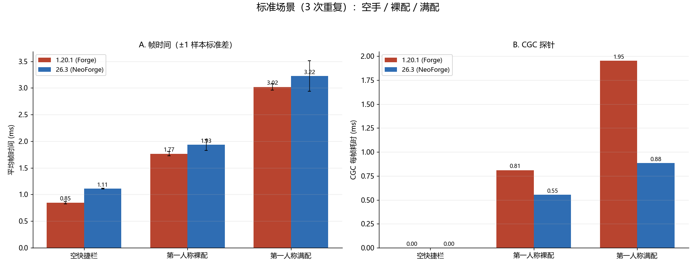
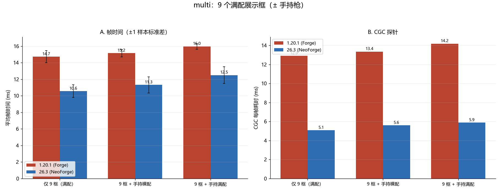
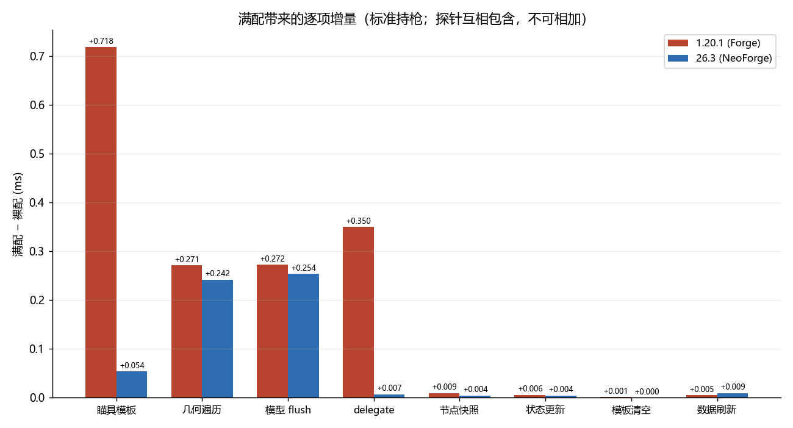

# 测试数据计算报告（CGC 1.20.1 / 26.3 · 满配枪械批次）

**数据**：本目录 24 个文本 —— 两端（`cgc1` = Forge 1.20.1，`cgc2` = NeoForge 26.3）各 3 次重复：标准 3 步（空快捷栏 / 第一人称裸配 / 第一人称满配）+ multi 3 段（9 个满配展示框；+ 手持裸配；+ 手持满配），Afterburner 与内置探针各 24 条记录。
**口径**：帧时间 = 1000 / FPS；内置探针为采集窗口内逐帧统计，窗口比 Afterburner 略长（F12 提前开始、延迟结束）。所有「平均」为重复样本的均值 ± 1 样本标准差；`n` 见各表。
**环境**：GTX 1660 SUPER / i5-9400F / 1920×1080 165Hz；1.20.1 用 Embeddium + Oculus，26.3 用 Sodium + Iris，全程不启用光影；枪械为 `tacz:m4a1`，满配 = 枪口 `muzzle_brake_cthulhu` + 激光 `laser_compact` + 握把 `grip_vertical_military` + 瞄具 `scope_mk5hd`（倍镜 + 红点组合镜）+ 枪托 `stock_tactical_arm`，详见 [标准.txt](./标准.txt)。
**复现**：`python analyze.py` → 三张总览图 + 控制台明细表。

> **与 `26.35.11.1-2` 的口径差异（不可跨批直接比较）**
> - 枪械换成 `tacz:m4a1`（上一批是 `tacz:ak47`），且本批第一次测「满配」场景；
> - multi 的 9 个展示框从裸枪换成了满配枪，因此本批 multi 的帧时间（14.7 ms）与上一批（5.45 ms）测的不是同一个场景；
> - 每端只有 3 次重复，且 1.20.1 第 3 次采集缺少「满配」一段（n=2），见第 8 节。

---

## 1. 标准场景

### 1.20.1（Forge）

|步骤|n|AF FPS|AF 帧时间|内置帧时间|采集开销|CGC|占帧|Δ帧时间(AF)|1% low|p99|
|---|---:|---:|---:|---:|---:|---:|---:|---:|---:|---:|
|空快捷栏|3|1178.7 ± 29.6|0.8487 ± 0.0213|0.8523 ± 0.0210|+0.0036|0.0000|0.0%|—|485.1|1.7983 ± 0.0231|
|第一人称裸配|3|566.5 ± 12.2|1.7659 ± 0.0376|1.7697 ± 0.0347|+0.0038|**0.8100**|45.7%|+0.9171|314.7|2.9427 ± 0.0811|
|第一人称满配|2|331.4 ± 6.8|3.0181 ± 0.0618|3.0200 ± 0.0608|+0.0019|**1.9505**|64.6%|+2.1694|234.7|4.1080 ± 0.0212|

### 26.3（NeoForge）

|步骤|n|AF FPS|AF 帧时间|内置帧时间|采集开销|CGC|占帧|Δ帧时间(AF)|1% low|p99|
|---|---:|---:|---:|---:|---:|---:|---:|---:|---:|---:|
|空快捷栏|3|900.4 ± 5.6|1.1106 ± 0.0069|1.1143 ± 0.0076|+0.0037|0.0000|0.0%|—|417.8|2.1043 ± 0.0927|
|第一人称裸配|3|518.4 ± 26.6|1.9325 ± 0.1022|1.9393 ± 0.1020|+0.0068|0.5540|28.4%|+0.8219|273.9|3.3817 ± 0.3937|
|第一人称满配|3|311.7 ± 26.2|3.2238 ± 0.2841|3.2277 ± 0.2823|+0.0039|0.8837|27.3%|+2.1132|175.4|5.4207 ± 1.3736|

### 对照

|项|1.20.1|26.3|说明|
|---|---:|---:|---|
|空手基线|0.8487|1.1106|含约 0.05 ms 探针开销（见第 7 节）|
|裸配帧时间增量|**+0.9171**|**+0.8219**|26.3 低 10%|
|满配帧时间增量|**+2.1694**|**+2.1132**|两端几乎相同|
|满配 / 裸配（CGC）|2.41×|1.60×|满配把单枪 CGC 抬到 2.4× / 1.6×|
|CGC 覆盖 AF 增量（裸配）|88.3%|67.4%|26.3 的 render pass 不在探针内|
|CGC 覆盖 AF 增量（满配）|89.9%|41.8%|同上|

- 满配让第一人称帧时间从 1.77 ⟶ 3.02 ms（1.20.1），CGC 从 0.81 ⟶ 1.95 ms。**这不是小项：附件把单枪 CGC 抬到 2.4 倍。**
- 26.3 的帧时间增量与 1.20.1 几乎一致（+2.113 vs +2.169），说明延迟渲染并没有让「满配」变便宜，只是把工作挪到了探针外。

---

## 2. 满配相对裸配的增量

|探针 / 计数器|1.20.1 裸配|1.20.1 满配|增量|26.3 增量|
|---|---:|---:|---:|---:|
|立方体数（/帧）|750|1735|**+985（+131%）**|+1282（+171%）|
|节点数（/帧）|90|168|+78|+78|
|动画通道（/帧）|14|14|0|0|
|`State changes`（/帧）|0.98|0.98|0|+0.01|
|几何提交/endBatch（/帧）|3|17|**+14**|—|
|draw 数（/帧）|12|27|**+15**|—|
|上传字节（/帧）|652 KB|1 506 KB|**+854 KB**|—|
|分配字节（/帧）|232 KB|454 KB|+222 KB|+213 KB|
|模板窗口（/帧）|0|1|+1|+1|
|入口事件（ms）|0.8140|1.9555|+1.1415|+0.0783|
|**CGC（ms）**|**0.8100**|**1.9505**|**+1.1405**|**+0.3297**|
|瞄具模板 `Scope render`|0.0000|**0.7185**|+0.7185|+0.0540|
|几何遍历|0.5263|0.7975|+0.2712|+0.2417|
|模型 flush|0.1507|0.4230|+0.2723|+0.2540|
|delegate|0.0880|0.4380|+0.3500|+0.0070|
|节点快照|0.0090|0.0185|+0.0095|+0.0043|
|功能节点|0.0103|0.0185|+0.0082|+0.0087|
|数据刷新|0.0030|0.0080|+0.0050|+0.0093|
|模板清空|0.0053|0.0065|+0.0012|0.0000|

三条事实：

1. **附件成本基本等于顶点成本。** `tacz:m4a1` 裸枪 750 立方体，满配 1735（+985）。1.20.1 的满配增量 1.14 ms 与 `+985 立方体 × 1.1 µs` 同量级，说明附件没有引入新的成本形态——它只是**放大顶点数**。这一点对方案很关键：烘焙按网格做，附件会自动一起被覆盖，不需要单独的「附件优化」。
2. **`Scope render` 是满配的最大单项。** 第一人称 0.7185 ms，占满配 CGC 的 36.8%；multi 里 0.488 ms/枪，占单枪 CGC 的 34%。它是 `_renderScope` 里那次独立的瞄具模型渲染（含模板窗口的多次 pass），与枪体遍历是并列关系，不是嵌套。
3. **delegate 增量集中在 1.20.1。** 第一人称 delegate +0.35 ms（26.3 只有 +0.007），其中包含配件模型与手臂/文字/火焰；multi（世界展示）里 delegate 也达到 0.265 ms/枪。26.3 的 delegate 近乎为零，是提交/绘制分离造成的口径差异。

---

## 3. 持枪段构成

|探针|1.20.1 裸配|1.20.1 满配|26.3 裸配|26.3 满配|
|---|---:|---:|---:|---:|
|入口事件（含提交）|0.8140|1.9555|0.0887|0.1670|
|第一人称提交|0.8100|1.9505|0.0830|0.1590|
|状态更新|0.0387|0.0445|0.0410|0.0453|
|数据刷新|0.0030|0.0080|0.0040|0.0133|
|瞄具模板|0.0000|**0.7185**|0.0000|0.0540|
|模型渲染总计|0.7443|1.4725|0.0103|0.0170|
|节点快照|0.0090|0.0185|0.0027|0.0070|
|功能节点|0.0103|0.0185|0.0087|0.0173|
|几何遍历|0.5263|0.7975|0.4657|0.7073|
|模型 flush|0.1507|0.4230|0.4710|0.7250|
|delegate|0.0880|0.4380|0.0010|0.0080|
|模板清空|0.0053|0.0065|0.0000|0.0000|
|flush 上传（整帧）|0.1550|0.3260|—|—|
|flush draw（整帧）|0.0933|0.2040|—|—|

1.20.1 满配的顶向量级可以直接闭合：`瞄具模板 0.72 + 几何遍历 0.80 + 模型 flush 0.42 ≈ 1.94`，等于 CGC 1.95（状态 / 数据 / 快照合计不到 0.09，且 delegate 0.44 嵌在遍历与 flush 内）。

26.3 的口径不同：`几何遍历 0.71 ≈ 模型 flush 0.73`（flush 回调里做遍历），提交阶段只有 0.16；render pass 的绘制不在探针内。

---

## 4. multi（9 个满配展示框）

### 4.1 实测

|端|分组|n|AF FPS|AF 帧时间|CGC|占帧|
|---|---|---:|---:|---:|---:|---:|
|1.20.1|仅 9 个展示框|3|68.0 ± 3.4|14.7231 ± 0.7247|12.9043 ± 0.5052|87.3%|
|1.20.1|9 框 + 手持裸配|3|66.0 ± 1.9|15.1601 ± 0.4451|13.3567 ± 0.3537|87.9%|
|1.20.1|9 框 + 手持满配|3|62.6 ± 1.3|15.9705 ± 0.3316|14.1917 ± 0.2507|88.8%|
|26.3|仅 9 个展示框|3|95.0 ± 7.2|10.5690 ± 0.7695|5.0790 ± 0.5636|47.8%|
|26.3|9 框 + 手持裸配|3|88.8 ± 8.0|11.3156 ± 0.9717|5.6070 ± 0.6682|49.4%|
|26.3|9 框 + 手持满配|3|80.4 ± 6.8|12.4996 ± 1.0061|5.8843 ± 0.6774|47.0%|

手持枪在 multi 里的增量（相对「仅 9 框」）：

|端|裸配手持|满配手持|同批标准场景的单独值（满配）|
|---|---:|---:|---:|
|1.20.1|+0.452 ms CGC|+1.287 ms CGC|1.951 ms|
|26.3|+0.528 ms CGC|+0.805 ms CGC|0.884 ms|

手持枪在 multi 中比单独测量便宜（1.20.1 满配 1.29 vs 1.95）。multi 帧时间长达 15 ms，CPU 频率/调度状态与 3 ms 的单独场景不同，**该差值不用于设计**，只作为「multi 下第一人称成本上限」使用。

### 4.2 单枪归因（1.20.1，仅 9 框组 ÷ 9）

|项|每帧|每枪|占 CGC|
|---|---:|---:|---:|
|CGC|12.904|**1.434**|100%|
|瞄具模板（含其内部 flush）|4.392|0.488|34.0%|
|几何遍历|6.300|0.700|48.8%|
|模型 flush（与瞄具模板部分重叠）|2.912|0.324|22.6%|
|其中上传|1.970|0.219||
|其中 draw|0.712|0.079||
|delegate（嵌在遍历/flush 内）|2.381|0.265|18.5%|
|节点快照|0.135|0.015|1.0%|
|功能节点 / 数据刷新 / 模板清空|0.194|0.022|1.5%|
|立方体数|12 852|**1 428**|—|
|几何提交 / endBatch|72|8|—|
|draw 数（扣掉 8 次整帧基线）|81|**9**|—|
|上传字节|11.13 MB|1.24 MB|—|
|分配字节|2.86 MB|0.318 MB|—|
|模板窗口|9|1|—|

26.3 的同一场景：CGC 5.079（每枪 0.564），其中遍历/ flush 回调 4.77 / 4.87、瞄具模板 0.032、delegate 0.024、分配 0.161 MB/枪。26.3 没有 draw / 上传拆分。

### 4.3 multi 的两处口径修正

1. **1.20.1**：相对场景基线 0.852 ms 的枪械增量是 13.87 ms，CGC 测得 12.90（93%），`14.723 − 0.852 − 12.904 = 0.967 ms` 在探针外。
2. **26.3**：枪械增量是 9.46 ms，CGC 只测得 5.08（54%），`10.569 − 1.109 − 5.079 = 4.381 ms` 在探针外。这 4.4 ms 是延迟渲染的 render pass（提交 + 绘制 + 状态），它是 26.3 这个场景里**最大的单项**，却没有任何探针。

因此跨版本只能比帧时间：**同一满配场景下 26.3 比 1.20.1 快 1.39×（10.57 vs 14.72 ms），而不是 CGC 显示的 2.5×**。延迟渲染把顶点生成摊进了 render pass，并没有让它消失。

---

## 5. 1.20.1 与 26.3 的同场景对照

|项|1.20.1|26.3|备注|
|---|---:|---:|---|
|multi 帧时间（9 满配枪）|14.72|10.57|26.3 快 28%|
|CGC 测得|12.90|5.08|覆盖范围不同|
|探针外|0.97|4.38|26.3 的 render pass|
|单枪立方体（满配）|1 428|1 425|基本一致|
|单枪立方体（满配，第一人称）|1 735|2 031|26.3 多 296 个（见第 8 节）|
|单枪 draw|9|无探针|—|
|单枪分配|0.318 MB|0.161 MB|26.3 少一半|
|瞄具模板（第一人称满配）|0.7185|0.0540|26.3 只有提交|

第一条给出一个可用的目标：**同样的几何、同样的枪数，26.3 的整帧比 1.20.1 少 4.15 ms**。重构在 1.20.1 上有至少 4 ms 的可回收空间（不论走烘焙还是别的路径）。

---

## 6. 成本模型复核

沿用 [链路分析](../../chain/Home.md) 的四量纲，用本批数据重新拟合：

|量纲|本批拟合值|依据|
|---|---|---|
|`C_vertex`|**约 1.0–1.1 µs/立方体**（1.20.1）|裸配 0.526/750、满配 (0.798+0.719)/1735、multi 6.30/12 852，三点一致|
|`C_vertex`（26.3 flush 回调）|**约 0.4 µs/立方体**|4.77/12 852；但 render pass 的 4.38 ms 未归因|
|`C_draw`|**约 8–10 µs/draw**|multi 0.712/81 = 8.8 µs；满配第一人称 0.204/19 = 10.7 µs；空手基线一致|
|`C_upload`|**约 6 GB/s**|满配第一人称 854 KB / 0.171 ms ≈ 5 GB/s；multi 1.97 ms / 11.13 MB ≈ 5.6 GB/s|
|`C_fixed`|≈ 0（空手与 `/clear` 同为基线）|—|

新的关键量是**每枪的 draw 数**：裸配 2 次，满配 9 次。按 9 µs/draw 计，仅 draw 一项就是 **0.08 ms/枪、0.72 ms/帧（multi）**。这是烘焙之后的地板，也是 B2 必须存在的理由。

---

## 7. 探针开销与稳定性

- 本轮采集的「AF 与内置帧时间之差」为 +0.0019…+0.0068 ms，与上一批一致（`nanoTime` 埋点本身很便宜）。
- 跨批对照（同一空手场景）：上一批无扩展探针的构建 0.8003 ms，本批 0.8487 ms → **探针固定开销仍约 0.048 ms/帧**。TODO 中「把整帧 GPU 查询与分配采样改成每 N 帧一次」尚未生效。
- 稳定性：同一文件内 3 段之间的相对关系稳定（满配 > 裸配 > 空手），但跨重复有漂移 —— 1.20.1 空手 1208.7 → 1177.9 → 1149.5 FPS（单调下滑，热状态）；26.3 multi 第 1 次明显偏快（103.3 / 90.7 / 90.9 FPS）。**只使用同一次采集内的相对值，跨重复的绝对值有 ±5–10% 漂移。**

---

## 8. 异常与说明

- **1.20.1 第 3 次重复缺少「满配」一段**（`cgc1 (3).txt` / `cgc1-builtin (3).txt` 只有 2 段），因此 1.20.1 满配为 n=2。其余分组 n=3。
- **26.3 multi 第 1 次重复的展示框立方体数为 12 771**，后两次为 12 852（差 81）；同时其帧时间明显偏快。判断为首次采集时的预热差异，不影响分组（`World-item submissions` 均为 9）。
- **26.3 满配第一人称比 1.20.1 多 296 个立方体**（2031 vs 1735），裸配两端一致（749 vs 750）。差异只出现在满配，且 `Cubes submitted` 与 `State changes` 都稳定，不是漏采集。原因未确认，记为待查（可能来自瞄具在延迟渲染下的可见节点集合不同）。
- 本批只用 `tacz:m4a1`，没有 TaCZ 对照；`tacz:m4a1` 与上一批的 `tacz:ak47` 不同，裸配数据不可跨批直接比较。
- 9 个满配展示框各自打开一次模板窗口（`Stencil windows = 9`），模板清空合计 0.059 ms/帧；上一批裸枪场景里每枪也会无条件清一次模板，因此这一项不是满配新增的。

---

## 9. 结论

1. **满配把单枪成本抬到 1.43 ms（multi）/ 1.95 ms（第一人称）**，立方体数 +131%（1.20.1）。附件不引入新的成本形态，它按顶点数等比放大。
2. **瞄具模板是满配的最大单块**：第一人称 0.72 ms（36.8%）、multi 0.488 ms/枪（34%）。它是与枪体遍历并列的一次独立渲染，含多次模板 pass。
3. **每枪 draw 数从 2 涨到 9**（multi 共 81 次 CGC draw、8 次 endBatch/枪）。按 9 µs/draw，draw 单独就是 0.72 ms/帧 —— **烘焙能消掉遍历与上传，但消不掉这部分；不合并 draw 就到不了 multi 的目标**。
4. **26.3 在同一满配场景只快 1.39×，不是 2.5×**：它的 CGC 只解释了 54% 的枪械增量，4.38 ms 落在 render pass 里。延迟渲染没有让几何变便宜，只是换了归属。
5. **探针外还有 0.97 ms（1.20.1）/ 4.38 ms（26.3）**；26.3 的这个数比它自己测得的所有单项都大，需要在 B1 里补 per-pass 计时才能给 multi 的帧时间目标定量。
6. 探针固定开销约 0.048 ms/帧，量级不变；只有 3 次重复，建议后续批次保持 6 次。

对路线的影响见 [重构方案](../../refactor/Home.md)：路线仍是 B1 → B2，但 **B2 从「multi 的加分项」变成了「multi 达标的必要条件」**，同时目标帧时间按满配场景重算。
