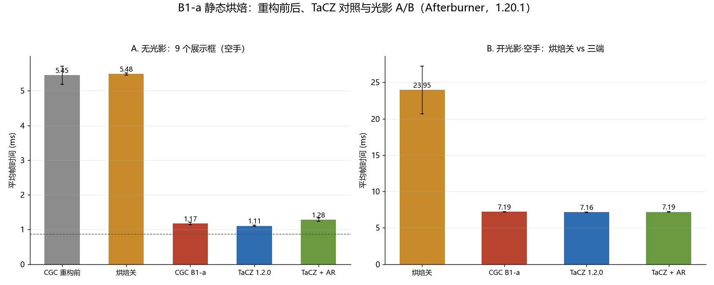

# 测试数据计算报告（CGC 1.20.1 · B1-a 静态烘焙阶段验收与 TaCZ 对照）

**数据**：本目录 20 个 Afterburner 文本，无内置探针——CGC `cgc1-multi (1..4).txt`（4 步 × 4 次）、TaCZ `tacz1-multi (1..4).txt`、TaCZ + Accelerated Rendering `tacz2-multi (1..4).txt`（同一 4 步 × 4 次）、`b1-a-1/cgc1-multi (1).txt`（修复前构建，n=1）、`b1-a-2/cgc1-multi (1..3).txt`（9 个**空**展示框，2 步 × 3 次，光影基线）、`b1-a-3/cgc1-multi (1..4).txt`（`StaticBake#ENABLED = false` 的 A/B 对照，空手 / 开光影 × 4 次）。4 步 = 空手（9 把 ak47）/ 第一人称 ak47 / 开光影·空手 / 开光影·第一人称 ak47。
**口径**：帧时间 = 1000 / FPS；均值 ± 1 样本标准差；每个文件 = 一次启动 + 进档。
**环境**：GTX 1660 SUPER / i5-9400F / 1080p165；Forge 47.4.23 + Embeddium + Oculus；multi = 9 个石头 + 9 把 `tacz:ak47` 展示框，渲染距离 5；光影 `ComplementaryReimagined_r5.9.3`（HIGH）。详见 [标准.txt](./标准.txt)。
**复现**：`python analyze.py`。

> 与 [`26.35.11.1-2`](../26.35.11.1-2/测试数据计算报告.md) 同场景可比（9 把裸枪、4005 立方体）；差异是本批装了 `cgccpackloader`，而上一批全程不开光影。

## 1. 本次验收（修复后构建）

|步骤|n|AF FPS|AF 帧时间|1% low|
|---|---:|---:|---:|---:|
|空手（9 把 ak47）|4|852.5 ± 23.2|**1.174 ± 0.032 ms**|455.4|
|第一人称 ak47|4|557.1 ± 7.4|1.795 ± 0.024 ms|335.2|
|开光影·空手|4|139.0 ± 0.8|7.193 ± 0.039 ms|133.6|
|开光影·第一人称 ak47|4|133.8 ± 0.2|7.474 ± 0.010 ms|117.9|

## 2. 与重构前对照（无光影）

|项|重构前|B1-a|变化|
|---|---:|---:|---:|
|9 把枪的帧时间成本|4.597 ms（5.449 − 0.852）|0.307 ms（1.174 − 0.866）|**−93.3%**|
|单把枪|0.511 ms|0.034 ms|**−93.3%**|
|9 把枪整帧|5.449 ms|1.174 ms|**−78.5%**|
|1% low|135.6 FPS|455.4 FPS|3.4×|

- 场景基线两次测得 0.852（`26.35.11.1-2/multi-baseline/`）与 0.866 ms（本批 `b1-a-2` 第 1 步），差 0.015 ms，可直接作对照。
- 整帧 1.174 ms 与上一批预估的 B1 量级（≈1.2 ms）一致；剩余的 0.307 ms 仍是每枪约 2 次 draw（≈0.18）+ 状态段 / 模板 / 缓存（≈0.13），交给 B2。
- 修复前构建（`b1-a-1`，n=1）四步为 855.0 / 567.5 / 139.1 / 133.9 FPS，与本批在噪声内一致：泄漏修复只影响内存，不影响渲染性能。

## 3. 与 TaCZ 1.2.0 对照

同一场景、同一台机器、同一 4 步协议，每端 4 次重复。旧批次 `26.35.11.1` 的 TaCZ multi（844.2 / 502.0 FPS）只有 1 次、步骤顺序相反，且 ak47 可能未拆枪托（性能略差），已被本批取代。

|项|CGC B1-a|TaCZ 1.2.0|TaCZ + AR|
|---|---:|---:|---:|
|无光影·空手|1.174 ms|**1.106 ms**|1.279 ms|
|无光影·持枪|**1.795 ms**|1.994 ms|2.026 ms|
|开光影·空手|7.193 ms|7.160 ms|7.187 ms|
|开光影·持枪|7.474 ms|7.447 ms|7.436 ms|

- 静态展示（空手）：CGC 比 TaCZ 慢 0.067 ms（+6.1%），比 TaCZ + AR 快 0.105 ms；重构前 5.449 ms 是 TaCZ 的 4.9×。按同一空展示框基线 0.866 ms 推算，9 把枪 TaCZ 0.240 ms（0.027 ms/枪）、CGC 0.307 ms（0.034 ms/枪）。
- 持枪：CGC 快 0.199 ms，来自第一人称路径本身，与静态化无关。
- 开光影：三端 7.16–7.19 / 7.44–7.47 ms，差异 <0.5%——三端都是已优化路径，都贴在 GPU 下限；烘焙关时为 23.9 ms（第 4 节）。
- 剩下 0.067 ms 从量级看更可能是每枪的常数项（draw 数 / 模板 / 状态）而非逐顶点成本，**尚未归因**——缺 draw 数与模板窗口的内置探针，对应 A 的剩余项与 B2。Accelerated Rendering 在静态场景反而慢 0.17 ms，不作参考。

## 4. 开光影：A/B 对照

`b1-a-3` 是把 `StaticBake#ENABLED` 置 `false` 后重新构建的对照端，其余代码相同。

|场景|n|帧时间|
|---|---:|---:|
|空展示框（无烘焙）|3|6.679 ± 0.039|
|9 把枪·烘焙关（`ENABLED = false`）|4|**23.949 ± 3.288**|
|9 把枪·B1-a|4|**7.193 ± 0.039**|
|9 把枪 + 第一人称·B1-a|4|7.474 ± 0.010|

- **光影下烘焙是 3.3× 收益**：23.949 → 7.193 ms。烘焙关时帧时间远高于空展示框的 6.68 ms，说明重构前该场景在光影下是 **CPU 受限**，不是 GPU 受限；烘焙后才贴近 GPU 下限。
- 同一 A/B 的无光影对照为 5.485 ms，与重构前的 5.449 ms 相差 0.7%，证明两次构建只差这一个开关。
- 因此之前「CPU 成本 5.45 ms 低于 GPU 6.68 ms，光影下收益不可见」的推断作废：**Oculus 下立即路径的 CPU 成本远高于无光影**，不能用无光影的 CPU 数值跨场景外推。
- 第一人称在光影下只加 0.281 ms（B1-a 范围内不含第一人称），这部分留给 B1-b。

## 5. 功能验收

|项|结果|
|---|---|
|画面 / 光照 / 失效 / 掉落物 / 资源重载 / 光影|通过（开关光影下配件、瞄具、开镜、展示框与掉落物旋转均正确；换配件立即更新）|
|雾的关烘焙对照|通过（陆地 / 水下；水下烘焙关的一次差异为等待时间不足，见 5.1）|
|`Bake rebuilds` / `Static bake` 等探针|未做（本批无内置探针数据）|

### 5.1 雾的对照（`b1-a-4`，人工观察）

无光影走 `cgc_baked_entity`（圆柱雾在「世界对齐坐标」里清 Y），开光影由光影包决定。两次对照都以「枪 vs 展示框木框」同距离比较，烘焙关为 `ENABLED = false` 构建：

|场景|摆放|烘焙开|烘焙关|
|---|---|---|---|
|陆地·圆柱，RD 2|4 个框在 z=32 的墙上（雾带末端），其中两把框内物品分别转 3 / 7 下|4 把同级别|4 把同级别|
|水下·球，RD 7|10 / 30 / 60 / 90 格各一把，60 格上方 35 格再放一把|90 不可见、60 可见、上方极其淡|60 已不可见（等待不足）|

- 陆地：枪与木框同步雾化，旋转/高度没有改变结果——「模型空间清 Y」的旧 bug 未复现。该位置在雾带末端（≈100% 雾），对旋转的分辨力有限；要严格验证可再在雾带中段（RD 2 的 28–32 格之间）放一组。
- 水下：按原版参数（start −8 / end 96、`waterVision = 1`）换算，60 格约 72% 雾、上方 35 格约 83%，烘焙开的表现与球雾一致。
- 烘焙关那次 60 格「不可见」是**等待时间不足**，截图时场景还没稳定，不是两条路径的雾差异；两次对照都算通过。
- 开光影：雾由光影包负责，两次对照一致；包的雾整体更淡、画面更亮。

## 6. 崩溃修复与内存

- **根因**：每帧强制重建时每次 `new BufferBuilder`，1.20.1 的构造申请「容量 × 6」原生内存且释放路径不归还 → 每次泄漏 6 MiB；3.96 s 内进程提交量 25.8 GB、页面文件剩 2 MB，随后原生分配失败崩溃。
- **修复**：按嵌套深度复用 `BufferBuilder`。F12 不再崩溃；但本场景开 F12 每帧重建，帧数跌到约 167。
- **内存**：两次 F3+T 前后显存 875–933 MB、RAM 8.9–9.1 GB，无增长趋势。

## 7. 结论

1. B1-a 在 1.20.1 无光影 multi 达标：整帧 −78.5%，单枪 −93.3%，与方案预估一致。
2. 静态展示已与 TaCZ 1.2.0 同水平：空手 1.174 vs 1.106 ms（单枪 0.034 vs 0.027 ms），重构前为 TaCZ 的 4.9×；剩余 0.067 ms 推测是每枪常数项，未归因。
3. **光影下 A/B 为 3.3×**：烘焙关 23.949 ms → 7.193 ms。重构前在光影下是 CPU 受限，烘焙后才贴近 GPU 下限（空展示框 6.68 ms）；此前「光影下收益不可见」的推断作废。
4. 持枪 CGC 快 0.2 ms；优化后三端在光影下同水平（7.16–7.47 ms）。
5. 剩余成本里 draw 仍占大头，B2 仍是 multi 继续下探的必要条件。
6. 仍缺：内置探针数据（以及阶段 4 的 26.3）。

## 8. 异常与说明

- `b1-a-2` 的展示框内没有枪：其空手帧数 1154.6 ± 25.3（0.866 ms）与空场基线 1174.3 ± 23.9（0.852 ms）一致，有枪的同场景重构前只有 183.9 FPS。
- `b1-a-2` 第 3 个文件首段只有 1.9 s；剔除后为 0.855 ms（n=2），不影响结论。
- `b1-a-3` 的开光影段波动大（34.9–46.9 FPS，sd 3.29 ms）：烘焙关时是 CPU 受限，对系统负载更敏感。最慢一次（34.9 FPS ≈ 28.7 ms）仍比烘焙后慢 4.0×，不改变结论。
- 「9 把枪 → +第一人称」的增量为 +0.62 ms，上一批同场景为 +1.08 ms；第一人称路径未改动，该差值来自 CPU 饱和程度，不作为收益。
