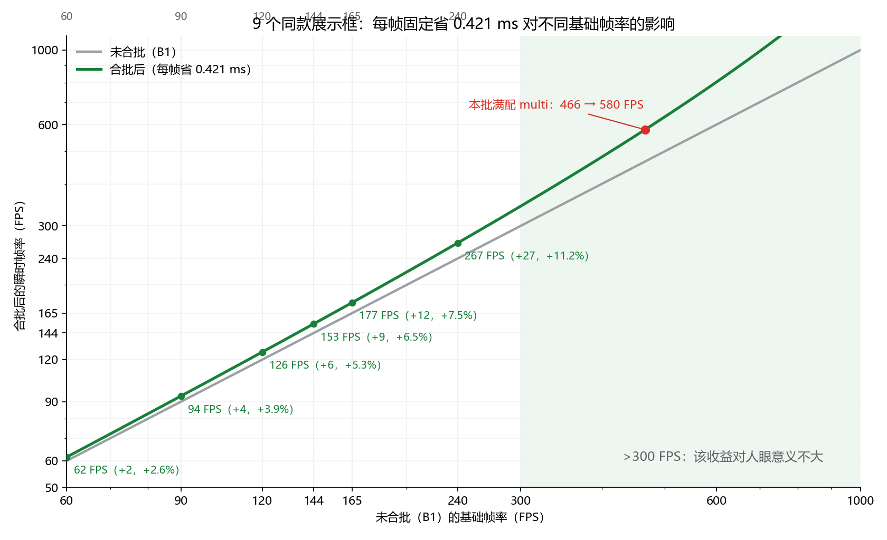

# 测试数据计算报告（CGC 1.20.1 · 26.35.11.1-7：B2 跨实例合批）

> **最终决定（2026-11-14）：B2 不保留，代码已回退。**
> 收益只出现在「同一把枪被多个展示框重复展示」或「多个展示框共用同一配件纹理」；这两类场景在实际游玩中几乎不存在，
> 非数量级的收益不足以抵消新增的兼容性风险。因此**不保留开关**，直接回退；
> 若以后重新实现，读 commit `ed78e3b4e`「Add render type merge render refactor」的代码部分。
> 本报告保留为决策依据（收益、边界、风险都在这里）。

**数据**：本目录 3 组文件，每组 = 一次独立启动（n=4；b2-1 另有第 5 次用于探针复跑）。每组内含 Afterburner 与 F12 内置探针两次运行，**时间上不重叠**（先 AF 10 s，再 F12 10 s）。
- `b2-1/*`：multi = 9 个 **ak47 裸配**展示框。3 步 = 空手 / +第一人称 ak47 / +光影。
- `b2-2/*`：multi = 9 个**满配**展示框。3 步 = 空手 / +第一人称满配 / +光影；**F12 只采集了后两步**。
- `b2-3/*`：夜晚移动光照（**无**物品展示框，第一人称 ak47 / 满配，逐格跨越亮度边界）。7 段 AF + 4 段 F12，见第 7 节。

**口径**：帧时间 = 1000 / FPS；均值 ± 1 样本标准差。Afterburner（AF）与 F12 分开，F12 采集期的帧时间不计入帧时间结论（含探针开销）。`Draw calls` 为整帧 `drawWithShader` 计数，**含 9 次展示框自身的背景绘制**（同场景 9 个空展示框的基线实测为 **9**，见 [`b1-a-6`](../26.35.11.1-4/b1-a-6/测试数据计算报告.md)），CGC 部分按差值计。
**环境**：GTX 1660 SUPER / i5-9400F / 1080p165；Forge 47.4.23 + Embeddium + Oculus（`cgccshader` 已装）；超平坦虚空、渲染距离 2、模拟距离 5、低模渲染距离 5；详见 [标准.txt](./b2-2/标准.txt)。

## 0. 结论先行

**B2 的结论是「能工作、但不值得保留」**：合批本身成立，收益只对同款重复展示成立，而这类场景在实际游玩中几乎不存在（见第 8 节的场景矩阵与第 6 节的决策记录）。

1. **B2 在同款场景生效**：9 个展示框的枪体与配件合并成「每个 RenderType 一次 draw」。
   - ak47（1 个 RenderType）：9 个框的枪体只发 **1 次 draw**——空手档 `Draw calls = 10` = 9（框背景）+ 1（合批）。
   - 满配（6 个 RenderType）：9 把满配的枪体、4 个非瞄具配件与瞄具本体合并成 **6 次 draw**；每把枪的瞄具镜身两部分（镜身 / 目镜环）仍逐实例绘制，共 18 次。展示部分合计 **72 → 24**（b1-a-5 是每把枪 8 次、共 72）。
2. **收益量级**：满配 multi 的空手帧时间 2.146 → **1.725 ± 0.027 ms**（−19.6%）；48 次 draw × 7.8 µs ≈ 0.37 ms，叠加展示实例不再开启模板测试，与实测 0.42 ms 吻合。**该收益只在同款枪（或共享纹理的配件）重复展示时成立**。
3. **收益边界决定了否决**：9 把**不同裸枪**为 **0**；9 把不同满配、共用一套配件才省 40 次 draw。实际场景以混合展示为主（见第 8 节）。
4. **稳态探针为 0 是预期**：`Batch build` / `Batch rebuilds` 只在批次重建时命中；本批的批在进游戏预热阶段就建好，F12 采集窗口内没有重建，因此分别为 `-` 与 0。**不能拿这两个探针判断合批是否生效**，要看 `Draw calls` 与 RenderType 数。
5. 光影档按设计不走合批（`Batch candidates = 0`），画面与耗时与 B1 一致。
6. **夜晚移动光照（b2-3）没有回归**：移动段 `Bake rebuilds = 0`，单次光照改写 0.147–0.628 ms（B1-c 之前是 0.6–9.2 ms）。该组场景**没有展示框**，只验证了第一人称的 B1-c-B；这组数据与 B2 是否保留无关。

## 1. b2-1：9 个 ak47 裸配展示框

|步骤|AF 帧时间|1% low|0.1% low|F12 帧时间|CGC|Draw calls|Distinct RT|endBatch|Upload|
|---|---:|---:|---:|---:|---:|---:|---:|---:|---:|
|空手（9 框）|**1.070 ± 0.013 ms**|482.8 ± 23.4|385.9 ± 37.5|1.139 ± 0.012|0.185 ± 0.007|**10**|1|0|30.8 KB|
|+第一人称 ak47|**1.329 ± 0.027 ms**|393.3 ± 19.6|178.6 ± 110.1|1.379 ± 0.027|0.355 ± 0.009|21.8 ± 1.5|1|2|34.8 KB|
|+光影|**7.219 ± 0.013 ms**|133.4 ± 2.5|106.9 ± 53.9|7.220 ± 0.019|1.200 ± 0.050|38.8 ± 1.5|2|2|113.8 KB|

**draw 分解**：空手档 10 = 9（展示框背景）+ **1（9 把 ak47 的枪体合批）**；+第一人称档 21.8 ≈ 10 + 11（第一人称 ak47 的分块绘制，其中一次采集为 24，属当次噪声）。

分解（F12，均值）：

|项|空手|+第一人称|+光影|
|---|---:|---:|---:|
|`World-item submit`|0.185|0.185|1.016|
|`Model render total`|0.135|0.254|0.941|
|`Scope render`|0.000|0.001|0.001|
|`Delegate render`|0.000|0.071|0.015|
|`endBatch draw`|0.079|0.133|0.925|
|`Stencil clear`|0.013|0.018|0.099|
|`CGC GPU busy`|0.039|0.081|0.807|
|`LOD hits`|0|0|10|
|`Batch candidates`|9（复跑）|9（复跑）|**0**（复跑）|

- ak47 是 B2 的极限形状：全场景只有 1 个 RenderType，展示部分从 9 次 draw 压到 **1 次**。
- 复跑（第 5 次）里 `Batch candidates = 9 / frame`、光影档 `= 0`，与设计一致。

## 2. b2-2：9 个满配展示框

|步骤|AF 帧时间|1% low|0.1% low|F12 帧时间|CGC|Draw calls|Distinct RT|endBatch|Upload|
|---|---:|---:|---:|---:|---:|---:|---:|---:|---:|
|空手（9 框）|**1.725 ± 0.027 ms**|342.7 ± 4.4|288.6 ± 16.9|未采集|—|—|—|—|—|
|+第一人称满配|**2.266 ± 0.052 ms**|280.5 ± 7.0|190.5 ± 78.5|2.406 ± 0.090|1.231 ± 0.045|**70**|6|4|37.4 KB|
|+光影|**8.776 ± 0.020 ms**|102.8 ± 2.6|31.4 ± 15.0|8.765 ± 0.013|4.411 ± 0.106|141|9|4|118.1 KB|

**draw 分解**：+第一人称档 70 ≈ 9（框背景）+ 24（展示部分：6 个 RenderType 的合批 + 瞄具镜身 2×9 未合批）+ 37（第一人称满配，B1-b 分块 + 瞄具模板 pass）。
同场景 `b1-a-5` 的空手档是 9（框背景）+ 72（每把满配 8 次）= 81 次；本批展示部分是 24 次。第一人称的精确值可由 ak47 组反推：b2-1 的 `21.8 = 10 + 11.8`，即第一人称 ak47 ≈12 次。

分解（F12，均值）：

|项|+第一人称满配|+光影|
|---|---:|---:|
|`World-item submit`|0.784|3.564|
|`Model render total`|0.769|4.588|
|`Scope render`|0.500|1.368|
|`Delegate render`|0.288|1.773|
|`endBatch draw`|0.437|3.337|
|`Stencil windows`|**1**|1|
|`Stencil clear`|0.045|0.100|
|`CGC GPU busy`|0.222|2.463|
|`LOD hits`|0|30|

- `Stencil windows = 1` 只剩第一人称那一处：静态展示不再开启模板测试（B2 的配套改动），9 个窗口的状态切换与模板测试期间的独立缓冲源一起消失。
- 光影档展示提交 19 次（影子 pass 再渲染一遍），按设计整段回退到 B1。

## 3. 与 B1 阶段数据的对照

与 [`26.35.11.1-4/b1-a-5`](../26.35.11.1-4/b1-a-5/测试数据计算报告.md) 的 9 个满配展示框（同场景、同函数生成）比较：

|项|b1-a-5|本批 b2-2|变化|
|---|---:|---:|---:|
|空手帧时间|2.146|**1.725 ± 0.027**|**−0.421 ms（−19.6%）**|
|空手 Draw calls|81（9 框 + 72 枪）|未采 F12（按形状应为 ~33 = 9 + 24）|—|
|+第一人称满配 帧时间|4.133|**2.266 ± 0.052**|**−1.867 ms（−45.2%）**|
|+第一人称满配 CGC|2.925|**1.231 ± 0.045**|−1.694 ms|
|Draw calls|101|70|−31（展示部分 72 → 24；第一人称由即时改为分块，draw 变多）|
|`Stencil windows`|10|1|−9|
|`Cubes submitted`|1735|1|第一人称改走烘焙（B1-b）|
|`endBatch calls`|17|4|—|

- **空手档的 −0.42 ms 可以直接归给 B2**：展示部分 draw 从 72 降到 24（合批部分 72 → 6，瞄具镜身 18 次未合批），48 次 × 7.8 µs ≈ 0.37 ms；实测 0.42 ms，差额与同批内「展示实例不再开启模板测试」同向。**该场景 9 把完全同款**，属于 B2 的最好情况。
- **+第一人称档的 −1.87 ms 主要是 B1-b**：b1-a-5 时第一人称仍是即时管线（1735 cubes、17 次 flush、20 次 draw），本批已改为分块烘焙（≈37 次 draw，但 cube 与 flush 归零），叠加 B2 的 48 次展示 draw 节省。
- 单次 draw 按 b1-a-5 的 0.629 ms / 81 ≈ 7.8 µs 估算；本批未单独测 draw 段（`endBatch draw` 只统计 `BufferSource` 的 flush，合批 draw 不在其中）。

## 4. 探针解读

> 本节的 `Batch*` 探针随 B2 一起回退，已不在代码中；数据保留用于解释上面的结论。

|探针|本批值|含义|
|---|---|---|
|`Batch candidates`|9 / frame（无光影）；0（光影）|进入合批判定且条件成立的实例数；证明 `batching()` 在跑|
|`Batch submits`|0.00|**旧实现只在「新建顶点块」时计数**；稳态走的是「键匹配直接复用」分支，所以为 0。本批已改为两条分支都计数|
|`Batch build` / `Batch rebuilds`|`-` / 0|批在预热阶段建好，采集窗口内没有重建——稳态应有的值|
|`Draw calls`|10（ak47）/ 70（满配）|判据：= 框背景 9 + 展示部分（合批 + 未合批的瞄具镜身）|
|`Batch: guard/emit reject`、`Batch: content rebake`、`Batch: unbatched`、`Batch draws`|本批未采集|下一批起随 F12 输出，用于直接确认合批路径|

## 5. 探针自身开销

F12 采集期的 `Average frame time` 与同场景 AF 帧时间之差：

|场景|AF|F12|差值|
|---|---:|---:|---:|
|b2-1 空手|1.070|1.139|+0.069|
|b2-1 +第一人称|1.329|1.379|+0.050|
|b2-1 +光影|7.219|7.220|+0.001|
|b2-2 +第一人称|2.266|2.406|+0.140|
|b2-2 +光影|8.776|8.765|−0.011|
|b2-3 ak47 无光影|1.196|1.159|−0.037|
|b2-3 ak47 光影|6.312|6.326|+0.014|
|b2-3 满配 无光影|1.459|1.474|+0.015|
|b2-3 满配 光影|6.860|6.860|0|

无光影下开销 0.05–0.14 ms；光影下帧时间由 GPU 决定，探针被掩盖。

## 6. 决策记录：B2 不保留

1. **为什么不保留**：
   - 收益只出现在「同一把枪被多个展示框重复展示」或「多个展示框共用同一配件纹理」；这两类场景在**实际游玩中几乎不存在**（第 8 节的场景矩阵）。
   - 收益不是数量级的：最好情况（9 把同款满配）是 0.42 ms / 帧；混合展示 0–0.31 ms，裸枪为 0。
   - 为此新增的兼容性风险（两个 mixin、绘制延后、相机矩阵剥离、裸 GL 与 Forge 专有 API、状态识别、模板语义改动，见第 8 节）不成比例。
   - **不保留开关**：留一个默认关闭的开关只是把同样的维护与移植成本留在代码里。
2. **回退范围**：commit `ed78e3b4e` 的**代码部分**已回退（回退提交 `834490ff1`；`StaticBatch`、`LevelRendererMixin`、`EntityRenderDispatcher` 的实体登记、`ModelObject` 接入、`BakedMesh.emitGeometry`、缓存清理调用、profiler 探针、mixin 配置）。**其中「静态展示不再进入瞄具模板流程」已作为独立改动保留**（无条件生效，无开关，见第 8 节）；**文档部分保留**。
3. **如果以后重新实现**：读 commit `ed78e3b4e`「Add render type merge render refactor」的代码部分（`StaticBatch` 的批次组织、相机剥离与锚点、按实例光照；`LevelRendererMixin` 的帧边界；`EntityRenderDispatcherMixin` 的实例身份；`BakedMesh.emitGeometry`）。同时先读本文第 8 节的收益边界与风险表，避免重复同样的取舍。
4. **b2-3 的数据不受影响**：它只覆盖第一人称的 B1-c-B，回退 B2 不改变任何数字。
5. 数据缺口：b2-2 的「空手」没有 F12 片段；b2-1 的 +第一人称档有一次采集的 draw 为 24（其余 21），属单次毛刺。

## 7. b2-3：夜晚移动光照（第一人称，无展示框）

**目的**：在 B2 构建上复跑 `b1-b-3` 的协议，确认逐格跨越亮度边界时光照改写的路径没有回归。场景**没有物品展示框**，因此 `Batch candidates = 0`，这一组只覆盖第一人称的 B1-c-B，不覆盖 B2 的按实例光照。

|步骤|AF 帧时间|1% low|0.1% low|F12 帧时间|CGC|
|---|---:|---:|---:|---:|---:|
|空手（夜晚）|**0.814 ± 0.013 ms**|519.3 ± 17.2|423.2 ± 37.0|—|—|
|第一人称 ak47·移动|**1.196 ± 0.026 ms**|342.5 ± 25.8|180.8 ± 3.6|1.159 ± 0.035|0.211 ± 0.015|
|光影 ak47·火把原地|**6.484 ± 0.030 ms**|150.1 ± 1.1|74.3 ± 65.3|—|—|
|光影 ak47·移动|**6.312 ± 0.012 ms**|150.3 ± 0.1|144.5 ± 3.2|6.326 ± 0.014|0.328 ± 0.028|
|第一人称满配·移动|**1.459 ± 0.025 ms**|348.3 ± 27.3|198.0 ± 36.7|1.474 ± 0.015|0.492 ± 0.005|
|光影满配·火把原地|**7.031 ± 0.010 ms**|138.6 ± 0.7|89.0 ± 44.5|—|—|
|光影满配·移动|**6.860 ± 0.019 ms**|135.9 ± 0.6|58.6 ± 3.6|6.860 ± 0.007|1.125 ± 0.021|

移动段的 F12 明细（均值，n=3）：

|场景|`Light patches`|每次事件重传（按每帧均值折算，量级）|`Light update`（每次事件）|`Bake rebuilds`|`Batch candidates`|
|---|---:|---:|---:|---:|---:|
|ak47 无光影|0.01 / frame|≈135 KB|**0.168 ms**|0|0|
|ak47 光影|0.05 / frame|≈230 KB|**0.147 ms**|0|0|
|满配 无光影|0.05 / frame|≈140 KB|**0.397 ms**|0|0|
|满配 光影|0.24 / frame|≈210 KB|**0.628 ms**|0|0|

- 与 `b1-b-3`（B1-c 之前）的单次事件 0.603 / 2.700 / 1.372 / 9.246 ms 对照：现在是 **0.168 / 0.147 / 0.397 / 0.628 ms**，`Bake rebuilds` 在全部移动段为 0——光照变化不再重新发射顶点。
- 满配+光影的 0.1% low 58.6 FPS，与 `b1-c-b` 修完瞄具子网格后的 58.5 一致；1% low 135.9 也回到静止档附近。
- 「火把原地」与「移动」两档几乎同速（6.484 vs 6.312、7.031 vs 6.860），移动不再产生可辨的尖峰。
- 仍未覆盖：B2 的**按实例区间**改写（需要夜晚 + 展示框）；记录在「剩余验收」里。

## 8. 收益边界：不同枪械混合展示

**规则**：合批的组键是 `RenderType`（纹理 + 渲染状态），不是「同一把枪」。每条展示实例的 draw 在 B1 下是「子网格数」，在 B2 下是「不同 RenderType 数」：

```
B1：每个展示模型各自一组 draw = 枪体 1 + 非瞄具配件各 1 + 瞄具镜身 2 + 瞄具本体 1
B2：同纹理的枪体 / 配件 / 瞄具本体合并；瞄具镜身（renderModelPart）仍逐实例
```

9 个展示框的几种典型组合：

|场景|B1 展示 draw|B2 展示 draw|节省|
|---|---:|---:|---:|
|9 把同款 ak47（1 条纹理）|9|**1**|8 次 ≈ 0.06 ms|
|9 把同款满配（6 条纹理）|72|**24**（6 合批 + 18 镜身）|48 次 ≈ 0.37 ms（实测 0.42）|
|9 把**不同**裸枪（各 1 条独有纹理）|9|**9**|**0**|
|9 把**不同**满配、共用同一套配件与瞄具|72|**32**（9 枪体 + 4 共用配件 + 1 瞄具本体 + 18 镜身）|40 次 ≈ 0.31 ms|
|9 把**不同**满配、配件也各不相同|72|~72|**0**|

结论：

- **枪体纹理按枪唯一，不同枪的枪体永远不合并**。只有「同款枪重复展示」或「不同枪共用同一配件 / 瞄具」时才有收益。
- **同款裸枪的收益也很小**：9 → 1 只是 8 次 draw（≈0.06 ms）。本批 ak47 组的帧时间优势主要来自展示实例不再开模板测试等改动，不是 B2。
- 本批满配 multi 的 **−19.6% 是「9 把同款满配」的最好情况**，不能外推到混合展示。现实里枪架 / 商店 / 展示墙常见同款重复，收益成立；而「收藏墙各摆一把不同的枪」只有配件层面能省，裸枪收藏墙为 0。
- 剩下的固定成本里，**瞄具镜身（每枪 2 次）没有合批**（走 `drawOrBakePatchable`）。若后续把它并入批次，同款满配还能再省 18 次 draw（≈0.14 ms），但需要处理它相对普通批次的绘制顺序与模板语义，不在本次范围。
- 状态段（每帧执行 functional 回调、算可见性与指纹）不受 B2 影响，这部分仍是「每实例 × 每帧」。

### 静态展示的模板流程移除（独立保留，无开关）

B2 否决后，其中「静态展示不再进入瞄具模板流程」这一项被单独保留，且**无条件生效**（不留配置，避免继续保留「受残留模板值影响」的路径）。

- **改动**：非第一人称不开模板测试窗口；展示实例结束时不再设置模板操作、不再关闭测试、不再 `glClear(GL_STENCIL_BUFFER_BIT)`。
- **收益推算**：约 **0.09 ms / 帧**（9 个展示框）。其中模板测试与状态切换 ≈0.05 ms（本批满配 multi 空手档 2.146 → 1.725 ms 的差 0.42 ms − B2 的 draw 节省 48 × 7.8 µs ≈ 0.37 ms），每枪清空 ≈0.04 ms（`Stencil clear` 实测 3.6–4.5 µs/枪）。**都是推算，不是独立 A/B**。
- **省掉的开销**：每框 `glEnable(GL_STENCIL_TEST)` / `stencilFunc` / `glDisable`、stencil 缓冲源 flush（烘焙路径下为空），以及一次全屏模板清空。主渲染目标的模板附件在首次 `enableStencil()` 时一次性重建后常驻，不是每次开销。
- **行为变化**：静态展示从不写模板值（写值只发生在第一人称的 `renderBoth / renderScope / renderSight` 与目镜三角扇），所以旧行为只是拿别处残留的模板值做比较：
  - 长筒镜（`EQUAL 0`）在残留为 0 时，移除前后画面一致；
  - 组合镜（`GREATER 127`）在残留为 0 时理论上会把枪体整块剔除、残留非 0 时可能切掉一块；移除后不再受残留影响。
  - 第一人称的模板窗口与准心路径完全未改（含每枪清空）。

### 兼容性风险（相对 B1 新增）

|项|风险|现状|
|---|---|---|
|`LevelRenderer` / `EntityRenderDispatcher` 两个 mixin|版本相关、必须逐版本移植；注入失败会直接崩（`defaultRequire = 1`），不会静默|1.20.1 已实现并验证注入生效（`Batch candidates` 有值）|
|绘制延后到实体循环之后|与其他实体绘制交错顺序变化；依赖实体循环期间全局 GL 状态不被别的模组改动|目前只在无光影包时启用；光影包下整段回退 B1|
|相机矩阵剥离|依赖 `RenderSystem.getInverseViewRotationMatrix()` 与姿态语义一致；影子 pass 下不成立|离线核对 + 光影包下禁用|
|裸 GL / Forge 专有 API|`glBufferSubData`、`glGetVertexAttribi`、`BufferBuilder#putBulkData`|1.20.1 专用；26.3 需要另一套缓冲模型|
|展示实例状态识别|只按「实体存在且在渲染距离内 + 物品 `Item` 不变」保活；同一 `Item` 换配置在离屏期间不会自己失效|重新进入视锥时会按新指纹重建|
|模板流程|静态展示不再进入瞄具模板流程（有意改动，已独立保留、无开关）|第一人称不变；画面 A/B 待人工验收|

## 9. 固定收益对不同基础帧率的影响

9 个同款满配展示框的固定收益：48 次 draw ≈ 0.37 ms（draw 口径），实测帧时间差 **0.42 ms**。按 Δ = 0.42 ms 换算：



|未合批（B1）|60|90|120|144|165|240|466（本批满配 multi）|1000|
|---|---:|---:|---:|---:|---:|---:|---:|---:|
|合批后|61.6|93.5|126.4|153.3|177.3|267.0|**579.7**|1727|
|变化|+2.6%|+3.9%|+5.3%|+6.5%|+7.5%|+11.2%|**+24.4%**|+72.7%|

- 与光照解耦的同一条结论：固定毫秒收益的意义取决于基础帧率。0.42 ms 在 60–90 FPS 只有 3%–4%，在本批约 466 FPS 的测试场景才显得可观。
- 该 Δ 只对「9 个同款满配展示框」成立；不同枪混合时 Δ 更小（第 8 节），裸枪接近 0。画图脚本见 [`plot_b2_gain.py`](./plot_b2_gain.py)。
