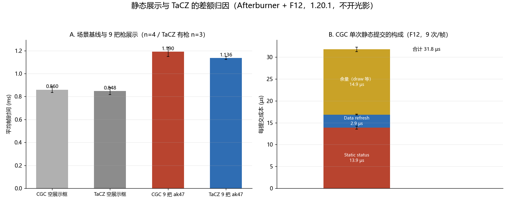

# 测试数据计算报告（CGC 1.20.1 · 静态展示与 TaCZ 的差额归因）

**数据**：本目录 16 个 Afterburner 文本 + 8 个 F12 探针文本，两端都不开光影包。
- `cgc1-multi (1..4).txt` / `tacz1-multi (1..4).txt`：2 步 = 空手（9 把 `tacz:ak47` 展示框）/ 第一人称 ak47，各 4 次
- `cgc1-multi-builtin (1..4).txt`：同场景的 F12 探针（每文件 1 段，含第一人称）
- `multi-baseline/`：9 个**空**展示框的场景基线，两端各 4 次，另有 CGC 的 F12 对照 4 次
- `tacz1-multi (2).txt` 只有第 2 步，按帧数（503 FPS）归位；TaCZ 第 1 步因此 **n=3**

**口径**：帧时间 = 1000 / FPS；均值 ± 1 样本标准差。每个文件 = 一次启动 + 进档。「每枪」=（有枪帧时间 − 同端同批空展示框基线）/ 9。
**环境**：GTX 1660 SUPER / i5-9400F / 1080p165；Forge 47.4.23 + Embeddium + Oculus（未开光影包）；见 [标准.txt](./标准.txt) 与 [multi-baseline/标准.txt](./multi-baseline/标准.txt)。
**复现**：`python analyze.py`。

## 1. 帧时间

|场景|n|CGC|TaCZ 1.2.0|差|
|---|---:|---:|---:|---:|
|空展示框（场景基线）|4 / 4|0.8597 ± 0.0258 ms|0.8479 ± 0.0316 ms|+0.0118 ms（1.4%）|
|9 把 ak47 展示框|4 / 3|1.1903 ± 0.0403 ms|1.1358 ± 0.0129 ms|**+0.0545 ± 0.0215 ms（2.5σ）**|
|+ 第一人称 ak47|4 / 4|1.3992 ± 0.0447 ms|2.0489 ± 0.0609 ms|CGC 快 0.6497 ms|

- **两端的空展示框基线在本批相等**：0.0118 ms 的差是 0.3σ，噪声内。本批把基线放到两端同一次采集，是这次能直接相减的原因。
- 每枪成本（同批基线相减）：CGC **36.73 µs** / TaCZ **31.99 µs**，差 **4.74 ± 3.29 µs/枪（1.4σ）**，合计 0.043 ms。
- `26.35.11.1-4` 的 0.067 ms 偏高：那批 0.866 ms 基线只测在 CGC 端，且 CGC 端多装 `cgccpackloader` / `cgccshader`。**以本批为准**，两者的差在 0.04–0.05 ms，落在噪声边缘。
- 第一人称那步 CGC 快 0.65 ms 是 B1-b 的收益（`26.35.11.1-4` 时同场景只快 0.20 ms），与静态展示无关。

## 2. CGC 单次静态提交的构成（新增 `Static status` 探针）

F12 段是第 2 步（9 个展示框 + 第一人称），`World-item submit` 只覆盖 9 次静态提交，n=4。

|项|每帧|每提交|占每提交|
|---|---:|---:|---:|
|`World-item submit`|0.2860 ± 0.0073 ms|**31.78 µs**|100%|
|`Static status`（状态段）|0.1250 ± 0.0032 ms|**13.89 µs**|**43.7%**|
|`Data refresh`|0.0265 ± 0.0010 ms|2.94 µs|9.3%|
|余量（2 次 draw + 缓存键 / 矩阵 / `getBuffer`）|0.1345 ms|14.94 µs|47.0%|

- `Functional nodes` 2.75 µs/提交嵌套在状态段内，**纯遍历 + 18 字段哈希占 11.1 µs/提交**（≈103 ns/节点）。
- 分母：`Nodes captured` 1080/帧 = 10 次提交（9 静态 + 1 第一人称）× **108 节点**。
- 余量 14.94 µs 与「每枪 2 次 draw × 7.8 µs」吻合（单 draw 成本取自 `26.35.11.1-4` 的 81 次 draw / 0.629 ms）；`26.35.11.1-4` 对裸 ak47 的估计同样是 2 次/枪。
- 稳态：`Bake rebuilds = 0`、`Bake upload bytes = 0`、`Light patches = 0`、`Distinct RenderTypes = 1`——9 个展示框共用一份网格，本帧没有任何烘焙与光照工作。
- `Draw calls` 29/帧 − 空展示框对照的 9/帧 = 多出 20 次；静态部分按 `26.35.11.1-4` 的 2 次/枪计约 18 次，余下的属同一步里的第一人称枪。

## 3. 与 B1-c-A（独立 uv2 流）无关

- 本场景**没有任何光照工作可省**：`Light patches = 0`、`Bake rebuilds = 0`、`Bake upload bytes = 0`。A 只在光照变化时生效（每次事件省 ≈0.6 ms），稳态下反而要为每次 draw 多绑一条顶点流。
- `lighting-decoupling.md` 里 A 的 4.8 µs（ak47）是**一次光照变化**填充 4 B/顶点光照数组的 CPU 成本，不是每帧成本；它与 4.74 µs/枪 的数值接近只是巧合。
- 这个差也没有被「顶点格式多 4 B」解释：静态展示稳态不上传，GPU 侧 `CGC GPU busy` 只有 0.10–0.11 ms/帧。

## 4. 差额落在哪：没有单项能对上

- CGC 侧能测量的最小项是 `Data refresh` 的 2.94 µs/提交，**状态段一项就是整枪差的 2.9 倍**。差额小到无法归到任何单项上。
- 结构上唯一同量级的差别是**每枪 draw 数**：TaCZ 的捕获期按材质合并（`GeometryCollector.snapshot()` 丢弃空 pass），裸 ak47 只有 1 次 draw；CGC 按模型对象逐个 draw，是 2 次。1 次 draw ≈ 7.8 µs，方向与量级都对得上，但 TaCZ 端没有探针，无法定论；它的 `ExternalGunAppearance.resolve` 每帧也在做与 CGC `Data refresh` 相当的工作，两端非 draw 开销本来就接近。
- 结论：**这个差不是 CGC 剩下的某个常数项**，继续追它不划算。

## 5. 状态段去重对「不同枪械」场景的价值

- 去重键只能是共享的 `ModelObject`。9 个展示框放**不同枪**时是 9 个模型，**命中率 0**，收益为 0。
- 代价有两条：每提交多一次帧序号比较（可忽略）；真正的成本是**含 functional 节点的子树仍必须每次执行回调**（委托是逐提交登记的），真正要跳过的是纯几何子树，分支与失效口径都变复杂。
- 这与 B2 否决的原因同形状：**收益只在「同一把枪重复展示」时成立，实际游玩中几乎不存在**。按同一标准**不加入**。
- 不同枪场景下，状态段仍是 13.89 µs/枪 = 0.125 ms/帧（≈整帧 8%）。要动它得换成本模型（例如用动画写入时维护的 revision 取代逐节点哈希、或只在姿态类节点上建指纹），属于另一项设计，不在本轮。

## 6. 结论

1. 静态展示与 TaCZ 的差为 **0.043–0.055 ms / 9 把（每枪 4.7 µs）**，同批基线相减后只有 **1.4σ**；它小于 CGC 侧任何可测单项，不是某一项常数。
2. CGC 每提交 31.78 µs 已闭合：状态段 13.89 + 数据刷新 2.94 + 2 次 draw 等 14.94。
3. 与 B1-c-A 无关（本场景零光照工作）；A 的 4.8 µs 是事件成本，不是每帧成本。
4. 状态段去重只对「同款重复展示」有效，不同枪场景命中 0，按 B2 标准不加入。

## 7. 异常与说明

- `tacz1-multi (2).txt` 缺第 1 步，TaCZ 静态展示的 n=3；补一次即可把 1.4σ 收紧。
- `World-item submit` 0.286 ms 与 AF 差值推出的 0.330 ms 差 13%：前者只覆盖 CGC 的静态提交，端到端差还含 F12 之外的项与进程间噪声，**分解只用探针口径**。
- 空展示框的 F12 对照本身有 `Draw calls 9`、`Upload bytes 30.8 KB`，两端一致，是与枪无关的场景项，不参与归因。
- 探针开销：F12 段 1.5025 ms vs 同一步 AF 1.3992 ms = **+0.104 ms/帧**，与 `26.35.11.1-4` 的 +0.114 ms 同量级。
- TaCZ 的 `0.1% low` 在多个文件里只有 66–94 FPS（CGC 为 297–409），是偶发长帧，本批未追；均值与 1% low 不受影响。
