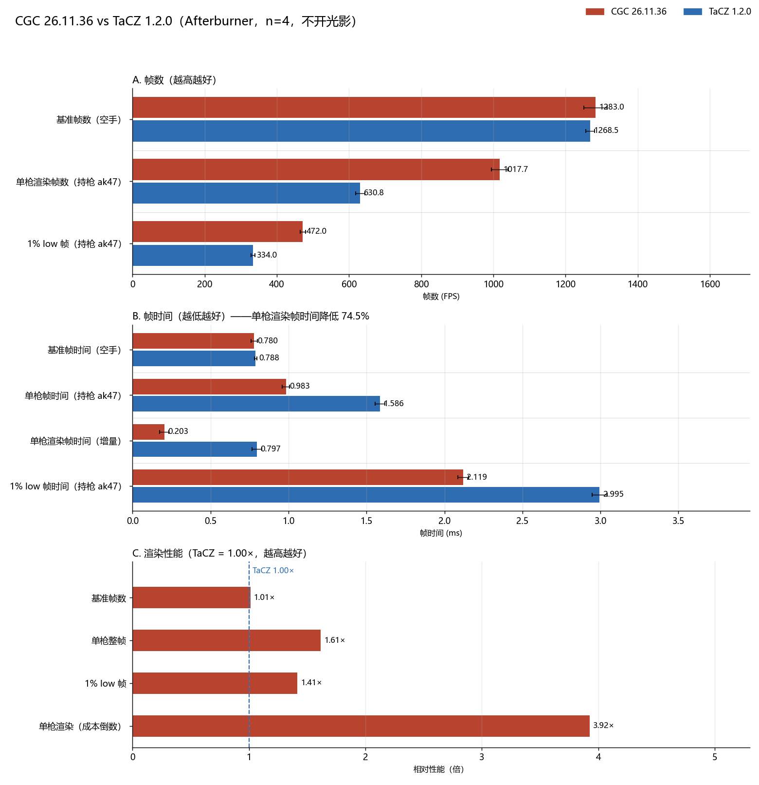

# 测试数据计算报告（CGC 26.11.36 · 与 TaCZ 1.2.0 对比）

**数据**：本目录 8 个 Afterburner 文本——`cgc1 (1..4).txt` / `tacz1 (1..4).txt`，每个文件 2 步 = 空手（基准）/ 第一人称 `tacz:ak47`，各 10 s，每步 n=4。
**口径**：帧时间 = 1000 / FPS；均值为重复样本均值 ± 1 样本标准差；每个文件 = 一次启动 + 进档，跨文件含进程级噪声。「单枪渲染帧时间」= 同端（持枪帧时间 − 空手帧时间），即归因到枪械渲染的那部分。
**环境与采集**：见 [新宿决战.txt](./新宿决战.txt)。GTX 1660 SUPER / i5-9400F / 1080p165，Forge 47.4.23 + Embeddium + Oculus，不开光影包；TaCZ 关枪械 HUD、CGC 补 TaCZ 内置第一人称动画、TaCZ 卸枪托，两端场景与视角一致。
**复现**：`python analyze.py`。

## 1. 四个指标

|指标|CGC 26.11.36|TaCZ 1.2.0|差|
|---|---:|---:|---:|
|基准帧数（空手）|1283.0 ± 32.4 FPS|1268.5 ± 11.9 FPS|+14.4 FPS（0.8σ，噪声内）|
|单枪渲染帧数（持枪）|1017.7 ± 23.4 FPS|630.8 ± 12.7 FPS|**+386.9 FPS（1.61×，+61.3%）**|
|单枪帧时间（持枪）|0.9830 ± 0.0228 ms|1.5858 ± 0.0315 ms|**−0.6028 ms（31.0σ）**|
|1% low 帧（持枪）|472.0 ± 7.8 FPS|334.0 ± 5.4 FPS|**+138.0 FPS（1.41×，29.2σ）**|

- **两端的空手基线相等**（差 0.8σ），因此同一次采集内直接相减得到的单枪成本没有基线偏差。
- 1% low 占均值：CGC 46.4% / TaCZ 52.9%——CGC 持枪时的掉帧幅度也更小。

## 2. 派生结论

|结论|数值|算法|
|---|---:|---|
|**单枪渲染帧时间降低**|**74.5%**|(0.7975 − 0.2032) / 0.7975|
|单枪渲染成本比|3.92×|0.7975 / 0.2032|
|**单枪帧时间渲染性能提升**|**1.61×**|1.5858 / 0.9830（整帧口径，对应帧数 630.8 → 1017.7）|
|**1% low 帧提升**|**1.41×**|472.0 / 334.0；对应 1% low 帧时间 2.1188 → 2.9942 ms（−29.2%）|

- 单枪渲染帧时间：CGC **0.2032 ms** / TaCZ **0.7975 ms**，差 **−0.5943 ± 0.0221 ms（26.8σ）**。
- 两个倍数口径不同：**整帧 1.61×** 含两端相同的空手基线（0.78 ms 左右），只是端到端观感；**单枪渲染成本 3.92×** 才是重构本身在枪械渲染上的收益。
- 1% low 的 1.41× 低于平均帧的 1.61×：1% low 里包含与枪无关的偶发长帧，稀释了两端的差。

## 3. 与其他批次的关系

- 本批**只测纯第一人称**（空手 / 持枪），`26.35.11.1-8` 的持枪帧时间是「9 把展示框 + 第一人称」（1.3992 / 2.0489 ms），场景不同，**不可跨批比较**。
- 此前批次没有「纯第一人称」的同场景数据，本批不取代、也不被它们取代；TaCZ 1.2.0 与 1.1.8 基本一致的既有结论不变。

## 4. 异常与说明

- CGC 第 1 次持枪 986.4 FPS 低于其余三次（1014.0–1039.5），n=4 下 sd 23.4；不影响 31σ 的差。
- TaCZ 的 `0.1% low` 跨文件只有 30.0–108.2 FPS（CGC 294.1–444.4），是偶发长帧（`26.35.11.1-8` 有同类记录），未追问；均值与 1% low 不受影响。
- CGC 端多装 `cgccpackloader` / `cgccshader`，其余模组两端相同。
