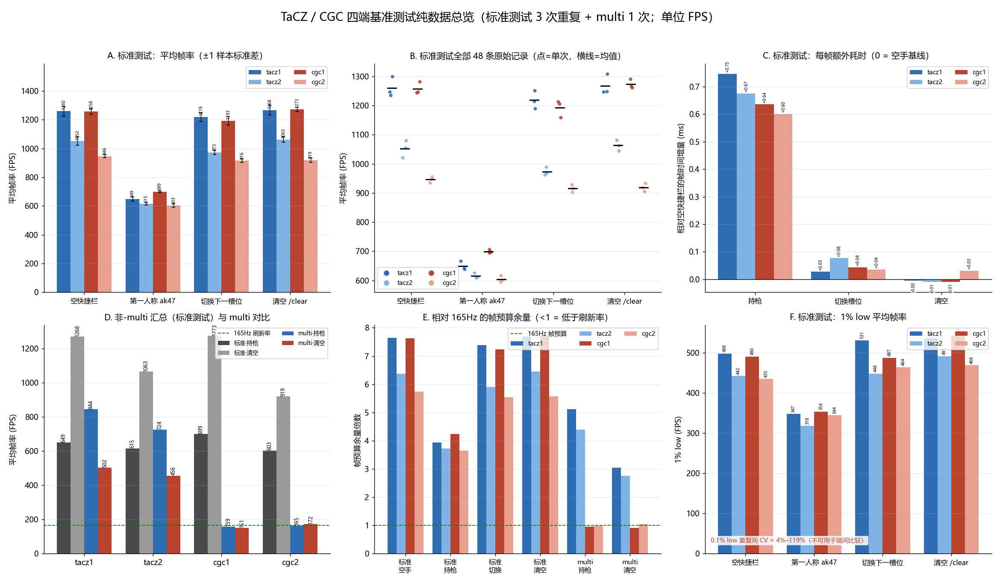

# 测试数据计算报告（精简版）

**数据**：16 个 Afterburner 文本、共 56 条记录（标准测试 4 端 × 4 步骤 × 3 次重复 = 48；multi 4 端 × 2 步骤 × 1 次 = 8）。仅做纯数据计算，未读任何模组代码。
**口径**：帧时间 = 1000/FPS；相对降幅以同端「空快捷栏」为基线；165Hz 帧预算 = 6.061 ms，余量倍数 = 6.061 / 帧时间。标准测试取 3 次重复的均值与样本标准差，multi 无重复。
**复现**：`analyze.py` → `测试数据总览-2026_11_09.png`。

---

## 1. 标准测试（3 次重复）

单元格格式：**平均帧率 ± s（相对空手；Δ帧时间 ms）**。

| 端 | ① 空快捷栏 | ② 第一人称 ak47 | ③ 切换下一槽位 | ④ 清空 /clear |
| --- | ---: | ---: | ---: | ---: |
| tacz1 | 1260.4 ± 34.3（—） | **649.4 ± 15.5（−48.5%；+0.746）** | 1219.0 ± 31.0（−3.3%；+0.027） | 1267.9 ± 35.1（+0.6%；−0.005） |
| tacz2 | 1052.3 ± 29.0（—） | **615.3 ± 8.7（−41.5%；+0.675）** | 973.5 ± 14.4（−7.5%；+0.077） | 1063.1 ± 18.2（+1.0%；−0.010） |
| cgc1 | 1257.8 ± 21.3（—） | **699.0 ± 6.0（−44.4%；+0.636）** | 1192.7 ± 29.0（−5.2%；+0.043） | 1273.0 ± 15.7（+1.2%；−0.010） |
| cgc2 | 946.4 ± 10.6（—） | **603.4 ± 11.6（−36.3%；+0.601）** | 915.6 ± 12.9（−3.3%；+0.036） | 919.0 ± 13.8（−2.9%；+0.032） |

1% low 均值（FPS）：

| 端 | ① 空快捷栏 | ② 持枪 | ③ 切换 | ④ 清空 |
| --- | ---: | ---: | ---: | ---: |
| tacz1 | 498.1 | 347.4 | 530.9 | 536.1 |
| tacz2 | 442.2 | 317.7 | 447.8 | 491.1 |
| cgc1 | 490.5 | 353.7 | 487.1 | 541.9 |
| cgc2 | 434.8 | 344.5 | 463.9 | 468.5 |

## 2. multi 与标准测试对比

| 端 | multi 持枪 | multi 清空 | 清空 vs 持枪 | multi 持枪 vs 标准持枪 | 165Hz 余量（持枪 / 清空） |
| --- | ---: | ---: | ---: | ---: | ---: |
| tacz1 | 844.2 | 502.0 | −40.5% | +30.0% | 5.12× / 3.04× |
| tacz2 | 724.0 | 455.6 | −37.1% | +17.7% | 4.39× / 2.76× |
| cgc1 | 159.4 | 151.3 | −5.1% | −77.2% | 0.97× / 0.92× |
| cgc2 | 164.6 | 172.3 | +4.7% | −72.7% | 1.00× / 1.04× |

cgc 组的 Maximum 仅 163.6 / 165.9 FPS（显示器 165Hz），读数受刷新上限截断；cgc2 第二段（11.344 s、Max 216.4）出现上限滑脱。tacz 组 multi 持枪反而高于标准持枪，说明两组条件不可直接相减，只能各自组内比较。

> **后续修订**：本批 TaCZ 的 multi 数据（844.2 / 502.0 FPS）已由 [`26.35.11.1-4`](../26.35.11.1-4/测试数据计算报告.md) 重测取代——本批每段只有 1 次、步骤顺序相反，且 ak47 可能未拆枪托。本表保留原值，不与 -4 混用。

## 3. 端间差值（%）

| 对比 | 空快捷栏 | 持枪 | 切换 | 清空 | 说明 |
| --- | ---: | ---: | ---: | ---: | --- |
| tacz1 → cgc1 | −0.2 | **+7.6** | −2.2 | +0.4 | **受控同代**（同 Forge 1.20.1、同 embeddium/oculus/资源） |
| tacz1 → tacz2 | −16.5 | −5.3 | −20.1 | −16.2 | 单变量：+acceleratedrendering |
| cgc1 → cgc2 | −24.8 | −13.7 | −23.2 | −27.8 | 平台代差（Forge 1.20.1 → NeoForge 26.3） |
| tacz2 → cgc2 | −10.1 | −1.9 | −5.9 | −13.6 | 非同代，仅参考 |

## 4. 可信度

- **平均帧率可靠**：标准测试 3 次重复 CV 0.9%–2.8%，端间差距可由均值判断；受控对比中只有持枪步骤的 +7.6% 超出重复噪声（s = 6.0 / 15.5）。
- **1% low 可参考**（重复间 CV 1%–11%）；**0.1% low 不可用**（CV 4%–119%，多数 > 50%）。
- multi 仅 1 次重复且 cgc 组被 165Hz 截断，结论强度低于标准测试。

## 5. 结论

1. 标准场景唯一显著开销是**第一人称持枪**：−36.3% ~ −48.5%（+0.601 ~ +0.746 ms/帧）；切换槽位仅 −3.3% ~ −7.5%；`/clear` 后回到基线。
2. 持枪帧时间排序：**cgc1 1.431 ＜ tacz1 1.540 ＜ tacz2 1.625 ＜ cgc2 1.657 ms**。
3. 受控同代比较中两端空手与清空状态无差别，差异只在持枪步骤（cgc1 快 7.6%）。
4. 标准场景最低仍有 3.66 倍 165Hz 余量，端间差异在该刷新率下不可见；**multi 是唯一接近上限的场景**，cgc 组已贴住刷新率。
