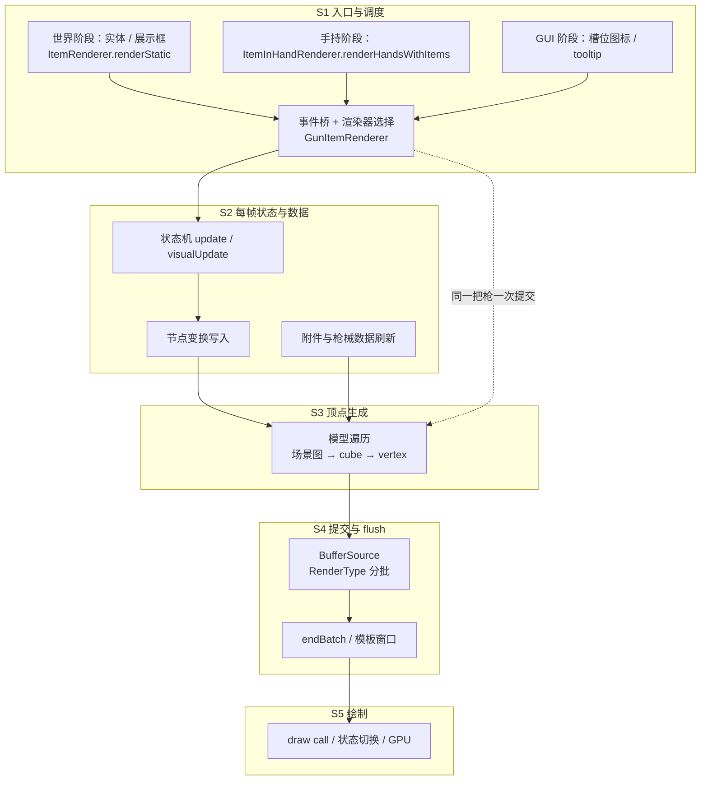

# 渲染链路分析总览

> 本文是「渲染链路分析」的入口。它回答一个问题：一帧之内，CGC 的渲染到底被调用了几次、每次花在哪一层、哪些开销随画面里的枪数线性增长。
>
> 现有 [渲染体系总览](../Home.md) 是业务视角（一套资源如何变成游戏里的枪），本系列是**技术链路 + 成本视角**，两者互补：业务视角讲「谁负责什么」，这里讲「时间花在哪里」。

## 分析目的与口径

本次分析的产出服务于 [PLAN](../PLAN.md) 的「渲染链路分析」阶段：定位性能开销、评估理想渲染方案的上限、界定重构范围。它不提出方案，方案写在 PLAN 的「渲染重构方案」一节。

口径：

- 场景与计时沿用 [基准测试报告](../benchmark/26.35.11.1/测试数据计算报告.md)：标准 4 步（空快捷栏 / 第一人称持枪 / 切换槽位 / 清空）与 multi（9 个展示框各一把枪 + 第一人称一把）。
- 帧预算按 165 Hz 计为 6.061 ms；裸 1000+ FPS 场景下判定为 CPU 瓶颈，GPU 未被充分利用。
- 源码分析以当前 1.20.1 工作区为主，26.2+ 延迟渲染的差异单独标注。**除 benchmark 归因出的数值外，本系列不写任何未经测量的数字**，一律标记「待测」或「推算」。

## 帧级链路总图

粗粒度约定：**一次「枪械提交」指渲染器把一杆枪（枪体、配件、瞄具、手臂、文字、特效作为整体）画进当前帧**。本系列不拆分枪体内部子项——对成本分析而言，子项只在「每个子模型各自 flush 一次」这类结构性事实上才有意义。

## 阶段划分

|阶段|做什么|每帧次数|归属文档|成本形态|
|---|---|---|---|---|
|S1 入口与调度|原版钩子 → CGC 事件 → 选定渲染器|每入口固定，与枪数无关|[入口与调度](./entry-and-dispatch.md)|每帧固定|
|S2 每帧状态与数据|状态机、附件数据、节点变换|每次提交一次|[每帧状态与数据](./state-and-data.md)|每枪 + 每帧|
|S3 顶点生成|场景图遍历、逐顶点变换|每次提交一次|[几何生成与提交](./geometry-and-submission.md)|每顶点|
|S4 提交与 flush|按 RenderType 分批、多次 flush|每次提交多次|[几何生成与提交](./geometry-and-submission.md)|每 flush|
|S5 绘制|draw call、模板、纹理、overdraw|每次 flush 一次|[几何生成与提交](./geometry-and-submission.md)|GPU|
|横切：场景与静态化|不同场景的提交次数与缓存|—|[场景差异与静态化](./scenes-and-static.md)|决定乘数|

## 成本模型

把一帧的 CGC 渲染时间拆成四类量纲，后续所有分析都往这四类里归位：

|量纲|含义|随什么增长|benchmark 中的表现|
|---|---|---|---|
|`C_fixed`|每帧固定入口开销|不随枪数|空快捷栏与 `/clear` 都是基线，说明不渲染枪时几乎为零|
|`C_gun`|单次枪械提交开销（S2–S4）|随「画面中的枪次数」线性|裸配：标准持枪 Δ +0.583 ms（CGC 0.507）、multi 每把 ≈0.461 ms；满配：CGC 1.951 ms（第一人称）、multi 每把 1.434 ms|
|`C_flush`|一次 flush 的固定代价|随子模型数线性|显式 flush 0.106 ms（标准）/ 0.794 ms（multi）；单次 draw ≈10 µs，上传 5–6.5 GB/s|
|`C_vertex`|单顶点生成代价|随总顶点数线性|约 27 ns/顶点（0.289 ms / 10 704 顶点）|

由 benchmark 可得的两个直接结论：

1. **`C_gun` 与场景无关**：第一人称单枪 0.507 ms 与展示框单枪 0.461 ms 同量级，说明成本由「一次提交」决定，而不是由「相机怎么摆」决定。
2. **`C_gun` 存在约一个数量级的压缩空间**：同样 9 个展示框，TaCZ 1.2.0 只增加 ≈0.039 ms/枪，而 CGC 约 0.461 ms/枪（详见 [场景差异与静态化](./scenes-and-static.md)），约 12 倍。这是「理想上限」最直接的参照。

## 基准数据锚点

|场景|帧率|帧时间|相对基线|推导|
|---|---:|---:|---:|---|
|cgc1 空快捷栏|1160.1|0.862 ms|—|基线（含约 0.06 ms 探针开销）|
|cgc1 第一人称持枪|692.0|1.445 ms|+0.583 ms|`C_gun`（第一人称），CGC 0.507|
|cgc1 切换槽位|1113.0|0.899 ms|+0.036 ms|GUI 槽位图标很便宜|
|cgc1 `/clear`|1168.4|0.856 ms|≈0|不提交即无成本|
|cgc1 multi 仅 9 展示框|183.9|5.449 ms|+4.597 ms vs 场景基线 0.852|每把 ≈0.511 ms|
|cgc1 multi + 手持枪|153.1|6.533 ms|+5.681 ms|9 把 + 第一人称一把|
|cgc1 multi 场景基线（无枪）|1174.3|**0.852 ms**|+0.05 ms vs 空快捷栏|9 个石头 + 9 个空展示框|
|tacz1 multi 持枪|844.2|1.185 ms|+0.355 ms vs 其标准持枪|9 把 ≈ 0.039 ms/把（静态化）|
|cgc1 空快捷栏（满配批次）|1178.7|0.8487 ms|—|基线（探针固定开销约 0.048 ms）|
|cgc1 第一人称裸配（满配批次）|566.5|1.7659 ms|+0.917 ms|`C_gun` 裸配 0.810|
|cgc1 第一人称满配（满配批次）|331.4|3.0181 ms|+2.169 ms|`C_gun` 满配 1.951，其中瞄具模板 0.719|
|cgc1 multi 9 个满配展示框|68.0|14.723 ms|+13.87 ms vs 场景基线|每把 1.434 ms、9 次 draw、1428 cubes|
|cgc1 multi + 手持满配|62.6|15.971 ms|+15.12 ms|9 把满配 + 第一人称满配|
|cgc2 multi 9 个满配展示框|95.0|10.569 ms|+9.46 ms vs 基线 1.109|CGC 只测得 5.08，其余 4.38 在 render pass|

数据取自 [`26.35.11.1-2`](../benchmark/26.35.11.1-2/测试数据计算报告.md)（两端各 6 次重复）与 [`26.35.11.1-3`](../benchmark/26.35.11.1-3/测试数据计算报告.md)（满配批次，两端各 3 次重复），非满配行的 multi 基线取自 [`multi-baseline/`](../benchmark/26.35.11.1-2/multi-baseline/)；TaCZ 一行仍来自 `26.35.11.1`。两个 CGC 批次新增探针带来约 0.048–0.09 ms/帧的固定开销，所以空手与标准场景的绝对值略高于无探针构建（无探针空手 0.800 ms）。

## 优化上限

优化上限取**空手帧时间**：无探针构建约 0.795–0.800 ms（≈1250–1300 FPS），本批次含探针约 0.849–0.862 ms。这是不画枪时的整帧时间，重构可以逼近但不能低于它。当前 CGC 成本为裸配 multi 4.146 ms、第一人称 0.507 ms/帧；满配 multi 12.904 ms、第一人称 1.951 ms/帧。multi 的场景基线已单独实测为 **0.852 ms**（1.20.1，9 个石头 + 9 个空展示框、无手持枪；26.3 为 1.109 ms），只比空快捷栏高约 0.05 ms，因此 multi 与标准场景共用同一个上限。详见 [CPU / GPU 利用与优化上限](./cpu-gpu-headroom.md#优化上限的推导)。

瓶颈判定与推导见 [CPU / GPU 利用与优化上限](./cpu-gpu-headroom.md)：现有证据（增量随提交次数线性、26.2+ 延迟渲染把 CPU 顶点生成压到 54% 后帧时间同步下降）指向 CPU 侧的顶点生成与提交；GPU 余量尚未实测，按几何量与带宽推算不是当前瓶颈，但 draw call 与 overdraw 仍需确认。

## 损耗点清单

编号用于各子文档与后续埋点对齐。量级取自 [第二批报告](../benchmark/26.35.11.1-2/测试数据计算报告.md)（1.20.1，裸配，标准持枪 / multi 9 展示框）与 [第三批报告](../benchmark/26.35.11.1-3/测试数据计算报告.md)（满配）；仍无数据的项标「无数据」。

|编号|损耗点|位置|性质|量级|
|---|---|---|---|---|
|P1|入口事件桥与渲染器选择的固定开销|`FirstPersonRender` / `RenderHandEventManager`|每帧固定|0.001 ms（`Hand event entry`）|
|P2|第三人称下状态机每帧 `visualUpdate`，与渲染重复|`_LocalAnimHandler.onRenderFrame`|每枪 + 每帧|第一人称 `State update` 0.028 ms（满配 0.045）；第三人称未测|
|P3|每次提交重读全部附件槽位（物品 / NBT / 资源索引）|`_GunModelRender` 刷新状态段|每枪 + 每帧|0.003 ms（multi 9 把 0.026；满配每枪 0.007）|
|P4|每个节点每帧重建变换快照，逐节点 apply / 还原|`ModelObject.render`|每枪 + 每节点|0.010 ms（multi 9 把 0.064；满配每枪 0.015）|
|P5|每帧分配（列表、节点快照、顶点临时对象）|`ModelObject` / `BedrockCubeBox`|每顶点 + 每节点|裸配每枪 0.10 MB、满配每枪 0.32 MB；逃逸分析已消掉大部分临时向量|
|P6|子模型各自 `endBatch`，打断全局合批|`ModelObject` / `TextRender` / `HandRender`|每 flush|裸配 flush 3 次（标准）/ 9 次（multi）；满配 **17 次（标准）/ 72 次（multi，8 次/枪）**；上传 0.077 / 0.535 ms（满配 0.171 / 1.97 ms）|
|P7|批键是 `RenderType` 实例，而实例按纹理 memoize：不同配件纹理必然各占一次绘制|`RenderType` / `BufferSource`|每次提交|裸配 CGC draw 4 次（标准）/ 约 18 次（multi）；**满配 19 次（标准）/ 81 次（multi，9 次/枪）**；单次约 9–10 µs|
|P8|模板窗口内改用独立缓冲源，并每枪清一次模板缓冲|`ClientRenderHelper.GL` / `_GunModelRender`|每枪 + 每帧|模板清空 0.005 ms（标准）/ 0.039 ms（multi，9 把）；满配 0.0065 / 0.059 ms（9 个带瞄具的枪各开一次窗口）|
|P9|delegate 渲染缓存矩阵后重建 PoseStack 再提交|`MuzzleFlashRender` / `TextRender` / `AttachmentRender`|每子模型|裸配 0.079 ms（标准）/ 0.091 ms（multi + 手持枪）；**满配 0.438 ms（标准）/ 2.38 ms（multi，0.265 ms/枪）**|
|P10|静态展示（展示框 / 地面）无任何结果复用|`GunItemRenderer.renderByItem`|每枪 + 每帧|裸配每枪 0.461 ms CGC、满配每枪 **1.434 ms**；`State changes = 0` 证实几何每帧相同|
|P11|LOD 只减少顶点，不减少提交与 flush|`ClientRenderDistance`|乘数|LOD 命中 0（测试场景），未触发|
|P12|draw call 数与 overdraw|S5|GPU|整帧计时只得到命令跨度；26.3 满配 multi 有 4.38 ms 落在 render pass、未归因|
|P13|26.2+ 延迟渲染把 submit 与 flush 分离|26.3 工作区|结构性|源码可证；满配 multi 的 CGC 只解释 54% 的枪械增量|
|P14|瞄具模板：`_renderScope` 单独渲染一次瞄具模型（第一人称含 5 次模板 pass）|`_GunModelRender._renderScope` / `_AttachmentModelRender`|每把带瞄具的枪|满配 0.7185 ms（第一人称，36.8% CGC）、0.488 ms/枪（multi）|

## 测量与数据登记

具体耗时依赖埋点，统一用 `DebugKey`（F12）作为开关，符合 PLAN 的约定。实现见 [`ClientRenderProfiler`](../../../../../core/src/main/java/dev/xcolorful/customgun/client/util/ClientRenderProfiler.java)：采集中为每个埋点付两次 `System.nanoTime()`，未采集时每个埋点只有一次 volatile 读 + 一次分支。

### 探针

|探针|覆盖范围|文档对应项|
|---|---|---|
|`Hand event entry`|`FirstPersonRender.handleEvent` 整体（含早退判定）|P1|
|`First-person submit`|第一人称整次提交（含状态更新、模型、枪口缓存、清理）|P1 后半段|
|`World-item submit`|`renderByItem` 非 GUI 分支整次提交|P10|
|`State update`|`AnimStateMachine.update()`|P2|
|`State machine init`|`tryInit`（只在切枪 / 首帧）。窗口外也**始终累计**，写文件后重新开始|P2|
|`Third-person visual update`|`_LocalAnimHandler` 每帧 `visualUpdate`|P2|
|`Data refresh`|提交前的附件 / 枪械数据刷新|P3|
|`Scope render`|`_renderScope`（瞄具模板准备）|P8 前半|
|`Model render total`|`ModelObject.render` 整体，含嵌套的配件模型|S3–S4|
|`Node snapshot`|节点变换快照的采集与还原|P4|
|`Functional nodes`|功能性节点回调（显隐 / 替换渲染登记）|P4|
|`Geometry traverse`|`shouldRender` 遍历与顶点生成|P5|
|`endBatch flush`|所有 `endBatch` 的耗时合计|P6|
|`endBatch upload`|整帧所有 `BufferUploader` 上传（含隐式 flush / 世界实体；mixin 埋点）|P6|
|`endBatch draw`|整帧所有 `drawWithShader`（同上；mixin 埋点）|P6|
|`Delegate render`|枪口火焰 / 抛壳 / 手臂 / 文字 / 配件|P9|
|`Muzzle cache`|第一人称枪口位置缓存|—|
|`Stencil clear`|瞄具模板缓冲清空|P8 后半|
|`GUI slot icon`|槽位贴图（GUI / tooltip）|场景乘数|
|`Camera angles`|`COMPUTE_CAMERA_ANGLES_EVENT`|渲染外开销|
|`Hand camera`|`BeforeRenderHandEvent` 的手部相机动画|渲染外开销|
|`FOV`|`COMPUTE_FOV_EVENT` 与 `COMPUTE_FOV_MODIFIER_EVENT`|渲染外开销|

计数器：第一人称提交次数、世界提交次数、`endBatch` 次数、立方体数（×24 即顶点量）、节点快照数（`NodeTransform` 分配量约 2×）、几何批次数（`getBuffer` 次数）、模板窗口数、LOD 命中数、draw 次数、上传字节数（顶点 + 索引）、渲染线程每帧分配字节数、动画通道数、节点状态指纹变化次数（每次提交的几何是否真的变了，直接对应「静态场景能否复用」）。

整帧另有 `GPU frame busy`：`GL_ARB_timer_query` 的 `GL_TIME_ELAPSED`，延迟一帧读取；F3 打开时原版自己会占用同类查询，探针自动跳过。

探针之间可以嵌套（提交包含模型渲染，模型渲染包含 flush），报告里各算各的，不能直接相加。

> **26.2+（26.3 分支）**：同一套埋点保留，只有两处语义随延迟渲染改变——`Model render total` 拆成 `Model submit`（提交阶段：节点快照采集 + 提交几何）与 `Model flush`（flush 回调：真正的顶点生成，含遍历与 delegate）；`endBatch` 计数改为 `Geometry submits` / `Flush callbacks`，`CGC render per frame` 按「提交 + flush 回调」计算。瞄具模板不再逐枪 `glClear`，`Stencil clear` 恒为 0。26.3 当前只有 `GPU frame busy`、渲染线程分配字节与动画通道数；`endBatch upload` / `endBatch draw` 与 draw 次数要等 26.3 的自定义 FeatureRenderer 实现后再补。`DebugKey`、开关逻辑、报告格式与 1.20.1 完全一致。

### 输出

- 采集周期：按 F12 开始，再按一次停止；停止瞬间统计并追加写入
- 文件：游戏目录下的 `customgun-render-profile.txt`，格式与 Afterburner 的 `Benchmark.txt` 类似，一次采集一个区块
- 每帧归属：帧边界取 `RENDER_FRAME_EVENT`（整帧渲染结束），因此一个样本完整覆盖世界、手部与 GUI 三个阶段
- 统计量：帧时间的平均 / 最小 / 最大 / 1% high（p99）；每个探针的平均 / 最小 / 最大 / p99 以及命中帧占比；`GPU frame busy` 的平均 / 最小 / 最大 / p99 与占帧比
- 存储上限：10 万帧，超出后丢弃并标注

### 数据登记

首次实测见 [第一批报告](../benchmark/26.35.11.1-1/测试数据计算报告.md)；扩展探针（上传 / draw 拆分、draw 数、上传字节、分配、状态变化）见 [第二批报告](../benchmark/26.35.11.1-2/测试数据计算报告.md)：1.20.1 持枪 CGC 0.507 ms（遍历 0.289、flush 0.106、delegate 0.079），9 个展示框 4.146 ms/帧（每把 0.461），单次 draw ≈10 µs、上传 ≈6.5 GB/s；26.3 持枪 0.303 ms、9 个展示框 1.771 ms。每次测量必须记录「场景 + 枪数 + 是否第一人称 + 是否开光影」，否则无法与 benchmark 对齐。

> 第二批的 `GPU frame busy` 实测恒为帧时间的 99.4%–99.8%：它测的是 GPU 命令跨度，不是利用率，不能据此判定 GPU 余量。第二批新增探针本身带来约 0.06–0.09 ms/帧的固定开销。

第二批（`endBatch upload` / `endBatch draw`、draw 数、上传字节、分配字节、GPU 忙时、动画通道数）的采集口径见 [`benchmark/26.35.11.1-2`](../benchmark/26.35.11.1-2/标准.txt)：标准 4 步 + multi 2 段；multi 的场景基线已在同目录的 [`multi-baseline/`](../benchmark/26.35.11.1-2/multi-baseline/) 单独测好，并入该批次报告。数据到位后优先回填 [CPU / GPU 与上限](./cpu-gpu-headroom.md) 与 [重构方案](../refactor/Home.md) 的推算值。

第三批（满配：瞄具 / 激光 / 握把 / 枪口 / 枪托）见 [第三批报告](../benchmark/26.35.11.1-3/测试数据计算报告.md)，口径见 [`benchmark/26.35.11.1-3/标准.txt`](../benchmark/26.35.11.1-3/标准.txt)：标准 3 步（空手 / 裸配 / 满配）+ multi 3 段（9 个满配展示框；+ 手持裸配；+ 手持满配）。关键量级：满配第一人称 CGC 1.951 ms（瞄具模板 0.719、遍历 0.798、flush 0.423，19 次 draw）；multi 每枪 1.434 ms、1428 cubes、9 次 draw、1.24 MB 上传；26.3 同场景帧时间 10.57 ms，但 CGC 只解释 54%，4.38 ms 落在 render pass。**该批 multi 的场景与第二批不同（满配 vs 裸枪），不可跨批比较。**

## 与重构计划的关系

本系列只陈述事实与量级，不给出方案。给方案阶段的输入是三条：

1. 主要成本是**每次提交**，不是每帧固定开销——因此优化必须落在 S2–S4。
2. 提交次数由场景决定（展示框 / 多人 / GUI 会成倍放大），因此「减少提交次数」与「降低单次成本」是两条独立的收益来源。
3. TaCZ 静态化把单枪成本压到约 1/13，说明单次成本的压缩上限远未触及。

## 文档导航

|文档|内容|
|---|---|
|[入口与调度](./entry-and-dispatch.md)|一帧里 CGC 被谁、在哪几个阶段、调用几次，以及派发前的判定链|
|[每帧状态与数据](./state-and-data.md)|状态机更新、附件数据刷新、节点变换与每帧分配|
|[几何生成与提交](./geometry-and-submission.md)|顶点生成、缓冲源选择、flush 点、RenderType、模板、draw call|
|[场景差异与静态化](./scenes-and-static.md)|各场景的成本乘数、multi 归因、静态化缺口、LOD 边界|
|[CPU / GPU 利用与优化上限](./cpu-gpu-headroom.md)|瓶颈判定、GPU 侧量级、draw 成本反推、优化上限与测量缺口|
