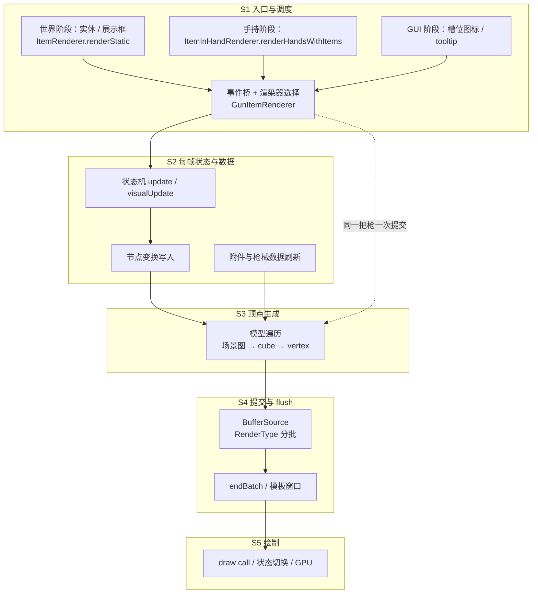

# 渲染链路分析总览

> 本文是「渲染链路分析」的入口。它回答一个问题：一帧之内，CGC 的渲染到底被调用了几次、每次花在哪一层、哪些开销随画面里的枪数线性增长。
>
> 现有 [渲染体系总览](../Home.md) 是业务视角（一套资源如何变成游戏里的枪），本系列是**技术链路 + 成本视角**，两者互补：业务视角讲「谁负责什么」，这里讲「时间花在哪里」。

## 分析目的与口径

本次分析的产出服务于 [PLAN](../PLAN.md) 的「渲染链路分析」阶段：定位性能开销、评估理想渲染方案的上限、界定重构范围。它不提出方案，方案写在 PLAN 的「渲染重构方案」一节。

口径：

- 场景与计时沿用 [基准测试报告](../benchmark/26.35.11.1/测试数据计算报告.md)：标准 4 步（空快捷栏 / 第一人称持枪 / 切换槽位 / 清空）与 multi（9 个展示框各一把枪 + 第一人称一把）。
- 帧预算按 165 Hz 计为 6.061 ms；裸 1000+ FPS 场景下判定为 CPU 瓶颈，GPU 未被充分利用。
- 源码分析以当前 1.20.1 工作区为主，26.2+ 延迟渲染的差异单独标注。**除 benchmark 归因出的数值外，本系列不写任何未经测量的数字**，一律标记「待测」或「推算」。

## 帧级链路总图

粗粒度约定：**一次「枪械提交」指渲染器把一杆枪（枪体、配件、瞄具、手臂、文字、特效作为整体）画进当前帧**。本系列不拆分枪体内部子项——对成本分析而言，子项只在「每个子模型各自 flush 一次」这类结构性事实上才有意义。

## 阶段划分

|阶段|做什么|每帧次数|归属文档|成本形态|
|---|---|---|---|---|
|S1 入口与调度|原版钩子 → CGC 事件 → 选定渲染器|每入口固定，与枪数无关|[入口与调度](./entry-and-dispatch.md)|每帧固定|
|S2 每帧状态与数据|状态机、附件数据、节点变换|每次提交一次|[每帧状态与数据](./state-and-data.md)|每枪 + 每帧|
|S3 顶点生成|场景图遍历、逐顶点变换|每次提交一次|[几何生成与提交](./geometry-and-submission.md)|每顶点|
|S4 提交与 flush|按 RenderType 分批、多次 flush|每次提交多次|[几何生成与提交](./geometry-and-submission.md)|每 flush|
|S5 绘制|draw call、模板、纹理、overdraw|每次 flush 一次|[几何生成与提交](./geometry-and-submission.md)|GPU|
|横切：场景与静态化|不同场景的提交次数与缓存|—|[场景差异与静态化](./scenes-and-static.md)|决定乘数|

## 成本模型

把一帧的 CGC 渲染时间拆成四类量纲，后续所有分析都往这四类里归位：

|量纲|含义|随什么增长|benchmark 中的表现|
|---|---|---|---|
|`C_fixed`|每帧固定入口开销|不随枪数|空快捷栏与 `/clear` 都是基线，说明不渲染枪时几乎为零|
|`C_gun`|单次枪械提交开销（S2–S4）|随「画面中的枪次数」线性|标准持枪 Δ +0.636 ms；multi 每把展示框枪 ≈ 0.54 ms|
|`C_flush`|一次 flush 的固定代价|随子模型数线性|待测|
|`C_vertex`|单顶点生成代价|随总顶点数线性|待测|

由 benchmark 可得的两个直接结论：

1. **`C_gun` 与场景无关**：第一人称单枪 0.636 ms 与展示框单枪 ~0.54 ms 同量级，说明成本由「一次提交」决定，而不是由「相机怎么摆」决定。
2. **`C_gun` 存在约一个数量级的压缩空间**：同样 9 个展示框，TaCZ 1.2.0 只增加 ≈0.039 ms/枪，而 CGC 约 0.54 ms/枪（详见 [场景差异与静态化](./scenes-and-static.md)）。这是「理想上限」最直接的参照。

## 基准数据锚点

|场景|帧率|帧时间|相对基线|推导|
|---|---:|---:|---:|---|
|cgc1 空快捷栏|1257.8|0.795 ms|—|基线|
|cgc1 第一人称持枪|699.0|1.431 ms|+0.636 ms|`C_gun`（第一人称）|
|cgc1 切换槽位|1192.7|0.838 ms|+0.043 ms|GUI 槽位图标很便宜|
|cgc1 `/clear`|1273.0|0.785 ms|≈0|不提交即无成本|
|cgc1 multi 持枪|159.4|6.273 ms|+4.84 ms vs 标准持枪|9 把展示框 ≈ 0.54 ms/把|
|cgc1 multi 清空|151.3|6.609 ms|—|清枪更慢：展示框占绝对主导|
|tacz1 multi 持枪|844.2|1.185 ms|+0.355 ms vs 其标准持枪|9 把 ≈ 0.039 ms/把（静态化）|

口径说明：multi 每组仅 1 次重复，且混入了 9 个石头方块与展示框实体本身的开销；因此上表的「每把」是从组间差值做的量级估算，不是精确单枪测量。

## 损耗点清单

编号用于各子文档与后续埋点对齐。量级一栏在没有日志前一律为「待测」；只有 benchmark 能直接支持的量级才写数值。

|编号|损耗点|位置|性质|证据|
|---|---|---|---|---|
|P1|入口事件桥与渲染器选择的固定开销|`FirstPersonRender` / `RenderHandEventManager`|每帧固定|待测|
|P2|第三人称下状态机每帧 `visualUpdate`，与渲染重复|`_LocalAnimHandler.onRenderFrame`|每枪 + 每帧|待测|
|P3|每次提交重读全部附件槽位（物品 / NBT / 资源索引）|`_GunModelRender` 刷新状态段|每枪 + 每帧|源码 TODO 已标注|
|P4|每个节点每帧重建变换快照，逐节点 apply / 还原|`ModelObject.render`|每枪 + 每节点|待测|
|P5|每帧分配（列表、节点快照、顶点临时对象）|`ModelObject` / `BedrockCubeBox`|每顶点 + 每节点|待测|
|P6|子模型各自 `endBatch`，打断全局合批|`ModelObject` / `TextRender` / `HandRender`|每 flush|待测|
|P7|批键是 `RenderType` 实例，而实例按纹理 memoize：不同配件纹理必然各占一次绘制|`RenderType` / `BufferSource`|每次提交|源码可证（`energySwirl` 例外，每帧新建）|
|P8|模板窗口内改用独立缓冲源，并每枪清一次模板缓冲|`ClientRenderHelper.GL` / `_GunModelRender`|每枪 + 每帧|待测（GPU 依赖强）|
|P9|delegate 渲染缓存矩阵后重建 PoseStack 再提交|`MuzzleFlashRender` / `TextRender` / `AttachmentRender`|每子模型|待测|
|P10|静态展示（展示框 / 地面）无任何结果复用|`GunItemRenderer.renderByItem`|每枪 + 每帧|benchmark 强证据|
|P11|LOD 只减少顶点，不减少提交与 flush|`ClientRenderDistance`|乘数|待测|
|P12|draw call 数与 overdraw|S5|GPU|推算，待测|
|P13|26.2+ 延迟渲染把 submit 与 flush 分离|26.3 工作区|结构性|源码可证|

## 测量与数据登记

具体耗时依赖埋点，统一用 `DebugKey`（F12，当前为空实现）作为开关，符合 PLAN 的约定。建议的测量顺序与字段：

|对象|埋点位置|需要回答的字段|填写|
|---|---|---|---|
|S1|事件处理器入口 / 渲染器入口|每帧调用次数、早退比例|待测|
|S2|状态机 `update`、附件刷新段|单次耗时、每帧次数|待测|
|S3|`ModelObject.render` 顶点循环|顶点数、单次耗时|待测|
|S4|每次 `endBatch` 前后|flush 次数、每次耗时|待测|
|S5|外部工具（Afterburner / GPU 计数器）|draw call、GPU 时间|待测|

数据登记要求：每项测量必须记录「场景 + 枪数 + 是否第一人称 + 是否开光影」，否则无法与 benchmark 对齐。填入后回填本页表格，并同步更新各子文档的「待测项」。

## 与重构计划的关系

本系列只陈述事实与量级，不给出方案。给方案阶段的输入是三条：

1. 主要成本是**每次提交**，不是每帧固定开销——因此优化必须落在 S2–S4。
2. 提交次数由场景决定（展示框 / 多人 / GUI 会成倍放大），因此「减少提交次数」与「降低单次成本」是两条独立的收益来源。
3. TaCZ 静态化把单枪成本压到约 1/13，说明单次成本的压缩上限远未触及。

## 文档导航

|文档|内容|
|---|---|
|[入口与调度](./entry-and-dispatch.md)|一帧里 CGC 被谁、在哪几个阶段、调用几次，以及派发前的判定链|
|[每帧状态与数据](./state-and-data.md)|状态机更新、附件数据刷新、节点变换与每帧分配|
|[几何生成与提交](./geometry-and-submission.md)|顶点生成、缓冲源选择、flush 点、RenderType、模板、draw call|
|[场景差异与静态化](./scenes-and-static.md)|各场景的成本乘数、multi 归因、静态化缺口、LOD 边界|
