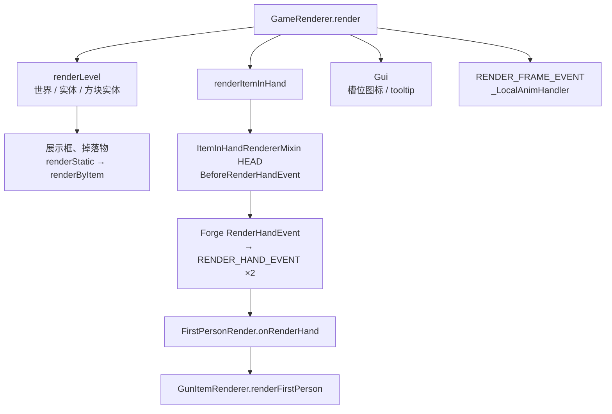

# 渲染链路：入口与调度

> 完整渲染链路的第一段。本文只回答一个问题：一帧里 CGC 被谁、以什么频率、在哪个渲染阶段叫起来，以及从被叫起到真正开始渲染枪械之前，已经花掉了什么。场景如何进入见 [渲染入口与场景](../rendering-entry-points.md)，进入之后的模块调用见 [主渲染链路](../render-pipeline.md)；本文不重复这两份文档的内容，只补它们的「次数」和「代价」。

## 帧内位置

1.20.1 一帧的顺序是固定的，CGC 的入口分布在其中三个互不相邻的阶段：

- 世界阶段：实体在 `LevelRenderer.renderLevel` 的实体循环里画进共享缓冲源（`LevelRenderer.java:1223`），实体渲染类型要等循环结束后才逐个 `endBatch`（`LevelRenderer.java:1283` 起）。
- 手部阶段：`GameRenderer.renderItemInHand` 在 `renderLevel` 返回之后单独调用 `renderHandsWithItems`，只有第一人称、非睡觉、GUI 可见、非旁观者时才发生（`GameRenderer.java:846-853`）。
- GUI 阶段：`Gui` 在整帧最后，槽位图标与 tooltip 都走各自的原版路径。

> 三个阶段各自持有缓冲源、深度状态和批处理窗口。CGC 在三个阶段都被调用，意味着同一份顶点生成代码要适配三种完全不同的提交环境——这是后续所有链路段落的共同前提。

## 入口清单

|入口|钩子位置|每帧次数|落到|
|---|---|---|---|
|`BeforeRenderHandEvent`|`ItemInHandRendererMixin` HEAD `renderHandsWithItems`（`ItemInHandRendererMixin.java:36`）|1|`GunCameraHelper.Addon`，手部摄像机动画|
|`RENDER_HAND_EVENT`|Forge `RenderHandEvent` → `RenderHandEventManager` 桥（`RenderHandEventManager.java:34-57`）|2（主手 / 副手）|`FirstPersonRender.onRenderHand`|
|`ItemInHandLayer` 头尾|`ItemInHandLayerMixin`（`ItemInHandLayerMixin.java:25,39,63`）|每个持有枪的玩家实体 1 次|`HumanoidOffhandRender`（`HumanoidOffhandRender.java:26`）、`isSelf` 标记|
|`renderByItem`|BEWLR，经 `ItemRenderer.renderStatic`|每个展示框 / 掉落物 / GUI 图标 1 次|`GunItemRenderer.renderByItem`|
|`RENDER_FRAME_EVENT`|`_LocalAnimHandler.onRenderFrame`（`_LocalAnimHandler.java:109`）|1（第一人称直接 return）|`visualUpdate`|
|`CLIENT_TICK_EVENT`|`_LocalAnimHandler.onClientTick`|20 次/秒|状态机 `trigger`|

Forge 的手部事件由 `ForgeHooksClient.renderSpecificFirstPersonHand` 在 `renderHandsWithItems` 内投递，返回值决定是否跳过原版 `renderArmWithItem`（`ItemInHandRenderer.java:316,323`）。也就是说：**主手事件必然先于原版手臂，副手事件也一定会派发**，CGC 没有「只有装了枪才收到事件」的入口过滤。

## 调度判定链

`FirstPersonRender.onRenderHand` 按固定顺序逐项判定，每一项都在渲染之前完成（`FirstPersonRender.java:65-135`）：

|判定|位置|代价类别|说明|
|---|---|---|---|
|Iris 半透明手部 pass|`IrisCompat.java:87`|常量|1.20.1 恒 `false`，26.2+ 才可能为真|
|副手是否动画物品|`FirstPersonRender.java:71-77`|O(1) 取物品 + 工厂查找|为真则直接 `setCanceled` 并返回|
|取动画物品接口|`FirstPersonRender.java:89`|O(1) 接口查找|物品层实现，无资源访问|
|取 BEWLR 渲染器|`FirstPersonRender.java:96`|O(1)，懒加载后常驻|首次可能触发 `ItemRenderer` 注册|
|状态机切换|`FirstPersonRender.java:100-107`|引用比较|切换时让旧状态机 `exit()`|
|后台物品保护 + `tryInit`|`FirstPersonRender.java:110-123`|含资源查询与声音|`switchItemNeedReset` 为假且 `needReInit` 为真才执行；初始化只在首帧 / 切枪时发生|
|`IrisCompat.endBatch`|`FirstPersonRender.java:126`|1.20.1 空调用|给光影兼容留的钩子|
|实际渲染|`FirstPersonRender.java:128`|见后续文档|本条链路的全部重活|

`needReInit` 内部每次都读一次 `System.currentTimeMillis()`，`needReInit` 与 `switchItemNeedReset` 本身都是常数级判断（`AnimateGeoItemRenderer.java:195-200`）；`tryInit` 会重建上下文、初始化状态机并触发 `INPUT_DRAW`，是这条链上唯一的重函数，但它被 `needReInit` 挡在切枪之外（`AnimateGeoItemRenderer.java:158-172`）。

## early-out 也要付的钱

即使最终什么都不画（副手、非枪械、Iris 半透明 pass），每次事件仍然会：

1. 构造一个 Forge 事件对象，再包装成 `ForgeRenderHandEvent` 并派发（`RenderHandEventManager.java:51`、`ForgeRenderHandEvent.java:24`）；
2. 走一次 CGC 事件分发到 `FirstPersonRender`（`ClientEventHandlers.java:33`）；
3. 读一次当前物品，做 1~2 次接口查找（`FirstPersonRender.java:72,89`）。

这些全部落在渲染线程的热路径上，量级应当是微秒级，`待测`；但它们决定了「空手」与「持非枪物品」时的固定底噪，也是重构后仍需保留的最小成本。

> 适配层的一个既有事实：`ForgeRenderHandEvent.getMultiBufferSource()` 返回 `null`，真正的缓冲源只从 `getMultiBufferSource_SubmitNodeCollector()` 取出（`ForgeRenderHandEvent.java:45-56`）。缓冲源选择属于 [几何生成与提交](./geometry-and-submission.md)。

## 取消原版的语义

`event.setCanceled(true)` 让 Forge 跳过原版 `renderArmWithItem`，因此原版的手臂摆动、装备抬起、物品切换动画都不参与（`ItemInHandRenderer.java:316`）。代价是原版那条「按物品透明度挑一遍渲染」的过滤也一并被绕过——1.20.1 手部只画一遍，没有影响；26.2+ Iris 把手部搬进 `LevelRenderer` 并跑两遍时，枪会在两遍里各画一次（`IrisCompat.java:69-90`），所以那里必须显式跳过半透明那一遍。

## 与实测的对应

|场景|帧时间|相对空手|说明|
|---|---|---|---|
|空快捷栏|0.795 ms|—|入口全部发生，但没有枪|
|第一人称持枪|1.431 ms|+0.636 ms|入口 + 全部渲染|
|切换到空槽位|0.838 ms|+0.043 ms|仅多画一个槽位图标|

数据取自 [基准测试报告](../benchmark/26.35.11.1/测试数据计算报告.md)。第一人称的 +0.636 ms 是「入口调度 + 状态更新 + 几何提交」的总和，本文只能确认入口自身占比很小（切换槽位只多 +0.043 ms，说明事件与调度不是主要开销），具体分摊见 [每帧状态与数据](./state-and-data.md) 与 [几何生成与提交](./geometry-and-submission.md)。

## 26.2+ 差异

> `[26.2, )` 手部渲染改为 submit 阶段提交（`SubmitNodeCollector`），事件仍在同一位置投递，但 CGC 拿到的是提交器而不是即时缓冲源；26.3 把 `ItemInHandRenderer` 拆成 `FirstPersonHandsAndItems`（持有的物品状态）与 `FirstPersonHandsAndItemsRenderer`（提交），钩子随之迁移到 `submitHandsWithItems`（`FirstPersonHandsAndItemsRendererMixin.java:19-25`，对应 26.3 源码）。入口次数不变，入口之后的提交模型不同。

## 本节待测项

|项目|埋点位置|期望量级|现状|
|---|---|---|---|
|入口事件与判定的固定开销|`FirstPersonRender.onRenderHand` 首尾|微秒级|待测|
|`tryInit` 单次代价|`AnimateGeoItemRenderer.tryInit`|毫秒级毛刺|待测|
|第三人称 `visualUpdate` 每帧代价|`_LocalAnimHandler._tickAnimRender`|未知|待测|
|展示框每帧进入 `renderByItem` 的次数|`GunItemRenderer.renderByItem` 计数|= 可见展示框数|待测（multi 场景可对照）|

埋点统一挂在 `DebugKey`（F12，当前为空实现，`DebugKey.java:37`）后面，遵循 [PLAN](../PLAN.md) 的「统一使用 DebugKey」约定。
