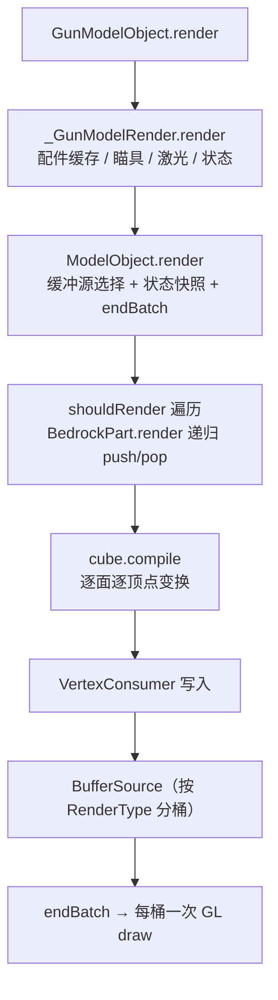

# 渲染链路：几何生成与提交

> 本文回答一个问题：一帧里，一杆枪的几何从场景图变成 GPU 绘制指令，中间做了多少工作、在哪些位置被打断成多少批。模块调用关系见 [主渲染链路](../render-pipeline.md)，节点与坐标见 [模型与几何系统](../model-and-geometry.md)；本文只关心成本结构与批处理边界。入口调度见 [渲染链路：入口与调度](./entry-and-dispatch.md)，每帧数据准备见 [渲染链路：状态与数据](./state-and-data.md)，场景密度见 [渲染链路：场景与静态化](./scenes-and-static.md)。

## 调用层次



整条链上没有「模型烘焙」这一步：每个立方体在每一帧、每一个出现位置都会重新走一遍 `D → E → F`。

## 顶点生成：每帧从零重建

`BedrockPart.render` 递归遍历场景图（`core/.../model/bedrock/BedrockPart.java:218-244`），每个节点 `pushPose / translate_rotate_scale / compile / popPose`，其中变换是 3 次平移 + 最多 4 次四元数旋转 + 1 次缩放（`BedrockPart.java:56-70`）。

立方体顶点变换在 `BedrockCubeBox.compile`（`core/.../model/bedrock/BedrockCubeBox.java:84-112`）与 `BedrockCubePerFace.compile`（同目录 `BedrockCubePerFace.java:81-109`，代码相同）：

- 每个面（polygon）新建一个 `Vector3f` 做法线矩阵乘法；
- 每个顶点新建一个 `Vector4f` 做位置矩阵乘法，再写进 `VertexConsumer`；
- 一个立方体 6 面 × 4 顶点 = **24 次顶点写入、6 + 24 = 30 个临时向量对象**。

于是单次提交的顶点工作量是 `24 × C`（C 为参与渲染的立方体数），分配量是 `30 × C`（JIT 逃逸分析可能消掉一部分，是否真的分配需 profiling，**待测**）。这个成本与帧率无关，只与「立方体数 × 每帧出现次数」成正比——这就是展示框里 9 把枪会成倍放大的原因（见 [场景与静态化](./scenes-and-static.md)）。

## 缓冲源与 flush

### 缓冲源的三条路径

`ClientRenderHelper.GL.getModelBufferSource()`（`core/.../util/ClientRenderHelper.java:270-330`）按优先级返回：

| 条件 | 返回 | 备注 |
|---|---|---|
| 模板窗口开启中 | 独立即时源 `stencilBufferSource`（固定 786432 字节） | 模板是裸 GL 状态，事件传入的源在光影下会延迟到 `HandRenderer#renderSolid` 结束才 flush，窗口已关闭 |
| 第一人称且事件给了 `MultiBufferSource` | 事件传入的源 | 光影下是 Iris/Oculus 的 `UnflushableWrapper`，由 Iris 代为 flush |
| 其他（第三人称 / 展示框 / 掉落物 / GUI） | `Minecraft.renderBuffers().bufferSource()` | 与同帧所有实体共用的全局源 |

`BufferSource` 以 **RenderType 实例**为键分桶（`MultiBufferSource.java:60-62`），`endBatch()` 逐桶各发一次 draw（`:76-89`）。因此「全局源」意味着 CGC 的 flush 会连带提交同帧其它实体已排队的几何。

### flush 点清单

| 位置 | 何时触发 | 作用域 |
|---|---|---|
| `ModelObject.render`（`core/.../model/ModelObject.java:234-236`） | 每个子模型主体绘制完 | 枪体、每个配件模型各一次 |
| `_AttachmentModelRender.renderModelPart`（`core/.../model/_AttachmentModelRender.java:244-245`） | 瞄具的每个部件 | 外环 / 镜身 / 目镜 / 划分各一次 |
| `TextRender`（`core/.../renderer/model/TextRender.java:92`） | 每个文字节点 | 独立 flush |
| `HandRender`（`core/.../renderer/model/HandRender.java:85`） | 左右手各一次 | 第一人称 |
| `FirstPersonRender`（`core/.../renderer/shooter/FirstPersonRender.java:125-126`） | 每帧进入枪械渲染前 | 冲掉上一帧遗留 |
| `ClientRenderHelper.disableItemEntityStencilTest`（`:76-84` → `:329`） | 模板窗口关闭 | 冲掉独立源里的枪口火焰等残留 |

### 一次提交的 flush 次数

```
flush ≈ 1（枪体）
      + A（非瞄具配件模型数）
      + S（瞄具内部部件数，S ≈ 2 + 3m，m 为目镜条目数；推算）
      + T（文字节点数）
      + H（手臂，第一人称 0~2）
      + 1（模板窗口关闭时的独立源）
```

`ModelObject.render` 会先 flush 主体、再执行 delegate（`:221-245`）。delegate 收到的 `VertexConsumer` 参数基本被忽略：配件、文字、枪口火焰都各自从 `ClientRenderHelper.GL.getModelBufferSource()` 重新取 buffer，因此它们写入的是「当前缓冲源里的下一批」，直到下一个 flush 点才提交。

结论：**flush 次数随子模型数量线性增长，而不是每帧固定几次**。每次 flush 都打断同帧其它实体的合批，且用全局源时会把整帧的实体几何一起提交掉。

## RenderType：纹理就是批键

1.20.1 的 `RenderType.entityCutout / entityTranslucent / entitySolid` 是**按纹理 memoize** 的工厂（`RenderType.java:39-50`，`entityCutout` 在 `:196-198`），所以同一纹理多次调用返回同一实例，不会每帧新建。

真正要注意的是它带来的批边界：

- 批键是 RenderType 实例，而实例按纹理区分 → **枪身、每个配件、每个槽位贴图各是一批，纹理不同就无法合并**，与帧号、与是不是同一把枪都无关；
- 9 个展示框里的同款枪共享同一实例，本来可以合并成一批，但 `ModelObject.render` 的 per-model `endBatch` 把它们逐把拆开（见 [场景与静态化](./scenes-and-static.md)）。

例外：`RenderType.energySwirl(ResourceLocation, float, float)` 没有 memoize（`RenderType.java:268-270`），参数含偏移量。`MuzzleFlashRender` 每帧用固定参数 `(1, 1)` 调它（`core/.../renderer/model/MuzzleFlashRender.java:166`），每帧都会产生**新的 RenderType 实例**，既是分配，也把加性混合那一层单独拆成一批。

## 模板测试窗口

瞄具的模板绘制（`core/.../model/_GunModelRender.java:148-185` 与 `_AttachmentModelRender.java:88-212`）在每枪每帧上额外增加：

1. `glClear(GL_STENCIL_BUFFER_BIT)` 清整张模板缓冲（`_GunModelRender.java:253-264`、`_AttachmentModelRender.java:489-492`）；
2. 逐条目写模板：每个目镜条目用 `Tesselator` 现场拼一个三角扇（1 个中心点 + 91 个圆周点）并**立即 `BufferUploader.drawWithShader`**（`_AttachmentModelRender.java:326-346`），不走进 BufferSource；
3. 每个部件前后切换 `stencilFunc` / `stencilOp` / `colorMask` / `depthMask`（`:254-282`、`:301-303`）；
4. 窗口内所有几何改用独立即时源，窗口关闭时再整批提交一次。

一次模板清空是整屏 tile 的写操作，在 TBDR 架构和部分驱动上代价远高于一次普通 draw；具体量级 **待测**。对本文更重要的一点是：模板把「一次提交」切成了多个窗口，窗口内外不能合批。

## delegate 渲染的额外成本

枪口火焰、抛壳、手臂、文字、非瞄具配件都走 `delegateRender`：遍历时缓存当前 `normal` / `pose` 矩阵（`Matrix3f` / `Matrix4f` 各 new 一份），delegate 阶段再 `new PoseStack()` 把自己的矩阵乘回去（`MuzzleFlashRender.java:121-131`、`TextRender.java:61-95`、`AttachmentRender.java:110` 起）。代价是每帧每渲染器 2 个矩阵对象 + 1 个 PoseStack + 1 次 `ModelObject.render` 级别的顶点生成，加上前文所说的额外 flush。

枪口火焰本身还是两遍绘制（半透明背景 + 加性发光，`MuzzleFlashRender.java:132-172`），两层各自一批。

## GPU 实际收到什么

按当前结构估算（C = 枪身立方体数，A = 配件数，典型 ak47 三配件，**全部为推算，待测**）：

| 场景 | 模型提交 | flush（含窗口关闭） | draw 估算 | 备注 |
|---|---|---|---|---|
| 第一人称裸枪 | 1 | 3~4 | 3~5 | 帧首 1 + 枪体 1 + 双手各 1 |
| 第一人称带瞄具 | 1 + 瞄具部件 | 8~15 | 10~20 | 每个目镜条目再加 1 次三角扇即时 draw |
| 第三人称 / 掉落物 | 1 + A | 2 + A | 2 + A | 无手臂 |
| 展示框（每把） | 1 + A | 2 + A | 2 + A | 与同款枪不合并 |

定性判断：

- 单体几何很小（一把枪的立方体数量级是几十到上百），顶点着色不是主成本；
- 成本主要是**提交次数 × 每次的状态切换与缓冲上传**，以及模板清屏；
- 枪模长而细，第一人称近景 overdraw 不可忽略，但只有在填充率受限时才会显现，需结合 GPU 计数器确认（**待测**）。

这与基准测试的观测一致：cgc1 空快捷栏 1257.8 FPS（0.795 ms），第一人称持枪 699.0 FPS（1.431 ms），差值 +0.636 ms/帧全部落在上述提交结构里（`../benchmark/26.35.11.1/测试数据计算报告.md`）。

## 26.2+ 延迟渲染的对应变化

26.3 分支上同一段链路的形态变了（对照 26.3 工作区 `core/.../model/ModelObject.java:184-250`）：

- `ModelObject.render` 改成 `collector.submitCustomGeometry(matrixStack, bakedRenderType, lambda)`，主体遍历与 delegate 都挪进 flush 阶段的 lambda 里；
- `endBatch` 消失（`FirstPersonRender.java:125-126` 直接注释掉），批处理边界改由提交顺序决定；
- `RenderType` 需要用 `ClientRenderHelper.bakePipelineState` 把模板与管线修饰器烘焙进去（`core/.../api/minecraft/pipeline/RenderTypePipelineBake.java:18-27`），模板随管线走而不是裸 GL 状态；
- 每帧分配没有消失：`parts` / `animatedTransforms` / `cleanedTransforms` 三个 `ArrayList` 与 `NodeTransform` 快照仍在每次提交里重建（`ModelObject.java:195-245`）。

延迟渲染只是把「何时写顶点」推后，并没有减少顶点生成量；它改变的是批处理与状态切换的组织方式。

## 待测项

| 项目 | 探针 | 期望量级 | 现状 |
|---|---|---|---|
| 单次提交顶点数与耗时 | `Geometry traverse` + 计数器 `Cubes submitted` | 立方体数 × 24 | 未测 |
| 每帧 flush 次数 | 计数器 `endBatch calls` | 见上式 | 未测，可由结构直接统计 |
| 模板清屏耗时 | `Stencil clear` + 计数器 `Stencil windows` | 单次数十微秒级？ | 未测，需 GPU 计时器 |
| 纹理批次数 / 帧（原 RenderType 实例数） | 计数器 `Geometry batches` | = 纹理批数 | 未测 |
| 顶点生成分配 | 计数器 `Nodes captured` / `Cubes submitted` | 30 × C / 提交 | 未测，需 profiler |
| 展示框每把枪成本 | `World-item submit` | 约 0.5 ms？ | 仅基准间接推算 |

埋点统一用 `DebugKey`（F12，目前空实现，`core/.../client/input/player/DebugKey.java:32-68`），日志口径见 [渲染链路总览](./Home.md#测量与数据登记)。
