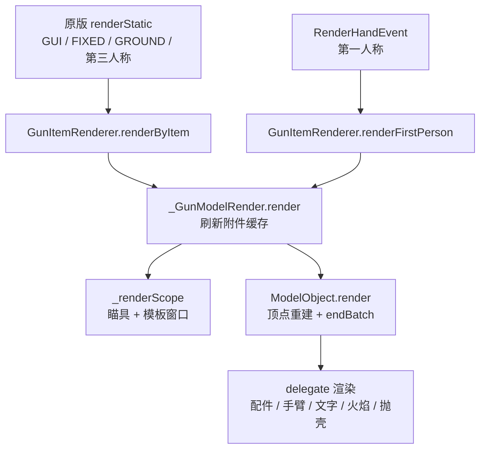

# 渲染链路：场景差异与静态化

> 同一个 `ModelObject.render` 被六种场景共用，但每帧要付出多少次提交、多少次 flush、有没有模板窗口，各场景并不相同。本文只回答两件事：**成本随场景如何变化**，以及**哪些场景本来可以静态化、却仍在每帧重建几何**。

## 同一内核，多条入口

场景入口本身的清单见 [渲染入口与场景](../rendering-entry-points.md)，这里只关心每条入口落到内核之后的行为差异。

## 场景对照

|场景|每帧 `ModelObject.render` 次数|渲染路径内状态机更新|模板窗口|delegate 渲染|结果复用|
|---|---|---|---|---|---|
|第一人称主手|1 + 配件数|是（渲染器内）|装瞄具时|手臂、文字、火焰、抛壳、配件|无|
|第三人称主手|1 + 配件数|否|装瞄具时|配件|无|
|物品展示框（FIXED）|1 + 配件数|否|装瞄具时|配件|无|
|地面物品（GROUND）|1 + 配件数|否|装瞄具时|配件|无|
|GUI 槽位图标|0（`SlotModel` 贴图）|否|否|否|直接贴图|
|Tooltip|0（同上，走 GUI 图标）|否|否|否|直接贴图|

表格依据：`GunItemRenderer.renderFirstPerson`（`renderFirstPerson` 内先 `stateMachine.update()`）、`GunItemRenderer.renderByItem`（除 GUI 分支外直接进模型渲染，**没有任何状态机更新**）、`_GunModelRender.render`（每个场景都刷新附件缓存并进入同一套主体渲染）。

两个直接推论：

- **只有第一人称会推进动画**。`_LocalAnimHandler` 的逐帧 `visualUpdate()` 只服务本地玩家，且第一人称时直接 return（`_LocalAnimHandler.java:115`），第三人称只更新状态与声音、不写模型。展示框里的枪因此长期处于「已清零的静态姿态」，但姿态静态不等于几何静态。
- **GUI / Tooltip 与 3D 场景不是一个量级**：前者只画一个 `SlotModel` 贴图（`GunItemRenderer.java:528`），后者每次都要走完整几何提交。

## benchmark 归因

原始数据与口径见 [benchmark 报告](../benchmark/26.35.11.1/测试数据计算报告.md)。以下换算均为 帧时间 = 1000 / FPS。

### 标准场景：第一人称单枪 ≈ +0.64 ms

|步骤|cgc1 FPS|帧时间|相对空快捷栏|
|---|---:|---:|---:|
|空快捷栏|1257.8|0.795 ms|—|
|第一人称持枪|699.0|1.431 ms|**+0.636 ms（−44.4%）**|
|切换到下一槽位|1192.7|0.838 ms|+0.043 ms|
|`/clear`|1273.0|0.786 ms|−0.010 ms|

- 持枪是唯一显著项：`1.431 − 0.795 = 0.636 ms/帧`。
- 切换槽位只多一个槽位图标：`0.838 − 0.795 ≈ 0.043 ms`，说明 GUI 贴图路径确实便宜。
- `/clear` 回到基线，说明不渲染枪时没有残留成本（无后台状态机空转）。

### multi：成本按「枪 × 提交」线性叠加

multi 场景为 9 个物品展示框各挂一把 ak47，再加第一人称一把：

|对比|FPS|帧时间|
|---|---:|---:|
|cgc1 multi 持枪|159.4|6.273 ms|
|cgc1 multi `/clear`|151.3|6.609 ms|
|cgc1 标准持枪（1 把第一人称）|699.0|1.431 ms|

- multi 里清掉手上的枪反而慢 0.34 ms，属于重复次数不足的噪声，但足以说明 **9 个展示框占绝对主导**，第一人称那把可以忽略。
- 以 `(6.273 − 1.431) / 9 ≈ 0.538 ms` 估算每把展示框枪的成本，与第一人称单枪的 0.636 ms 同量级。
- 结论：**成本是「每枪每次提交」的线性量，与视口位置、是否第一人称关系不大**。这是重构最重要的定量事实——优化必须作用在「每次提交」上，否则只会随枪数线性恶化。

### 与 TaCZ 1.2.0 的差值 = 静态化收益

同场景（9 个 ak47 展示框）、无光影：CGC 重构前取自 [`26.35.11.1-2`](../benchmark/26.35.11.1-2/测试数据计算报告.md)（6 次），TaCZ 取自 [`26.35.11.1-4`](../benchmark/26.35.11.1-4/测试数据计算报告.md)（4 次）。两端都没有各自的空展示框基线，统一用同场景的 0.866 ms 近似：

|端|multi 空手|9 把枪成本|每把|
|---|---:|---:|---:|
|CGC 重构前|5.449 ms|4.597 ms|**0.511 ms**（上界）|
|TaCZ 1.2.0（已静态化）|1.106 ms|0.240 ms|**0.027 ms**|

差约 **19 倍**。PLAN 已注明 TaCZ 1.2.0 相对 1.1.8 的唯一渲染改动就是「静态展示渲染优化」，因此这个差值基本可以全部归因于**静态展示复用**，而不是 TaCZ 整体更快。B1-a 之后 CGC 同一场景为 1.174 ms（0.034 ms/枪），差值降到 9 把合计 0.067 ms。

### 口径与不确定度

- 两端各 4 次重复、同一 4 步协议；`0.866 ms` 是 CGC 构建下的空展示框基线，用于 TaCZ 是跨端近似，TaCZ 的 `0.240 ms` 只作量级。
- multi 场景还多了 9 个石头方块与 9 个展示框实体本身，`0.511 ms/把` 是**上界**。
- 旧批次 `26.35.11.1` 的 TaCZ multi（n=1、步骤顺序相反、ak47 未拆枪托）已作废，不与本表混用。

## 展示框为什么每帧重建

`renderByItem` 的非 GUI 分支没有任何缓存：每次调用都重新解析物品、重算定位组变换、进入 `_GunModelRender.render` 刷新全部附件槽位，再逐节点重建顶点。具体地：

1. **状态确实不变**：展示框路径不调用 `stateMachine.update()`，`cleanAnimationTransform()` 之后各节点 offset/rotation 保持清零，所以同一把枪在展示框里的姿态每帧完全一致。
2. **几何仍然重建**：`ModelObject.render`（`ModelObject.java:184`）每帧都为所有节点做 `NodeTransform.capture`，然后遍历 `shouldRender` 重新发射全部顶点（`BedrockPart.render` → `BedrockCubeBox.compile`）。没有任何「相同物品 + 相同姿态」的顶点缓存。
3. **flush 次数与子模型数成正比**：`ModelObject.render` 结尾对本帧缓冲源调用 `endBatch()`（`ModelObject.java:234`），每个配件子模型再各调一次（`AttachmentRender` → `AttachmentModelObject.render`），第一人称还叠加文字（`TextRender.java:92`）、手臂（`HandRender.java:85`）与入口处的 `IrisCompat.endBatch`（`FirstPersonRender.java:126`）。
4. **模板窗口按枪开启**：装瞄具时 `_GunModelRender` 会启用模板测试并在结束时 `glClear(STENCIL_BUFFER_BIT)`（`_GunModelRender.java:138-144`），展示框里的枪同样触发。

也就是说，展示框的枪每帧都在做「一次完整的第一人称级提交」，只是少了动画与手臂。这与 benchmark 的 0.538 ms/把完全吻合。

> 26.2+：延迟渲染把「提交」与「flush」拆开，`ModelObject.render` 改为 `collector.submitCustomGeometry(...)`，回调在 flush 阶段执行（`26.3:ModelObject.java:203`），因此不再需要每个子模型 `endBatch`。但回调仍然每帧执行一次，**静态化不会自动获得**。

## LOD 的作用边界

`ClientRenderDistance.shouldRenderLod`（`ClientRenderDistance.java:13`）按当前 `PoseStack` 的平移量与 `RenderConfig.GUN_LOD_RENDER_DISTANCE` 比较：

- 只被第三人称 / 展示框 / 地面分支调用（`GunItemRenderer.java:431`、`AttachmentRender.java:78`、`AttachmentItemRenderer.java:66`）；
- **第一人称完全绕过 LOD**（`renderFirstPerson` 里没有这段判断）；
- 屏幕打开任一 GUI 时强制高模（`ClientRenderDistance.java:16`）。

因此 LOD 只减少**每次提交的顶点数**，不减少提交次数、flush 次数和模板窗口次数。multi 测试把低模距离设为 5、枪在 3 格内，9 把枪实际全部走高模。

## 第一人称的特有成本（对照）

第一人称在公共内核之外还叠加了这些项，细节见 [几何生成与提交](./geometry-and-submission.md) 与 [枪械附加变换模块](../gun-render-addons.md)：

- 模板窗口 + 逐帧 `glClear`；
- 手臂、文字、枪口火焰、抛壳四个 delegate 渲染器（展示框场景只有配件）；
- 枪口位置缓存（`cacheMuzzlePosition`，额外一段定位组路径遍历）；
- 每帧的摄像机动画 / FOV 事件（`GunCameraHelper`），与模型提交串行在同一条渲染线程上。

这些是「第一人称 0.636 ms > 展示框 0.538 ms」的差额来源，也说明第一人称的成本大头仍在公共提交路径，而不是这些附加值。

## 结论：两类优化空间

**(a) 降低单次提交成本**——顶点烘焙与复用、减少 per-vertex 分配、RenderType 复用、减少 flush 次数、模板窗口合并。证据强度：强（标准场景 0.636 ms、multi 0.538 ms/把均为单次提交成本）。

**(b) 减少提交次数**——静态展示缓存、可见性/距离剔除、按需刷新、脏标记。证据强度：强（重构前 CGC 单枪 0.511 ms 与 TaCZ 静态化后的 0.027 ms 相差约 19 倍，直接对应静态化；multi 的线性叠加说明当前没有任何次数削减）。

当前最大缺口是 **(b)**：CGC 在静态场景下没有任何复用，而 (a) 的收益上限被 (b) 缺失所放大——枪越多，重复劳动越多。同时 (b) 的收益不能覆盖第一人称场景（姿态每帧变化），所以两者都需要，但优先级不同。

## 待测项

|项目|探针|期望|现状|
|---|---|---|---|
|单把展示框枪的提交耗时|`World-item submit`|≈0.5 ms|待测|
|每帧 `endBatch` 次数|计数器 `endBatch calls`|1 + 配件数|可由代码推导|
|模板窗口开销|`Scope render` / `Stencil clear` / 计数器 `Stencil windows`|待测（驱动相关）|待测|
|顶点数与 cube 数|计数器 `Cubes submitted`|按枪型统计|待测|
|LOD 命中率|计数器 `LOD hits`|multi 内应为 0|可由配置推导|
|GUI 槽位图标耗时|`GUI slot icon`（切换槽位那一步）|≈0.04 ms|待测|

埋点统一走 `DebugKey`（F12），目前 `onDebugKeyInput` 为空实现。

## 26.2+ 的差异（仅与本段相关）

- 提交与 flush 分离：`submitCustomGeometry` 回调在 flush 期执行，每子模型 `endBatch` 的批处理破坏消失（`26.3:ModelObject.java:203`、`:231`）。
- 因为节点在 flush 前已被清空，26.2+ 每帧额外做 `NodeTransform.capture` × 2 组并回放（`26.3:ModelObject.java:186-215`），**分配反而比 1.20.1 更多**。
- 静态化在延迟渲染下依然可行（跳过回调或提交缓存几何），但需要自行实现；模板测试改由 `RenderPipeline` 携带，不再有逐枪 `glClear` 的固定成本。
