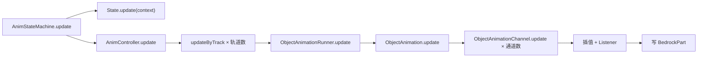

# 渲染链路：每帧状态与数据准备

> 这一环不产出任何像素，但决定了下一环要提交多少几何，也是目前唯一每帧重复读取物品数据的地方。本文只讨论成本结构，状态机语义见 [动画状态机与轨道](../animation-state-machine.md)，模块调用顺序见 [主渲染链路](../render-pipeline.md)。

## 这一环的边界

|阶段|触发者|每帧次数|输出|
|---|---|---|---|
|状态更新|第一人称渲染器 / 帧事件|主手那把枪 1 次（世界里的枪 0 次）|节点 offset / 旋转 / 缩放|
|数据准备|每次枪械提交|每个枪实例 1 次 × 配件类别数|`currentAttachmentItem` 等渲染缓存|
|功能性渲染器登记|节点遍历|每个功能性节点 1 次|delegate 列表|

## 谁在每帧更新状态

两条路径互斥，取决于视角：

- **第一人称**：`GunItemRenderer.renderFirstPerson` 在渲染前调用 `stateMachine.update()`，这是该视角下唯一一次状态更新（`core/src/main/java/dev/xcolorful/customgun/client/renderer/item/GunItemRenderer.java:232-237`）。
- **第三人称**：`_LocalAnimHandler.onRenderFrame` 在帧事件里调用 `renderer.visualUpdate()`（`core/src/main/java/dev/xcolorful/customgun/client/entity/shooter/player/_LocalAnimHandler.java:110-121, 159`），进入 `AnimateGeoItemRenderer.visualUpdate` → `AnimStateMachine.visualUpdate`。

两者的差别在于**写不写模型**：`update()` 会把关键帧写进节点，`visualUpdate()` 只推进动画进度和声音（`core/src/main/java/dev/xcolorful/customgun/client/animation/controller/AnimController.java:137-140`）。第三人称因此每帧仍要付一次状态计算，但这次计算不产生几何——世界里的枪使用节点上的当前值，而第一人称渲染结束会把节点清回基准姿态（`GunItemRenderer.java:304`），`renderByItem` 自己既不 update 也不 clean（`core/src/main/java/dev/xcolorful/customgun/client/renderer/item/AnimateGeoItemRenderer.java:303-329`）。

展示框、掉落物、GUI 里的枪连 `visualUpdate` 都没有：它们每帧直接复用节点的当前值。

## 状态更新链路与工作量

每帧工作量与「播放中的轨道数 × 动画里的通道数」成正比，**与模型节点数无关**：

- `ObjectAnimationRunner.update` 每帧取一次 `System.nanoTime()` 推进进度，再交给动画（`core/src/main/java/dev/xcolorful/customgun/client/animation/ObjectAnimationRunner.java:264-286`）。
- `ObjectAnimationChannel.update` 对每个通道做一次关键帧二分查找 + 插值，并分配一个 `float[3]` 结果数组（`core/src/main/java/dev/xcolorful/customgun/client/animation/ObjectAnimationChannel.java:77-100`，`.../interpolator/Linear.java:24-36`）。
- 监听器把结果写进节点；`ModelRotateListener` 在 blend 模式下还要把当前四元数转成欧拉角再相加，额外一次 `float[3]`（`.../listener/model/ModelRotateListener.java:20-31`）。

`updateSoundOnly()` 跳过插值与监听器，只推进进度并播放声音通道（`ObjectAnimationRunner.java:288-298`）——这是第三人称 `visualUpdate` 的成本下界。

## 每帧数据准备：配件缓存刷新

`_GunModelRender.render` 每次提交都重跑一遍「刷新状态」（`core/src/main/java/dev/xcolorful/customgun/client/model/_GunModelRender.java:61-104`）：

1. 清空并重建 `adapterToRender`；
2. 遍历全部 `AttachmentCategory`，对每类调用 `iGun.getAttachment()`，空则退回 `getBuiltinAttachment()`；
3. 对每个配件取 `IAttachmentGetter.fromItemStack` → `getAttachmentLocation` → `ClientResourceApi.getClientAttachmentIndexInstance`；
4. 读 `AttachmentData.getMagazineCategory()` 与 `AttachmentDisplay.getShowMount()`。

成本分两部分，性质完全不同：

- **资源查找是缓存的**：`getGunDisplayInstance` / `getClientAttachmentIndexInstance` 都是 `_AssetsInstanceManager` 里的 map 查询（`core/src/main/java/dev/xcolorful/customgun/client/api/resource/ClientResourceApi.java:166-179`）。
- **物品数据不是**：`getAttachment` 每帧用 `AttachmentBuilder` 新建一个 `ItemStack` 并写 NBT（`core/src/main/java/dev/xcolorful/customgun/core/api/item/gun/GunDataAccessor.java:501-516`，`.../builder/AttachmentBuilder.java:18-28`）；取 `AttachmentLocation` 本身也是一次 NBT 读。

源码已标注这是待处理项（`_GunModelRender.java:49-51`：每帧读 NBT，1.21.1+ 读操作还有额外 copy 开销）。26.3 的同名方法保持相同结构，说明这是跨版本一致的设计问题，不是移植瑕疵。

## 每帧分配清单

|位置|分配|规模|
|---|---|---|
|`ModelObject.render`|`ArrayList` ×2（`parts`、`cleanedTransforms`）+ 每节点一个 `NodeTransform` 记录 ×2（`core/src/main/java/dev/xcolorful/customgun/client/model/ModelObject.java:195-219`）|O(节点数)|
|`ModelObject.render`|渲染结束把 `delegateRenderers` 换成新 `ArrayList`（`ModelObject.java:245`）|每实例每帧 1|
|`AttachmentRender` / `HandRender` / `TextRender` / `MuzzleFlashRender` / `ShellRender`|每个功能性节点 `new Matrix3f` + `new Matrix4f` + delegate 闭包 + `new PoseStack`（`.../renderer/model/AttachmentRender.java:106-111` 等）|O(功能节点数)|
|`ObjectAnimationChannel`|每通道每帧 `float[3]`|O(通道数)|
|`_GunModelRender` 刷新|每类别一个 `ItemStack`|O(类别数)|

`NodeTransform` 是 `26.2` 引入的记录类型（`core/.../model/bedrock/NodeTransform.java`），在 1.20.1 上同样被构建——延迟渲染所需的节点快照成本被提前支付了。

## 功能性渲染器：登记而非绘制

功能性节点的 `render` 每帧调用一次绑定的函数，用返回值决定「替换渲染」还是「走默认几何」（`core/src/main/java/dev/xcolorful/customgun/client/model/bedrock/FunctionalBedrockPart.java:64-95`）。需要独立姿态栈的渲染器不在此时画，而是 `delegateRender` 登记，等模型主体提交完再执行（`ModelObject.java:163-165, 238-245`）。

因此每个功能节点每帧的成本是：一次 lambda 调用 + 闭包分配 + 矩阵拷贝，实际绘制被推迟到同一帧的稍后。

## 数据来源与缓存边界

|数据|来源|更新时机|每帧重算|
|---|---|---|---|
|模型几何、`shouldRender` 列表|资源加载|加载时|否|
|动画关键帧与通道|资源加载|加载时|否|
|节点变换|状态机|每帧（仅第一人称）|是|
|配件 `ItemStack`|枪械 NBT|每次提交|是|
|`GunDisplayInstance` 等 Instance|资源索引|加载/重载|否（map）|
|摄像机 / 后坐力数据|渲染事件|每帧|是|

## 量级与待测

基准锚点：同一场景下空手 1257.8 FPS（0.795 ms/帧）、第一人称持枪 699.0 FPS（1.431 ms/帧），净增 **0.636 ms/帧**。这一数值包含本节全部工作与 [几何生成与提交](./geometry-and-submission.md) 的成本，二者目前无法从外部测量中分离，必须在代码里埋点。

|埋点|位置|关注量|现状|
|---|---|---|---|
|状态更新|`AnimStateMachine.update()` 外层|ms/帧、活跃轨道数|待测|
|配件刷新|`_GunModelRender.render` 刷新段|ms/次、类别数|待测|
|功能节点登记|`FunctionalBedrockPart.render`|ms/次、节点数|待测|
|分配计数|`ModelObject.render`|每次提交的对象数|待测|

埋点开关沿用 `DebugKey`（F12，目前 `onDebugKeyInput` 为空实现，见 `core/src/main/java/dev/xcolorful/customgun/client/input/player/DebugKey.java:60-68`）。

> **26.2+**：延迟渲染下 `SubmitNodeCollector` 在 flush 阶段已被清空，所以节点快照必须在 submit 阶段捕获（26.3 的 `ModelObject.render` 把 capture/apply 移进了 `submitCustomGeometry` 的回调），但每帧仍捕获两次。本节描述的成本结构在 26.3 上不减少，只是执行时机前移。
