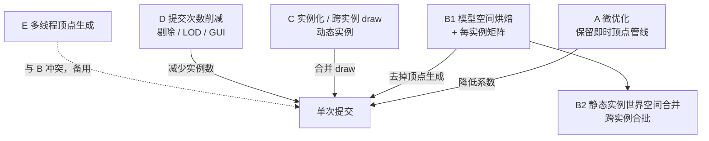

# 渲染重构方案

> 本文把 [渲染链路分析](../chain/Home.md) 的事实转成可执行的方案：重构要打掉哪些成本、有几条互斥或可叠加的路线、各自的收益上限与风险，以及推荐的实施顺序。
>
> 上游约定见 [PLAN](../PLAN.md)。本目录只写方案与取舍，成本事实与量级仍以 `chain/` 为准；两者冲突时以实测日志更新 `chain/`，再回改本文。

## 目标与成功判据

### 上限与下限

|量|值|说明|
|---|---:|---|
|优化上限（标准场景空手）|0.795–0.80 ms/帧（≈1250–1300 FPS），本批含探针 0.862 ms|[第二批报告](../benchmark/26.35.11.1-2/测试数据计算报告.md)；画枪不可再低于「空手 + 少量 draw」|
|multi 场景基线|1.20.1 **0.852 ms** / 26.3 **1.109 ms**|9 个石头 + 9 个空展示框、无手持枪；实测见 [`multi-baseline/`](../benchmark/26.35.11.1-2/multi-baseline/标准.txt)，只比空快捷栏高约 0.05 ms|
|当前下限（CGC 成本）|multi 4.146 ms / 第一人称 0.507 ms|1.20.1，6 次重复均值|
|单次提交成本|0.461 ms（展示框）/ 0.507 ms（第一人称）|两者同量级，成本由提交次数决定|

### 场景目标（推算，验收时以实测修正）

|场景|当前帧时间|目标帧时间|目标 CGC 成本|压缩比|
|---|---:|---:|---:|---:|
|multi：9 个满配展示框|14.72 ms|≤1.6 ms|≤0.35 ms|CGC −97%|
|multi：9 个裸配展示框|5.45 ms|≤1.2 ms|≤0.30 ms|CGC −93%|
|第一人称满配|3.02 ms|≤1.6 ms|≤0.65 ms|帧 −47% / CGC −67%|
|第一人称裸配|1.77 ms|≤1.2 ms|≤0.30 ms|帧 −32% / CGC −63%|
|切换槽位 / GUI|0.90 ms|不回归|—|—|

目标在 `26.35.11.1-3`（满配批次）之后重算。原表的「multi ≤1.0 ms」建立在裸枪 multi（每枪 2 次 draw）之上；满配把每枪 draw 数抬到 9 次（81 次/帧），仅 draw 一项就是 0.72 ms，因此 multi 的目标改为 **≤1.6 ms**，并把「≤1.0 ms」降级为 B2 合并之后的冲刺目标。

第一人称目标更保守：即使遍历与上传全部消失，仍有 delegate（文字 / 手臂 / 枪口火焰 / 抛壳）、状态更新与约 19 次 draw 残留。

> 数据取自 [第二、三批报告](../benchmark/26.35.11.1-2/测试数据计算报告.md)与 [`26.35.11.1-3`](../benchmark/26.35.11.1-3/测试数据计算报告.md)；两批都含约 0.05 ms/帧的探针开销，所以「当前帧时间」比无探针构建略高。

目标不是「必须一次达到」，而是**每次提交只付 draw 与少量状态切换**这一终点的量化表达；分阶段推进时每阶段都要向这个表靠近，而不是只换一个更快的系数。

### 成功判据的写法

- 以场景帧时间与 CGC 探针值为准，不以「代码看起来更快」为准。
- 每个阶段必须能单独提交并人工验收渲染结果（[PLAN](../PLAN.md) 的 Commit 约定）。
- 任何「缓存」都要能说明失效条件；说不清失效条件的缓存不算完成。

## 成本事实摘要

第一人称一次提交 0.5070 ms 的构成（1.20.1，[第二批报告第 2 节](../benchmark/26.35.11.1-2/测试数据计算报告.md)）：

|项|耗时|占 CGC|性质|
|---|---:|---:|---|
|几何遍历（顶点生成）|0.2890 ms|57.0%|每顶点 × 每枪 × 每帧|
|`endBatch` flush（显式）|0.1063 ms|21.0%|每 flush × 每枪 × 每帧|
|delegate（配件 / 手臂 / 文字 / 火焰）|0.0790 ms|15.6%|每子模型|
|状态更新|0.0278 ms|5.5%|每帧，仅第一人称|
|节点快照|0.0102 ms|2.0%|每节点|
|功能节点|0.0067 ms|1.3%|每功能节点|
|模板清空|0.0050 ms|1.0%|每枪|
|数据刷新|0.0030 ms|0.6%|每类别|

探针之间存在嵌套（delegate 内部还有配件模型的遍历与 flush），百分比不可相加。

第二批新增量纲（整帧统计，CGC 归因 = 有枪 − 无枪）：

|项|第一人称持枪|multi 9 展示框|
|---|---:|---:|
|CGC 上传|0.077 ms|0.535 ms|
|CGC draw|0.037 ms|0.181 ms|
|CGC draw 数|4|约 18|
|单次 draw|9.3 µs|10.1 µs|
|上传字节|389 KB|3.49 MB（388 KB/枪）|
|渲染线程分配|181 KB|906 KB（101 KB/枪）|
|`State changes`/帧|0.98|**0.00**|
|`Animation channels`/帧|12|0|

五条结构性结论（推导见 [CPU/GPU 与上限](../chain/cpu-gpu-headroom.md)）：

1. **大头是「每帧重新生成全部顶点」**，占 CGC 的 57%（标准）到 77%（multi）；它随「顶点数 × 提交次数」增长，与场景、相机无关。
2. **flush 的主体是上传**：multi 里上传 0.535 ms、draw 0.181 ms，分别约占显式 flush 的 2/3 与 1/4；单次 draw 稳定在约 10 µs。持久 VBO 能去掉上传，但去不掉 draw。
3. **状态、数据与分配都不是大头**：状态 + 快照 + 数据合计不到 8%；每枪分配仅约 0.10 MB，逃逸分析已经生效。以「减少分配 / 少读 NBT」为主的微优化拿不到多少收益。
4. **静态展示的几何确实每帧相同**：`State changes` 为 0，烘焙缓存的前提成立；第一人称每帧 1–2 次变化、12 条活跃通道，适合「root 矩阵 + 脏子树」。
5. **模板清空在 multi 下合计 0.039 ms/帧**：当前只占 0.7%，但烘焙之后它会成为剩余成本里显眼的一项，应改为每帧最多清一次。

### 满配批次（`26.35.11.1-3`）

上面五条基于裸枪（`tacz:ak47`，每枪 2 次 draw）。满配（`tacz:m4a1` + 枪口 / 激光 / 握把 / 组合瞄具 / 枪托）的数据改变了三条量级，且新增一条结构性事实：

|项|裸配|满配|倍数|
|---|---:|---:|---:|
|第一人称 CGC|0.810 ms|1.951 ms|2.4×|
|第一人称立方体|750|1 735|2.3×|
|multi 每枪 cubes|445（ak47）|1 428|3.2×|
|**multi 每枪 draw 数**|**约 2**|**9**|**4.5×**|
|multi 每枪 CGC|0.461 ms|1.434 ms|3.1×|
|multi 每枪上传|388 KB|1.24 MB|3.2×|
|单次 draw|10.1 µs|8.8 µs|—|

6. **附件不引入新的成本形态，它按顶点等比放大。** 满配增量 1.14 ms 与 `+985 cubes × 1.1 µs` 吻合。烘焙按网格做，附件会自动覆盖，不需要单独的「附件优化」。
7. **瞄具模板是满配的最大单块**：第一人称 0.7185 ms（占满配 CGC 36.8%）、multi 0.488 ms/枪（占 34%）。`_renderScope` 是**并列于枪体遍历**的一次独立渲染（第一人称含 5 次模板 pass），不是嵌套在遍历里；因此它必须作为独立的「一组 draw」进入烘焙与合并预算。
8. **每枪 draw 数决定烘焙后的地板**：multi 81 次 CGC draw × 8.8 µs ≈ **0.72 ms**。B1 去掉遍历与上传后，multi 仍停在约 0.85–0.95 ms CGC；**B2 的跨实例合批是 multi 达标的必要条件，而不是加分项**。B2 的下限由「全场景不同 `RenderType` 的数量」决定，该数量尚未测量（见测量与验收）。

跨版本对照的口径也同步修正：同一满配场景 26.3 帧时间 10.57 ms、1.20.1 14.72 ms（1.39×），但 26.3 的 CGC 探针只解释了 54% 的枪械增量，**4.38 ms 落在 render pass 里**。延迟渲染没有让几何变便宜，只是换了归属；跨版本只能比帧时间。

## 方案分层



按「是否解决大头」「是否改变成本量纲」两个轴归类，得到下面这条主分界：

- **A 是系数优化**：成本仍是 `顶点数 × 提交次数`，只是系数变小。
- **B / C 是新成本模型**：成本变成 `draw 次数 × 单 draw 代价 + 少量脏节点顶点`，与顶点总量解耦。
- **D 改的是乘数**：不改变单次成本，只减少「有多少把枪要提交」。
- **E 改的是并行度**：单次成本总量不变，靠多核摊薄；它只在仍有大量顶点生成时有意义。

## 评估矩阵

|方案|能否解决当前大头|成本模型|1.20.1 可行性|26.2+ 可行性|主要风险|预期量级（推算）|
|---|---|---|---|---|---|---|
|**A 微优化**|否（实测可回收项合计 <5%）|不变：`Σ(顶点 × 提交)`|高|高|收益封顶，之后仍随枪数线性|满配 1.951 → 约 1.85 ms/枪（合并重复 flush、去掉双重快照、模板一清）|
|**B1 模型空间烘焙 + 每实例矩阵**|是（去掉遍历与全部上传）|新：`Σ(draw × 次数)`|条件可行（原版 API 齐全）|有条件可行（需自定义 FeatureRenderer）|光影接管下的自绘；失效条件|满配 ≈0.09 ms/枪（9 draw 0.079 + 少量状态）；multi CGC ≈0.85–0.95 ms|
|**B2 静态实例世界空间合并**|是（把「每枪的 draw」压成「每 RenderType 一次 draw」）|新：`Σ(纹理批次)`，与枪数无关|条件可行|有条件可行|展示框 / 掉落物状态变化与失效；瞄具模板 pass 无法并入普通批次|9 把满配 ≈0.10–0.15 ms 总量（下限由全场景 RenderType 数量决定，待测）|
|**C 实例化 / 跨实例 draw**|是（动态实例也合并 draw）|新：`Σ(不同网格 × 纹理)`|有条件|待验证|需自定义顶点属性 / 着色器，光影兼容风险高|与 B2 同量级，但覆盖动态场景|
|**D 剔除 / LOD / GUI**|否（只减乘数）|不变|高|高|multi 里 9 把全部可见；原版已做视锥与 64×包围盒距离剔除|最多把 multi 压到 3.1 ms，第一人称无收益|
|**E 多线程顶点生成**|部分（理论 ÷ 核数）|不变，只改并行度|中|低（flush 在渲染线程串行）|缓冲非线程安全、同步开销、与 B 冲突|遍历 0.289 → 0.1–0.2 ms（理想）|

「条件可行」指需要先解决光影与缓冲源约束，细节见各方案文档。矩阵中的量级全部是推算，验收前以 `DebugKey` 日志回填。

## 推荐路线（已定）

**分阶段推进，每一阶段都要能独立验收，并且下一阶段不推翻上一阶段的正确性。**

测量已足够确定路线，不再需要新的游戏内采集批次。路线为 **B1 → B2**，且两段都是必需：

1. **阶段 1：B1-a 静态烘焙**
   把「姿态不变」的几何烘焙成模型空间网格，按实例矩阵绘制。覆盖展示框 / 地面 / 第三人称（`State changes = 0`），含瞄具模板的那组 pass（瞄具按「模板窗口 + 独立网格」处理，不并入枪体批次）。
   顺手完成原 A 的其余项（合并同纹理 flush、去掉 1.20.1 双重节点快照、模板每帧一清）——合计不到 5%，不单独立阶段。
2. **阶段 2：B1-b 第一人称**
   root 变换提升为绘制矩阵 + 脏子树重写；瞄具模板改为从烘焙网格重放。
3. **阶段 3：B2 跨实例合并（multi 达标的必要条件）**
   把静态实例按「`RenderType` 批次」合并到世界空间缓冲，把 81 次 draw 压到「全场景不同 RenderType 数」。
   **顺序不能颠倒**：B1 之后 multi 仍停在约 0.85–0.95 ms CGC（draw 地板），只有 B2 才能把它压到 0.3 ms 以下。
4. **阶段 4：按需 C**
   只有在动态实例（多人第三人称、掉落物）仍占大头时才引入实例化；否则不做。
5. **E 暂不实施**：其收益会被 B 覆盖，且在 26.2+ 的 flush 阶段无法并行。

## 分阶段预期效果

以下全部是**从实测项直接推算**：被消掉的项取 `26.35.11.1-3` 的实测值，残留项按 `C_draw ≈ 9 µs`、`C_vertex ≈ 1.05 µs/cube` 计。框架时间 = 场景基线 + CGC + 探针外未归因项（1.20.1 multi 实测 0.97 ms，原样保留）。**「实测」列是当前值；其余列是预期，验收时回填。**

### 1.20.1 · multi 9 个满配展示框

|项|实测|B1-a 后（已回填）|B2 后|
|---|---:|---:|---:|
|几何遍历 6.30|6.30|≈0（烘焙，只剩状态段）|同左|
|瞄具模板 4.39（含其内部 flush）|4.39|**0.349**（每枪 0.039）|0.349（模板 pass 无法并入普通批次）|
|模型 flush 2.91（上传 1.97 + draw 0.71）|2.91|**0.629**（81 次 draw × 7.8 µs，上传≈0）|≈0.05（6 次）|
|节点快照 0.135|0.135|≈0|≈0|
|功能节点 / 数据刷新 0.135|0.135|≈0.08|≈0.08|
|模板清空 0.059|0.059|0.033（仍是每枪一次）|0.033|
|**CGC**|**12.90**|**1.199**|**≈0.55–0.65**|
|**帧时间**|**14.72**|**2.15**|**≈1.55–1.65**|

数据来自 [`b1-a-5`](../benchmark/26.35.11.1-4/b1-a-5/测试数据计算报告.md)（n=4）。B1-a 后与预估的差别只有一项：瞄具模板 0.05 → **0.349**，静态展示里的模板 pass 没有被烘焙消掉。那 0.97 ms「未归因项」也同期测得为 **0.947 ms**（帧时间 − CGC），与空展示框场景基线 0.866 ms 同量级，即它是场景基线而不是 CGC 的 GPU 成本。

B2 之后剩下的是一套与枪数无关的成本：模板 pass 0.349（每枪一个窗口）、数据/功能节点 0.08、模板清空 0.033、6 次 draw。帧时间的残余是场景基线（约 0.95 ms），B2 消不掉。

### 1.20.1 · 第一人称

|项|裸配 实测|裸配 B1-b|满配 实测|满配 B1-b|
|---|---:|---:|---:|---:|
|几何遍历|0.526|≈0.05–0.15（仅脏子树）|0.798|≈0.1–0.2|
|瞄具模板|0.000|0.000|0.719|≈0.06（重放）|
|模型 flush|0.151|≈0.05|0.423|≈0.25（19 draw）|
|delegate（文字/手臂/火焰/抛壳）|0.088|0.088|0.438|≈0.10（附件模型并入烘焙）|
|状态 / 数据 / 快照|0.051|0.051|0.079|0.079|
|**CGC**|**0.810**|**≈0.25–0.35**|**1.951**|**≈0.45–0.60**|
|**帧时间**|**1.77**|**≈1.15–1.25**|**3.02**|**≈1.45–1.65**|

### 结论

- **multi 的 draw 仍是最大单项**：B1 之后 81 次 draw 占 CGC 的 52%（0.629 / 1.199）；B2 把「每枪 9 次」变成「全场景 **6** 次」（实测 `Distinct RenderTypes = 6`）。
- **第一人称的主要残留是 draw + delegate**，不是遍历；裸配与满配的差别几乎全部来自附件顶点与瞄具模板，烘焙后按比例一起消失。空闲时脏节点只占 **0.06%–0.27%**（`b1-a-5`），脏子树重写能消掉几乎全部遍历；开火/换弹状态的脏比例尚未测。
- 「multi ≤1.0 ms」不可达：B2 之后的地板 ≈1.56 ms 里约有 0.95 ms 是场景基线（空展示框），与枪无关。目标维持 ≤1.6 ms，冲刺目标改为 ≤1.4 ms。

## 新成本模型

重构后不能再沿用 [链路分析](../chain/Home.md) 的 `C_gun` / `C_vertex` / `C_flush` 三量纲，因为顶点数不再是主变量。新模型：

```
帧内 CGC 成本 ≈ Σ_draw (C_draw + C_state) + C_upload × 新增字节 + Σ_dynamic C_vertex × 动态顶点
```

|量纲|含义|随什么增长|对应探针（需新增 / 拆分）|
|---|---|---|---|
|`C_draw`|一次 draw 的驱动开销|draw 次数|`endBatch flush` 拆分后的 draw 段|
|`C_state`|一次状态切换（着色器 / 纹理 / 模板）|draw 次数|同上|
|`C_upload`|单位字节上传|新增 / 重建的网格字节|新增「上传字节」计数器|
|`C_vertex`|动态顶点生成|动画改变的节点子树|`Geometry traverse`（只统计动态部分）|
|`C_bake`|烘焙一次的成本|资源 / 配件 / 姿态状态变化|新增「烘焙次数 / 耗时」探针|

这套模型的直接推论：

- `Cubes submitted` 与 `Geometry traverse` 不再是主要指标；**draw 数**与**烘焙重建次数**才是。
- 「减少顶点数」（LOD）在新模型下几乎没有意义；「减少纹理所对应的 draw」才有意义。
- 评估新特效 / 新配件时，要看它是否引入了新的纹理批次或新的重建条件。
- **瞄具模板是一组固定的 draw 序列**（每把带瞄具的枪 1 次模板窗口；第一人称 5 次 pass），计入 draw 预算但不参与普通批次合并。它的失效条件与枪体网格相同（配件集合 / 显示上下文），窗口内容取决于瞄具资源。

## 测量与验收

沿用 `DebugKey`（F12）与 `customgun-render-profile.txt`。需要新增 / 拆分的项目：

|项目|手段|判定|
|---|---|---|
|`endBatch` 拆成上传 / draw|`BufferUploaderMixin` + `endBatch upload` / `endBatch draw` 探针（1.20.1）|draw 段是否已接近 10 µs|
|draw 数 / 上传字节|`Draw calls` / `Upload bytes` 计数器（1.20.1）|合并后是否降到「纹理数」量级|
|**全场景不同 `RenderType` 数**|新增计数器：每帧按 `bufferSource.getBuffer` 的批次键去重计数（B1 实现时一起加）|**B2 的 draw 下限**；实测当前每枪 9 次 draw、8 次 endBatch，去重后是多少未知|
|**CGC 绘制区间的 GPU 时间**|`CGC GPU busy`：与整帧查询共用的分段 `GL_TIME_ELAPSED`（每 4 帧采样）|1.20.1 multi 的 0.97 ms、26.3 的 4.38 ms 未归因项是否在 GPU 侧；开光影时该段不可信|
|**按节点的脏计数**|`Distinct nodes` / `Dirty nodes` 与 `Dirty node share`（按帧去重，只在即时管线统计）|脏子树占总节点的比例 → 决定 B1-b 的遍历残留|
|GPU 余量|整帧 `GPU frame busy`（实测恒为帧时间 99%+，是命令跨度不是利用率）|不能据此判定；需 per-pass 计时或驱动计数器|
|烘焙命中 / 重建|计数器 + 原因枚举（B 阶段实现）|静态场景是否每帧 0 次重建|
|分配字节|`Allocated bytes`（渲染线程 `ThreadMXBean`）|每帧分配是否降到 O(动态顶点)|
|动画覆盖|`Animation channels` 计数器|第一人称每帧活跃通道数|
|状态变化|`State changes` 计数器（节点状态指纹）|静态场景首帧后应为 0；第一人称每帧 >0|

光影下 `endBatch` 是入队语义，包在 CGC 提交外的 GPU 查询接近 0，**只有整帧查询可信**；26.3 的提交与绘制分离，需要按 render pass 计时。详见 [CPU/GPU 与上限](../chain/cpu-gpu-headroom.md#测量缺口)。

验收以场景帧时间 + CGC 探针为准；每个阶段结束都要在同一批次里重跑标准 4 步与 multi，并记录「场景 + 枪数 + 是否第一人称 + 是否开光影」。

## 风险登记

|风险|影响|缓解|
|---|---|---|
|Iris / Oculus 接管 RenderType 与缓冲源|自绘可能不进入光影的阴影 / 材质 pass，或画进错误的 pass|**双路径**：无光影走持久 VBO，有光影退回 `putBulkData`（仍走 `BufferSource`）；先做无光影路径并实机 A/B|
|26.2+ 延迟渲染的提交模型不同|B 的提交方式不能照搬|以 26.3 为第二实现，先确认「能否提交预构建网格」|
|静态缓存失效遗漏|展示框 / 掉落物停在旧姿态或旧配件|失效条件按「配件集合 + 可见节点 + 纹理 + 姿态指纹」定义；提供强制重建开关|
|共享实例（同一枪多个展示框）|按实例缓存会放大内存|缓存键放在「资源实例 + 配件集合 + 姿态指纹」，世界矩阵不参与|
|模板测试|烘焙后模板窗口与 draw 的先后关系改变|模板仍按「窗口内单独绘制」处理，不参与合批|
|瞄具模板的 5 次 pass 阻塞合批|B2 之后瞄具成为剩余 draw 的主要来源|按「先写所有枪的模板，再画枪体」排序；瞄具从烘焙网格重放，不回到即时管线|
|跨版本统一|1.20.1 与 26.3 的绘制抽象不同|先各自实现，再抽公共的「烘焙 / 提交」接口|

## 文档导航

|文档|内容|
|---|---|
|[A 微优化](./scheme-a-micro.md)|保留即时管线时能拿到的收益、清单与封顶|
|[B 几何烘焙](./scheme-b-baked-mesh.md)|模型空间烘焙、静态子树、世界空间合并、失效条件|
|[C draw 合并与实例化](./scheme-c-draw-batching.md)|跨实例合并 draw 的两种做法与光影风险|
|[D 剔除、LOD 与并行](./scheme-d-culling-lod-parallel.md)|提交次数削减、LOD 的边界、多线程方案与否决理由|
|[外部参照：TaCZ 1.2.0 差异](./reference-tacz-1.2.0.md)|参照实现做了哪些静态化改动、哪些差异需要在各阶段用 benchmark 与光影实测验证（**不是方案**）|
|[B1-a 实施记录](./b1a-static-bake.md)|静态烘焙已落地的覆盖范围、缓存键与失效条件、退回即时管线的情况、验收清单与未完成项|
|[CPU/GPU 与上限](../chain/cpu-gpu-headroom.md)|瓶颈判定、draw 成本反推、测量缺口|
