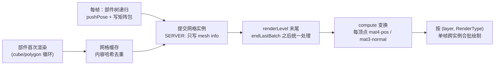

# 外部参照：Accelerated Rendering 1.0.16（1.20.1）

> **定位**：本文只登记 AR 的机制、它与 CGC 重构方案的重合度，以及此前负优化的归因。它不是 CGC 的实现方案；路线仍以 [重构方案](./Home.md) 的 B1 为准（B2 已否决并回退）。
>
> 用途：`PLAN` 里「目前无法解释其未能提升渲染性能的原因」一条，在此给出机制级解释；已测数值不改动，结论回填 `PLAN` 与 [`chain/`](../chain/Home.md)。

## 为什么只能当参照

|事实|后果|
|---|---|
|分支只到 1.21.1（`1.20.1` / `main` / `ng`），没有 26.2+|与本次重构的硬约束（26.2+ 延迟渲染）根本冲突，不能作为 26.3 参照|
|硬需求 compute shader / `buffer_storage` / 持久映射缓冲（README 写作 GL 4.6）；移动端与软件渲染被 `AvailabilityUtils` 直接关闭|收益依赖显卡能力，CGC 的用户面不保证|
|1.20.1 版自述 **ALPHA**，部分功能依赖 Configured / MixinBooster|兼容风险高于收益，不能进方案|
|源码可读（MIT），机制可采信；但性能结论只能取本项目批次|与 TaCZ 的情况相反：机制可以直接从源码确认|

## 一、它做什么（源码结论）

一句话：**把「每帧 CPU 逐顶点变换」换成「每帧 GPU compute 逐顶点变换」**，同时把部件几何缓存成网格。

|#|机制|证据|
|---|---|---|
|1|**不是后台线程**：README 的 “parallel in GPU” 指 GPU 并行；CPU 侧仍在渲染线程单线程|README；`TransformProgramDispatcher` 在渲染线程 `glDispatchCompute`|
|2|**部件级网格缓存**：首次渲染某部件时走一遍 cube/polygon 循环写 `MeshData`，之后命中缓存**跳过循环**|`ModelPartMixin#render`、`BedrockPartMixin#render`（`mesh != null` 分支）|
|3|**缓存键**：部件实例 → 顶点消费者图（`IBufferGraph`）；`MeshData` 内容哈希去重。**没有「脏」的概念**，几何变化只靠资源重载或部件实例替换|`SimpleMeshDataCache`、`ClientMesh.Builder`|
|4|**每帧 CPU**：部件树递归（`pushPose` / `translateAndRotate`）→ `beginTransform` 写 112 B 的 `mat4 + mat3` 共享包 → `mesh.write`；SERVER 模式只写每实例 mesh info，CLIENT 模式 memcpy 整段顶点|`AcceleratedBufferBuilder#beginTransform / addClientMesh / addServerMesh`|
|5|**GPU 变换**：compute shader 每顶点做 `mat4·pos`、`mat3·normal`、颜色相乘、uv2 取 max，写进第二缓冲再绘制——**顶点着色器之外的第二遍全量顶点流**|`entity_vertex_transform_shader.compute`|
|6|**合批**：单帧内按 layer + `RenderType` 合并所有实例；默认 `SEPARATED`（不透明/半透明两趟）、`BASEVERTEX`（索引跨帧缓存，方向剔除关闭）|`AcceleratedBufferSource#prepareBuffers/drawBuffers`、`FeatureConfig`|
|7|**捕获期面剔除**：默认 `CULLED`，剔除不可见面|`CulledMeshCollector`、`mesh_collector_type`|
|8|**默认全开**：原版实体 / 方块实体 / 物品 / 手持 / GUI / 文字 / SBM（2.x 之前）/ GeckoLib；`restoring`（SSBO 与原子计数器绑定捕获）默认开|`FeatureConfig` 默认值|

## 二、每帧的固定成本（源码可见）

即使一帧里没有任何可加速几何，`renderLevel` 的 `endLastBatch` 之后仍会：

- 对 **7 套 CoreBuffers** 各跑一次 `prepareBuffers / drawBuffers / clearBuffers`（`LevelRendererMixin#drawCoreBuffers`）；
- 前后各一次 `CoreStates.recordBuffers / restoreBuffers`——捕获 SSBO 与原子计数器绑定，默认开启；
- 每个 `RenderType` 一次 mesh-upload dispatch + transform dispatch + `glMemoryBarrier`；
- 环形缓冲（默认 8 组）的取用、fence 等待与重置。

这解释了下一节里「代价与枪数无关」的读数，但各项的份额**未拆分**（见 V2）。

## 三、与 CGC 重构方案的重合度

|#|AR 机制|CGC 对应|重合度|
|---|---|---|---|
|1|模型空间网格缓存（内容去重）|B1-a 静态烘焙|**B1**：前提相同|
|2|每实例矩阵包（`mat4 + mat3`）|B1 每实例矩阵 / B1-b root 矩阵|**B1**|
|3|**每帧 GPU compute 全量变换**|持久 VBO + `ModelViewMat`，每帧零顶点流量|**不重合**：这是 B1 要消掉的成本，AR 是把它搬到 GPU 再付一次|
|4|单帧内按 `RenderType` 跨实例合批|B2（已否决）|**B2**：收益边界同样是「键 = 纹理」|
|5|捕获期面剔除|无|D 的低价值子项（CGC 新模型里 draw 是主成本）|
|6|26.2+ 适配|无|**不重合**，且为重构硬约束|
|7|多线程 / 方向 E|—|**不重合**，见第五节|

三条结论：

- AR ≈ **B1 + B2 + GPU 变换**的合集，用 GPU 变换替代 B1 的「每帧零顶点流」。
- 因此对**静态几何**它比 B1 严格更贵：B1 只付 draw，AR 还要付一份全量顶点流和 dispatch。
- B2 的否决理由（不同枪纹理互不合并）只约束 AR 的**合批那一半**；AR 的主收益（CPU 变换 → GPU）按顶点算，与纹理无关。见第七节第 1 条。

## 四、为什么之前测的是负优化

### 数据（不改动已测值）

`26.35.11.1-4`（Forge 1.20.1 + Embeddium + Oculus，9 把 ak47 展示框，n=4）：

|步骤|TaCZ 1.2.0|TaCZ + AR|Δ|
|---|---:|---:|---:|
|无光影·空手|1.106 ms|1.279 ms|**+0.173**|
|无光影·持枪|1.994 ms|2.026 ms|+0.032|
|开光影·空手|7.160 ms|7.187 ms|+0.027|
|开光影·持枪|7.447 ms|7.436 ms|−0.011|

`26.35.11.1`（标准 4 步，n=3，帧时间由 FPS 折算）：

|步骤|tacz1|tacz2|Δ|
|---|---:|---:|---:|
|空快捷栏|0.793 ms|0.950 ms|**+0.157**|
|第一人称|1.540 ms|1.625 ms|+0.085|
|切换槽位|0.820 ms|1.027 ms|**+0.207**|
|清空|0.789 ms|0.941 ms|+0.152|
|multi 持枪（n=1）|1.185 ms|1.381 ms|**+0.197**|

### 三条读数

1. **代价与枪数无关**：空枪 +0.157、9 枪静态 +0.173、9 枪 multi +0.197。AR 的开销不是顶点量，而是每帧固定项。
2. **只在 CPU 受限的帧里显形**：无光影 +0.173 ms；开光影时三端都贴在 GPU 下限 7.19 ms，Δ 只剩 +0.027（CPU 有约 6 ms 余量，固定成本被吞掉）。这与「CPU 侧固定开销」一致，与「GPU 更忙」的假设相反。
3. **展示路径的收益项 ≈ 0**：TaCZ 1.2.0 的展示几何是自烘焙的——`DisplayGunGeometry.capture` 把整枪 + 配件写进它自己的 `GeometryCollector`，每帧不进部件渲染，AR 没有可拦截的顶点。AR 自带的 SBM 兼容还针对 **2.x 之前的 SBM**（`com.github.tartaricacid...BedrockPart`），TaCZ 用的是自己的 `BedrockPart`，因此那条 mixin 对 TaCZ 无效；TaCZ 能吃到的加速只来自它**自己写的** AR 适配（见第六节），覆盖的是动态部件而非展示。

### 归因

|强度|结论|
|---|---|
|强|展示路径收益≈0：被测内容已被参照实现自己烘焙，AR 唯一能省的那段不存在；动态部件那点的收益不足以盖过固定成本|
|强|固定 CPU 成本约 **0.15–0.2 ms/帧**；「与内容无关、只在 CPU 受限时显形」两点同时吻合，但**未逐项拆分**（候选见第二节）|
|中|GPU 侧第二遍顶点流：无光影下被 GPU 余量吸收；开光影下与 GPU 下限重合，不赚也不亏|
|排除|**不是多核利用率不足**：AR 并不使用 CPU 多核；它换的是执行变换的硬件|

**结论**：AR 在 CGC 的目标场景里是「为一项已被消掉的成本付费」——它加速的是 `26.35.11.1-3` 里占 CGC 57%–77% 的「每帧重新生成全部顶点」，而 B1 已经把这部分归零；剩下的 draw / 模板 / delegate 它一个都覆盖不到。

## 五、它是方向 E 吗

**不是。** E 的定义是「CPU 多线程顶点生成，单次成本总量不变、靠多核摊薄」（[重构方案](./Home.md#评估矩阵)）；AR 改的是**执行变换的硬件**，不是并行度。逐条校正推测：

|推测|实际情况|
|---|---|
|后台线程跑顶点变换|GPU compute shader；CPU 侧仍单线程|
|没有消除顶点遍历的工作量|**部分成立**：命中缓存时跳过 cube/polygon 循环；但每帧仍有 O(部件数) 的树递归与提交，以及 O(顶点数) 的 GPU 变换与写入——总量没有消失，只是换了处理器|
|核心利用不够时不如静态烘焙|**成立**，且正是负优化的主因：静态内容不需要每帧变换，AR 却每帧都做|
|无法预测静态 / 脏子树|**成立**：AR 没有脏子树概念，可见部件每帧全量提交、全量变换|

与 E 的另一处相同点：两者都要与 B 冲突。AR 更彻底——它要求每帧存在一份完整顶点流，而 B1 的目标正是让这份顶点流不存在。

### 它真正适用的边界

收益场景与失效场景见第七节第 4 条。对 CGC 而言，动态部分（第一人称动画）的残留成本已由 B1-b 实测为 **draw + delegate**（35 次 draw ≈0.27 ms、模板 0.189、delegate 0.185），不是逐顶点变换，AR 也覆盖不到。

## 六、TaCZ 侧的 AR 接入（1.1.8 / 1.2.0）

TaCZ 不依赖 AR 自带的 SBM mixin：两版都自带 `compat/ar` 与 `mixin/client/ar/BedrockPartMixin`，在**自己的** `BedrockPart` 上实现 AR 的 `IAcceleratedRenderer`（按 `IBufferGraph` 缓存网格；`cube.compile` 用空 `PoseStack`，顶点不变换，矩阵交给 AR）。

|项|1.1.8|1.2.0|
|---|---|---|
|部件级网格缓存 + GPU 变换|有|有，另分 shaded / unshaded 两套缓存|
|静态展示|每帧走部件渲染，被 AR 加速|`DisplayGunGeometry.capture` 自烘焙，**不进部件渲染，AR 无物可加速**|
|瞄具 / 目镜模板|用 AR 的渲染层（`-943…`）与层前/层后回调重排模板 pass|同左|
|激光束|`AcceleratedBeamRenderer` 直接按 AR 原语发射（`beginTransform` + 原始顶点）|同左|
|AR 官方 SBM mixin|不适用（TaCZ 用自己的 `BedrockPart`，不是 `tartaricacid` 包的类）|不适用|

- 「TaCZ 已有对 AR 的适配」**不是无效代码**，它是 TaCZ 唯一能吃到的加速入口；失效的只是 AR 自带的 SBM mixin。
- **1.1.8 本身不做 GPU 变换**：`BedrockCubeBox#compile` 在 CPU 上 `vector4f.mul(matrix4f)`，逐顶点变换后直接发射。装 AR 后由上面的 mixin 把这段搬到 GPU——「顶点变换移到 GPU」是 AR + TaCZ 适配提供的，不是 TaCZ 自带的。
- 1.2.0 不是「失去适配」，而是主展示路径改成自烘焙，AR 的加速面只剩动态部件（第一人称 / 配件 / 瞄具）。`26.35.11.1-4` 测的恰好是这个「AR 可加速面最小」的版本。

## 七、GPU 变换的成本与收益边界

### 1. 同纹理限制：只约束合批，不约束变换

- AR 的合批键是（layer, `RenderType`），`RenderType` 含纹理——**跨实例合并只在同一纹理 / 同一渲染状态内成立**，与 B2 的限制完全相同；CGC 否决 B2 的理由对 AR 的这一半同样成立。
- AR 的主收益不是合批，而是「每顶点 CPU 变换 → GPU」。这一半按顶点算，与纹理无关：不同贴图的枪 / 实体只要顶点量大、且 CPU 变换在关键路径上，AR 都省。
- AR 官方演示（大量同类羊 / 猪）是**两条收益都最大**的场景（同纹理可合批 + 顶点多 + 网格内容相同可去重），不能当作一般场景的预期。

### 2. GPU 侧不是「免费并行」

- **带宽不省、略增**：CPU 每帧仍要把未变换顶点写进持久映射缓冲（相当于原版的上传），顶点格式 36 B（原版 32 B）再加每顶点 16 B 的 varying 流；省掉的只是矩阵运算与（缓存命中时）Java 逐顶点调用。
- GPU 内部：compute 读网格 + 写变换结果，绘制再读一次 → 约 2× 顶点带宽 + 一次全量顶点着色器。以 CGC 满配 9 枪约 5.1 万顶点 × 36 B 估算，约 1.8 MB 读 + 1.8 MB 写；理论带宽成本约 0.01 ms，加 dispatch / barrier 推算约 0.02–0.05 ms（无单独探针）。数值小，但**随顶点数线性增长**，且 compute → draw 之间有屏障，不能与主 pass 重叠。
- 「并行」只说明能摊到多个 SM，不等于不占用 GPU：同一帧其它渲染共用 SM 与带宽，GPU 已经忙时它就是加活。光影 7.19 ms 下只测到 +0.027，是因为那时 AR 可加速的几何很少（TaCZ 自烘焙），不是因为变换免费。
- 与 B1 的差别：B1 每帧**零**变换（模型空间顶点 + `ModelViewMat`）；AR 每帧**全量**变换。

### 3. 如果 TaCZ 也做脏子树

- 静态展示已烘焙，脏子树只影响动画部件；CGC 实测脏子树的 p99 顶点占比 9.3%–44%，对应成本约 0.08–0.15 ms，典型帧接近 0。
- 那时 AR 剩下的空间 = 这点 CPU 变换，而它仍要付每帧全量提交 + GPU 流 + 固定税 0.15–0.2 ms，**净收益大概率为负**。
- AR 仍有空间的唯一情形：每个可见顶点的变换每帧都变（整模型动画且 GPU 有余量）。枪械骨骼动画是刚体子树，脏子树烘焙已覆盖。

### 4. 收益场景

- **正收益**：大量每帧都在动的实体 / 方块实体（生物群、玩家），CPU 单线程逐顶点变换是瓶颈、GPU 有空闲、GL 能力足够。
- **无效 / 负收益**：静态展示与已烘焙内容；GPU 贴下限（光影）；GL 能力不足（直接关闭）；26.2+（无实现）。

## 八、与 CGC 同装会不会互相干扰

先纠正一处直觉：**AR 接管的入口是「渲染器」，不是任意原始顶点流**。它只在这些位置拦截并改道：

|接管入口|范围|依据|
|---|---|---|
|`ModelPart#render`|原版模型（手臂、生物模型等）|`features/modelparts/mixins/ModelPartMixin`|
|原版物品 baked model|`ItemRenderer#renderModelLists`；BEWLR 路径不动|`features/items/mixins/ItemRendererMixin`|
|`Font` / GUI|文字、`fillGradient`、`innerBlit`、tooltip、GUI 物品批处理|`features/text/mixins/FontMixin`、`GuiGraphicsMixin`、`GuiBatchingController`|
|旧 SBM `tartaricacid` 包的 `BedrockPart`|2.x 之前的 SBM|`features/simplebedrockmodel/mixins/BedrockPartMixin`|
|自接的 mod|自己实现 `IAcceleratedRenderer` 并调用 `doRender`（TaCZ 就是这样）|TaCZ `mixin/client/ar/BedrockPartMixin`|

**自己写渲染器、直接向 `BufferBuilder` 写顶点的 mod 不会被改道**——`BufferSourceMixin` 只是给 `BufferBuilder` 挂上「可加速」的标记，真正的加速发生在显式调用 `doRender` / `addClientMesh` 的渲染器里。

对 CGC 的实际暴露面因此是：

|风险|机制|
|---|---|
|原版手臂 / 生物模型被延后|CGC 第一人称若画原版手臂，走 `ModelPart` → 被 AR 接管并延后到 `endLastBatch`，与 CGC 自己的模板窗口、瞄具遮罩顺序不再交错|
|HUD 物品 / 文字被接管并重排|CGC 的 HUD 枪械图标走 `GuiGraphics`、文字走 `Font`；AR 默认开启，且有自己的一层 GUI 批处理（`GuiBatchingController`）|
|掉落的弹壳（若为物品实体）|走 `ItemRenderer` → 被物品加速接管|
|自定义几何**不受影响**|CGC 的烘焙枪体（自绘 VBO）、自定义火焰 / 激光四边形（直接写顶点）都不经过上述入口|
|Mixin 面重叠|两者都改 `LevelRenderer` / `BufferSource` / `ItemRenderer` / `GuiGraphics`|

TaCZ 的 opt-out 代码（渲染层 `-943…`、`disableAcceleration()`、保存 VAO、`BufferUploader.invalidate()`）要按这个机制读：它关的是**TaCZ 自己那个 mixin 的拦截**——不关的话，TaCZ 会把模板几何自己送进 AR 的延迟层，「造成被延后和内存泄漏」。对 CGC 而言，只要不主动接入 AR，就不存在同类问题；有风险的是上表里那几个原版入口。

### 如果要同装：AR 已给的接线点

1. **管线栈**：`AcceleratedEntityRenderingFeature#useVanillaPipeline / resetPipeline`（物品、文字各有同名方法）。在区域前后 push / pop，区域内这些渲染器就回落到原版路径。TaCZ 的 `ARCompatImpl#disableAcceleration` 就是这三个一起 push。
2. **粒度更粗的过滤器**：`FilterFeature` 的实体 / 方块实体 / 物品 / 菜单 / `RenderLevelStage` 五个过滤器（黑/白名单），**没有按 `RenderType` 或按单个几何块的开关**。
3. **特性开关**：文字、物品 / 手持 / GUI 物品、实体加速各自有 `feature_status`；但即便全关，AR 每帧的 7 套缓冲与状态捕获仍在，固定税不会消失——去掉它只能不装。

接线注意：push 必须发生在拿到 `VertexConsumer` 之前（AR 在取缓冲时决定路径）；同一帧同一 `RenderType` 若已被 AR 取过，之后回落的部分会变成「AR 延迟绘制 + 本段即时绘制」两个 draw，顺序要自己保证；AR 的类只能在确认已加载后再触达（TaCZ 用独立 `ARCompatImpl` + mixin plugin 门控，避免未装时类加载失败）。

## 九、待验证点

|ID|问题|判定方式|状态|
|---|---|---|---|
|V1|AR 是否完全没加速 TaCZ 的展示几何？|源码指向「展示路径不进部件渲染」；动态部件（第一人称 / 瞄具）有 TaCZ 自己的接入|**部分**（展示：确认；动态部件：确认被加速）|
|V2|0.17 ms 固定成本里各项占多少？|逐项关特性 A/B：文字 / GUI 物品加速、`restoring`、`layers = SORTED`、空世界只留 HUD|**未验证**|
|V3|CGC + AR 是否同样负收益、画面是否错乱？|CGC B1 自绘持久 VBO，推断只剩固定税；模板 / 顺序风险按第八节推断|**未验证**（推断：负收益 + 顺序风险）|
|V4|上次测试时 AR 是否可用（扩展齐全）？|GTX 1660 SUPER 满足要求，但没有记录 AR 的可用性输出|**未记录**|
|V5|TaCZ 1.1.8 + AR 是否为正收益？|同一 multi 场景跑 1.1.8 与 1.1.8 + AR；这是 AR 可加速面最大的版本|**未测**|

这些只在「将来还要参考 AR」时才有价值；重构路线不依赖它们。

## 十、数据边界

- 帧时间全部来自本项目批次（`26.35.11.1`、`26.35.11.1-4`）；AR 配置快照未记录，只能按默认值推断（`mesh SERVER` / `draw BASEVERTEX` / `layers SEPARATED` / `restoring` 与全特性 ENABLED）。
- 1.0.16 相对 1.0.15 只改 GUI 玩家渲染，性能上无差异（changelog）。
- 平台 Forge 1.20.1 + Embeddium + Oculus；26.2+ 无对应实现，不做跨版本推断。
- 机制取 1.0.16 源码；TaCZ 侧取 `TACZ`（1.2.0 线）与 `TACZ118`（1.1.8）两个检出。第七节第 2 条的 GPU 耗时为按顶点数与带宽的推算，不是探针实测。
