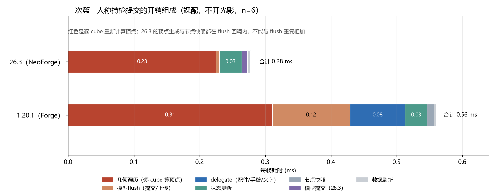
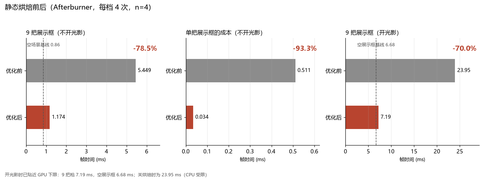
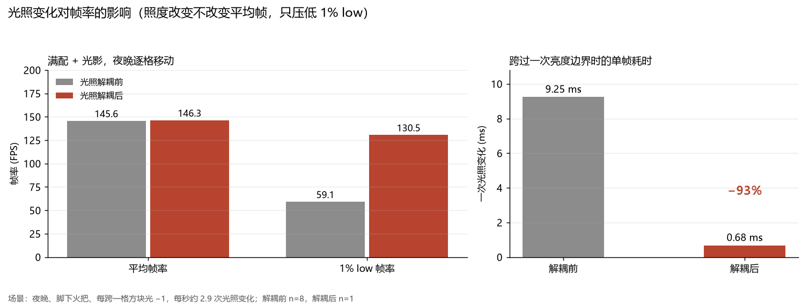
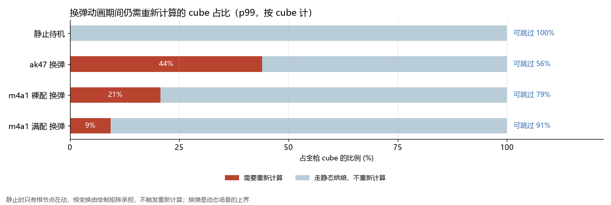
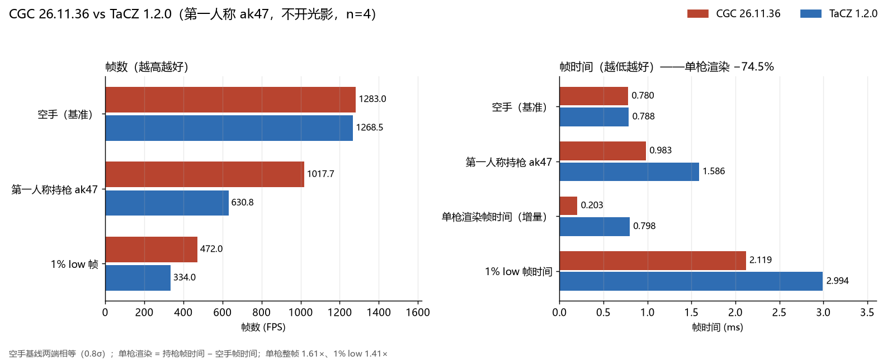

[English](#English)

# 渲染优化说明
> wiki 版本：`26.11.36`.0

## 优化原理
> ⭐实操结论可直接到[指导意义](#指导意义)，但建议先了解优化原理

### 渲染慢的原因

经[实验测量](https://github.com/XColorful/Custom-Gun-Continued/blob/HEAD/docs/architecture/client/render/benchmark/26.11.35.1-1/测试数据计算报告.md)，`1.20.1-26.1.2`和`26.2+`（延迟渲染）两套渲染体系下枪械模型的渲染开销组成如下：

|项目\版本|1.20.1|26.3|
|---|---|---|
|delegate|0.084|0.001|
|模型flush|0.118|0.230|
|几何遍历|0.311|0.225（flush 内）|
|节点快照|0.010|0.003（flush 内）|
|数据刷新|0.003|0.004|
|状态更新|0.033|0.034|

> 表中为每帧毫秒（n=6）；`26.2+`延迟渲染下，顶点生成从渲染线程的内联路径挪进了 flush 回调
> 
> 因此 26.3 的几何遍历与节点快照在 flush 内，不能与 flush 重复相加

成本主要在于：
- 每帧都在重新计算全量顶点变换

简而言之：
- 每帧都要计算全部的 cube 在什么相对位置、缩放状态等

### 优化上限

以空手时渲染性能为基准，持枪时渲染性能上限即空手渲染性能：
- 优化可使其无限接近但不会超越
- **开光影时为 GPU 主导**，持枪时帧数下降幅度已经很低，优化收益很有限

### 静态烘焙

既然每帧都在全量计算 cube 节点变换，那么很容易想到的优化方式就是：
- 把几何遍历的结果缓存起来，使得静态场景下**无需每帧重新计算**

经[实验测量](https://github.com/XColorful/Custom-Gun-Continued/blob/HEAD/docs/architecture/client/render/benchmark/26.11.35.1-4/测试数据计算报告.md)，`1.20.1-26.1.2`渲染体系下的性能提升如下：

|项目\版本|优化前|优化后|
|---|---|---|
|delegate|—|—|
|模型flush|0.794|0|
|几何遍历|3.179|0|
|节点快照|0.064|0.125|
|数据刷新|0.026|0.027|
|状态更新|—|—|

> 表中为每帧毫秒（9 个展示框，不开光影）；优化后的「节点快照」改为逐节点状态判定，高于优化前
> 
> 「—」表示该场景没有这一项或没有对应探针

但这仅能解决物品展示框等静态场景，对于第一人称需要更新动画的场景，不直接适用

#### 光照解耦

当光照更新时，静态烘焙的节点需要更新亮度信息才能保证画面正确：
- Minecraft 原版亮度分为 0-15 共 16 个等级，当经过亮度交界点时就需要重烘焙
- 白天露天场景不受其影响；室内、夜晚等场景的亮度多变化

经[实验测量](https://github.com/XColorful/Custom-Gun-Continued/blob/HEAD/docs/architecture/client/render/benchmark/26.11.35.1-6/测试数据计算报告.md)，光照对渲染影响如下：

让光照跟烘焙解耦可以避免重烘焙，但：
- 光照对平均帧数影响较小，且光照解耦本身不提供性能提升，其**收益在于提升 1% low 帧**

> 解耦后的 1% low 来自 1 次采集（解耦前为 8 次），按量级参考

### 脏子树

静态烘焙可以大幅优化性能，但第一人称动画**需要更新节点状态**，每帧重烘焙将导致收益清空。

注意到动画播放时仍有 cube 不参与状态更新，因此同样容易想到：
- 让需要动的节点每帧按动画重新计算，不动的节点仍然走静态烘焙

优化方式为：
- 将动画组进行切分，各自判断是否需要重烘焙
> 如装弹动画将使弹匣和枪体分开

经[实验测量](https://github.com/XColorful/Custom-Gun-Continued/blob/HEAD/docs/architecture/client/render/benchmark/26.11.35.1-4/b1-a-8/测试数据计算报告.md)，播放装弹动画时有大量 cube 可跳过节点变换：

- 这意味着实际需要重算的 cube 只占全枪的一小部分
- 大部分 cube 已经吃到渲染优化的收益

每进行一次切分，枪械被多分一个块，就会多一次 draw 开销，但：
- 单次 draw 约 8–10 µs，远低于省下的顶点计算
- 相较不做切分，第一人称 CGC 成本仍下降 48%–71%

### 未实现的优化

在之前的基础上仍有可实现的优化项，均不影响渲染开销的数量级，各自的否决说明如下：

#### 合批渲染

在脏子树优化之后，draw 成为剩余开销项的大头。

根据`RenderType`合批进行渲染，能将多次 draw 合并为一次，但：
- 仅能对同纹理的模型进行合批，即相同枪械、相同配件，实际应用场景极少
- 光影包的影子 pass 拿不到合批所需的相机矩阵，开光影时只能退回逐实例绘制
- draw 开销本身不大，少量应用场景的收益不足以弥补其引入的整体风险

#### 独立光照流

目前[光照解耦](#光照解耦)的实现方式为：
- 烘焙时把亮度写进顶点，光照变化时原地改写这些字段，并整段重传几何缓冲

经[实验分析](https://github.com/XColorful/Custom-Gun-Continued/blob/HEAD/docs/architecture/client/render/refactor/lighting-decoupling.md)，把亮度改成独立的小缓冲后：
- 光照变化时只传亮度（约 133 KB，而非约 2.5 MB），每次可再减少约 0.6 ms

对于固定帧时间的优化，其收益衡量方式如下：
- 假设已经实现该优化，当不做该优化（保持现状）时，性能下降多少
- 在参考点（60 / 90 / 120 / 144 / 165 / 240 FPS）的下降幅度分别是 −3.5% / −5.1% / −6.7% / −8.0% / −9.0% / −12.6%
- 0.6 ms 在 120 FPS 上是 111 FPS（−9）、240 FPS 上是 210 FPS（−30）
- 若`26.2+`延迟渲染下能验证第二条顶点流（vertex binding）可行，就值得做

#### 多线程顶点生成

- Minecraft 的缓冲非线程安全，会引入同步开销
- `26.2+`延迟渲染下 flush 在渲染线程串行，可行性较低

### 性能数据

经[实验测量](https://github.com/XColorful/Custom-Gun-Continued/blob/HEAD/docs/architecture/client/render/benchmark/26.11.35.1-9/测试数据计算报告.md)，自定义枪械永续`26.11.36`更新日志使用的实验数据如下：

- 相较于 TaCZ 1.2.0，测试枪械渲染帧时间减少约 74.5%，渲染性能提升约 3.92 倍

## 指导意义

以上优化将改变枪包制作期的优化标准：
1. 整枪动作（呼吸、摇晃、后坐）务必写在根节点`root`上：根节点变化不触发重烘焙，否则整枪每帧重算
2. 不同动画尽量复用同一组骨骼：每多切一个块就多一次 draw，切块越多剩余开销越大
3. 动画组里尽可能少放 cube，静态装饰不要挂在动画骨骼下：这些 cube 是优化后仍要重算的开销

# English
> wiki version: `26.11.36`.0

## How it works
> ⭐ The hands-on rules are in [Guidelines](#Guidelines); the principle is worth a read first

### Why gun rendering is slow

Measured on both renderer generations — `1.20.1-26.1.2` and `26.2+` (deferred) — the frame cost of a gun model breaks down as follows:

|Item\Version|1.20.1|26.3|
|---|---|---|
|delegate|0.084|0.001|
|model flush|0.118|0.230|
|geometry traversal|0.311|0.225 (in flush)|
|node snapshot|0.010|0.003 (in flush)|
|data refresh|0.003|0.004|
|state update|0.033|0.034|

> Values are ms per frame (n=6); under `26.2+` deferred rendering, vertex generation moved from the render thread's inline path into the flush callback
> 
> The 26.3 traversal and snapshot rows therefore sit inside flush and must not be added again

The cost is mostly:
- Recomputing every vertex transform each frame

In plain words:
- Every frame recalculates where each cube sits, how it is scaled, and so on

### The ceiling

The empty-hand render time is the ceiling: a held gun can approach it but never beat it.
- Optimization can get arbitrarily close, never past it
- **With shaders the frame is GPU-bound**; a held gun already costs little, so gains are limited

### Static baking

Since every frame recomputes all cube transforms, the obvious optimization is:
- Cache the result of the geometry traversal so static scenes **skip the per-frame recompute**

Measured under the `1.20.1-26.1.2` renderer, the result is:

|Item\Version|Before|After|
|---|---|---|
|delegate|—|—|
|model flush|0.794|0|
|geometry traversal|3.179|0|
|node snapshot|0.064|0.125|
|data refresh|0.026|0.027|
|state update|—|—|

> Values are ms per frame (9 item frames, no shader pack); the node snapshot row became a per-node state check after baking and now runs higher
> 
> "—" means the scene has no such item, or no probe covers it

This only covers static scenes such as item frames; first-person animations update node state every frame, so it does not apply directly.

#### Lighting decoupling

When lighting changes, baked nodes must refresh their brightness to stay correct:
- Vanilla light has 16 levels (0-15); crossing a level boundary forces a re-bake
- Open daytime scenes never hit this; indoor and night scenes change often

Measured, lighting affects rendering as follows:

Decoupling lighting from the bake avoids re-baking, but:
- It barely moves the average rate; decoupling adds no speed, its **gain is the 1% low**

> The decoupled 1% low comes from a single run (8 runs before decoupling); read it as a magnitude

### Dirty subtrees

Static baking helps a lot, but first-person animation **must update node state**; re-baking every frame would erase the gain.

Note that during an animation some cubes still take no state update, so:
- Recompute only the nodes that move, and keep baking the static ones

The approach:
- Split the animated groups apart and decide per group whether to re-bake
> A reload, for example, separates the magazine from the gun body

Measured, a reload animation leaves many cubes with no transform to recompute:

- The cubes that really need recomputing are a small part of the whole gun
- Most cubes already benefit from the optimization

Each split adds one more block and one more draw, but:
- A draw costs about 8 µs, far less than the vertex work it saves
- Compared with no splitting, first-person CGC cost still drops by 48%–71%

### Not implemented

Further options exist on top of the above; none changes the order of magnitude. Why each was rejected:

#### Draw batching

After dirty subtrees, draw calls are the largest remaining item.

Batching by `RenderType` merges several draws into one, but:
- Only same-texture models merge: the same gun or shared attachment textures, which is rare
- A shader pack's shadow pass cannot see the camera matrix batching needs, so shaders fall back
- A draw is cheap, and the rare cases do not justify the compatibility risk

#### Separate light stream

Today, [lighting decoupling](#Lighting-decoupling) works like this:
- Brightness is written into vertices at bake time, patched in place, then re-uploaded whole

Analysis shows that moving brightness into its own small buffer would upload only the light (about 133 KB instead of about 2.5 MB), saving roughly another 0.6 ms per change:

A fixed per-frame cost is judged as follows:
- Assume the optimization exists; how much slower is the game without it?
- At 60/90/120/144/165/240 FPS the drop is −3.5% / −5.1% / −6.7% / −8.0% / −9.0% / −12.6%
- 0.6 ms turns 120 FPS into 111 FPS (−9) and 240 FPS into 210 FPS (−30)
- So it is worth doing once a second vertex binding is confirmed on `26.2+` deferred rendering

#### Multi-threaded vertex generation

- Minecraft's buffers are not thread-safe; synchronizing them costs more than it saves
- Under `26.2+` deferred rendering, flush runs serially on the render thread, so this is unlikely

### Performance data

The numbers used in the `26.11.36` changelog of Custom Gun Continued, measured:

- Versus TaCZ 1.2.0, gun render time drops by about 74.5%, a 3.92× gain in gun rendering

## Guidelines

These optimizations change what gun packs should optimize for:
1. Put whole-gun motion (breathing, sway, recoil) on the root node: root changes skip the re-bake; anywhere else the whole gun is recomputed every frame
2. Reuse the same bones across animations: each extra block adds a draw, and more blocks cost more
3. Keep animated groups small, static trim out of animated bones: those cubes still get recomputed
